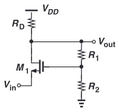

# 장말문제 12.25 — 저항 분배 귀환 CG 단의 폐루프 이득과 I/O 임피던스 (λ ≠ 0)

## 원문
Consider the feedback circuit shown in Fig. 12.90, where $R_1 + R_2 \gg R_D$. Compute the closed-loop gain and I/O impedances of the circuit. Assume $\lambda \neq 0$.

## 조건
- 회로: Fig 12.90의 귀환 회로
- $R_1 + R_2 \gg R_D$
- $\lambda \neq 0$

## 구할 것
- 폐루프 이득
- 입력 임피던스와 출력 임피던스 (I/O impedances)

## 회로 — Fig 12.90
```spice
RD  VDD   Vout  {R_D}
M1  Vout  n1    Vin   nmos   ; 좌우 반전 (게이트 오른쪽)
R1  Vout  n1    {R_1}
R2  n1    0     {R_2}
```
- 단자: VDD = 전원, 값 미지정 (T 전원 기호) / Vin = 입력 (개방 원) / Vout = 출력 (개방 원)
- 표시: 노드 라벨 VDD (T 기호 오른쪽), V_in (입력 원 왼쪽), V_out (출력 원 오른쪽) / 소자 라벨 R_D (저항 왼쪽), M1 (트랜지스터 왼쪽), R1, R2 (각 저항 오른쪽) / 부호 없음 / 화살표 없음 / 수치·면적 라벨 없음
- 배치: 왼쪽 세로줄 위→아래 VDD T 기호, R_D, 접속점, M1 / M1 nmos 좌우 반전 (게이트 오른쪽, 드레인 위, 소스 왼쪽 아래·화살표 바깥) / M1 소스에서 아래로 내려가 왼쪽으로 꺾여 V_in 원 / R_D 아래 접속점에서 가로선이 오른쪽으로 뻗어 오른쪽 접속점(Vout)에 닿고 계속 오른쪽 V_out 원 / 오른쪽 세로줄 위→아래 Vout 접속점, R1, n1 접속점, R2, 접지 / n1에서 가로선이 왼쪽으로 M1 게이트 / 접속점 (세 갈래 이상, 3곳): R_D 아래 = 위 R_D + 아래 M1 드레인 + 오른쪽 가로선 (점), 오른쪽 Vout = 왼쪽 가로선 + 아래 R1 + 오른쪽 V_out 선 (점), n1 = 위 R1 + 아래 R2 + 왼쪽 M1 게이트선 (점) / 교차: 없음


> 참고: Fig 12.90은 본문 예제 12.7의 Fig 12.11과 같은 회로
