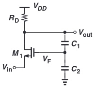

# 장말문제 12.26 — 용량성 분배 귀환 CG 단의 폐루프 이득과 I/O 임피던스

## 원문
Repeat Problem 12.25 for the topology of Fig. 12.91. Assume $C_1$ and $C_2$ are very small and neglect other capacitances.

## 조건
- 회로: Fig 12.91 (문제 12.25 회로의 $R_1$, $R_2$ 자리에 $C_1$, $C_2$, 원문에 없음)
- $C_1$과 $C_2$는 매우 작다고 가정
- 다른 커패시턴스는 무시
- 문제 12.25에서 이어받는 가정: $\lambda \neq 0$ (원문에 없음)

## 구할 것
- 폐루프 이득 (문제 12.25에서 이어받는 요구, 원문에 없음)
- 입력 임피던스와 출력 임피던스 (문제 12.25에서 이어받는 요구, 원문에 없음)

## 상속·참조
- 문제 12.25: "Consider the feedback circuit shown in Fig. 12.90, where $R_1 + R_2 \gg R_D$. Compute the closed-loop gain and I/O impedances of the circuit. Assume $\lambda \neq 0$."
- 문제 12.25의 회로 (Fig 12.90): $V_{DD}$ – $R_D$ – 출력 노드 $V_{out}$, $M_1$ 드레인 = $V_{out}$, 소스 = $V_{in}$ (공통 게이트), 게이트 = $R_1$ ($V_{out}$ 쪽)과 $R_2$ (접지 쪽)의 분배점
- 문제 12.25의 조건 $R_1 + R_2 \gg R_D$에 대응하는 것이 이 문제의 "$C_1$, $C_2$가 매우 작다"는 가정 (분배기가 출력을 부하하지 않음)으로 봄 (원문에 없음)

## 회로 — Fig 12.91
```spice
RD  VDD   Vout  {R_D}
M1  Vout  VF    Vin   nmos   ; 좌우 반전 (게이트 오른쪽)
C1  Vout  VF    {C_1}
C2  VF    0     {C_2}
```
- 단자: VDD = 전원, 값 미지정 (T 전원 기호) / Vin = 입력 (개방 원) / Vout = 출력 (개방 원)
- 표시: 노드 라벨 VDD (T 기호 오른쪽), V_in (입력 원 왼쪽), V_out (출력 원 오른쪽), V_F (M1 게이트 가로선 아래) / 소자 라벨 R_D (저항 왼쪽), M1 (트랜지스터 왼쪽), C1, C2 (각 커패시터 오른쪽) / 부호 없음 / 화살표 없음 / 수치·면적 라벨 없음
- 배치: 왼쪽 세로줄 위→아래 VDD T 기호, R_D, 접속점, M1 / M1 nmos 좌우 반전 (게이트 오른쪽, 드레인 위, 소스 왼쪽 아래·화살표 바깥) / M1 소스에서 아래로 내려가 왼쪽으로 꺾여 V_in 원 / R_D 아래 접속점에서 가로선이 오른쪽으로 뻗어 오른쪽 접속점(Vout)에 닿고 계속 오른쪽 V_out 원 / 오른쪽 세로줄 위→아래 Vout 접속점, C1, VF 접속점, C2, 접지 / VF에서 가로선이 왼쪽으로 M1 게이트 / 접속점 (세 갈래 이상, 3곳): R_D 아래 = 위 R_D + 아래 M1 드레인 + 오른쪽 가로선 (점), 오른쪽 Vout = 왼쪽 가로선 + 아래 C1 + 오른쪽 V_out 선 (점), VF = 위 C1 + 아래 C2 + 왼쪽 M1 게이트선 (점) / 교차: 없음


