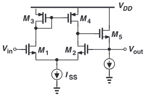

# 장말문제 12.27 — 차동 쌍과 NMOS 소스 폴로어로 된 단위 이득 귀환 증폭기의 폐루프 이득과 출력 임피던스

## 원문
The amplifier shown in Fig. 12.92 provides a closed-loop gain close to unity but a very low output impedance. Assuming $\lambda > 0$, determine the closed-loop gain and output impedance and compare the results with those of a simple source follower.

## 조건
- 회로: Fig 12.92 — 전류 거울 부하($M_3$, $M_4$) 차동 쌍($M_1$, $M_2$, 꼬리 전류원 $I_{SS}$) 뒤에 NMOS 소스 폴로어 $M_5$ (전류원 부하), 출력 $V_{out}$이 $M_2$ 게이트로 귀환
- 이 증폭기는 폐루프 이득이 1에 가깝고 출력 임피던스가 매우 낮음
- $\lambda > 0$
- 소자 값은 주어지지 않음 (답은 $g_m$, $r_O$의 식으로) (원문에 없음)

## 구할 것
- 폐루프 이득
- 출력 임피던스
- 두 결과를 단순한 소스 폴로어의 결과와 비교

## 회로 — Fig 12.92
```spice
M3  n1    n1    VDD   pmos   ; 다이오드 연결, 좌우 반전 (게이트 오른쪽)
M4  n2    n1    VDD   pmos
M1  n1    Vin   n3    nmos
M2  n2    Vout  n3    nmos   ; 좌우 반전 (게이트 오른쪽)
M5  VDD   n2    Vout  nmos
ISS n3    0     {I_SS}
I1  Vout  0                  ; 라벨·값 없는 전류원, 화살표 아래
```
- 단자: VDD = 전원, 값 미지정 (가로 레일) / Vin = 입력 (개방 원) / Vout = 출력 (개방 원)
- 표시: 노드 라벨 V_DD (레일 오른쪽 끝), V_in (입력 원 왼쪽), V_out (출력 원 오른쪽) / 소자 라벨 M3 (M3 왼쪽), M4 (M4 오른쪽), M5 (M5 오른쪽 아래), M1 (M1 오른쪽, 소스 화살표 옆), M2 (M2 왼쪽, 소스 화살표 옆), I_SS (꼬리 전류원 오른쪽), I1 (라벨 없음, 오른쪽 전류원) / 부호 없음 / 화살표 없음 / 수치·면적 라벨 없음
- 배치: 맨 위 V_DD 가로 레일 / 왼쪽 세로줄 위→아래 레일, M3, n1 접속점, M1 / 가운데 세로줄 위→아래 레일, M4, n2 접속점, M2 / M3는 좌우 반전된 PMOS (게이트 오른쪽, 소스가 위에서 레일로·화살표가 채널 쪽을 향함), M4는 보통 방향 PMOS (게이트 왼쪽) / M3 게이트와 M4 게이트는 가로선으로 이어지고 그 가운데 접속점에서 선이 아래로 내려가 왼쪽으로 꺾여 n1 접속점 (M3 다이오드 연결) / M1은 보통 방향 NMOS (게이트 왼쪽, V_in 원에서 가로선), M2는 좌우 반전된 NMOS (게이트 오른쪽, 소스 화살표가 왼쪽 바깥을 향함) / M1 소스와 M2 소스는 아래에서 가로선으로 이어지고 그 가운데 n3 접속점에서 아래로 I_SS 전류원(원 안 화살표 아래), 접지 / n2 접속점에서 가로선이 오른쪽으로 M5 게이트 / 오른쪽 세로줄 위→아래 레일, M5 (보통 방향 NMOS, 드레인이 위에서 레일 오른쪽 끝으로 올라감, 소스 아래·화살표 바깥), Vout 접속점, I1 전류원(원 안 화살표 아래), 접지 / Vout 접속점에서 가로선이 왼쪽으로 M2 게이트, 오른쪽으로 V_out 원 / 접속점 (세 갈래 이상, 5곳): M3·M4 게이트 가운데 = 왼쪽 M3 게이트 + 오른쪽 M4 게이트 + 아래 n1으로 가는 선 (점), n1 = 위 M3 드레인 + 아래 M1 드레인 + 오른쪽 게이트 접속점에서 오는 선 (점), n2 = 위 M4 드레인 + 아래 M2 드레인 + 오른쪽 M5 게이트 선 (점), n3 = 왼쪽 M1 소스 + 오른쪽 M2 소스 + 아래 I_SS (점), Vout = 위 M5 소스 + 왼쪽 M2 게이트 선 + 오른쪽 V_out 원 + 아래 I1 (점) / 교차: 없음


