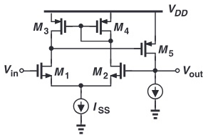

# 장말문제 12.29 — 거울 방향을 바꿔 부귀환으로 고친 PMOS CS 출력 귀환 증폭기(Fig 12.94)의 폐루프 이득과 I/O 임피던스

## 원문
Having discovered the polarity of feedback, the student in Problem 12.28 modifies the circuit as shown in Fig. 12.94. Determine the closed-loop gain and I/O impedances of the circuit and compare the results with those obtained in Problem 12.27.

## 조건
- 회로: Fig 12.94 — 문제 12.28의 학생이 귀환 극성을 알아낸 뒤 고친 회로. 전류 거울의 다이오드 연결 소자가 $M_4$이고, $M_3$ 드레인(= $M_1$ 드레인)이 PMOS 공통 소스 단 $M_5$의 게이트를 구동, 출력 $V_{out}$이 $M_2$ 게이트로 귀환
- 문제 12.28의 회로 (Fig 12.93): $M_3$가 다이오드 연결이고 $M_4$ 드레인이 $M_5$ 게이트를 구동해 정귀환이었음 (원문에 없음)
- 문제 12.27의 결과와 비교: 문제 12.27은 같은 차동 쌍 뒤에 NMOS 소스 폴로어 $M_5$를 둔 Fig 12.92 회로의 폐루프 이득과 출력 임피던스를 $\lambda > 0$으로 구함 (원문에 없음)
- 채널 길이 변조 가정은 이 문제 문장에 없음 (문제 12.27은 $\lambda > 0$) (원문에 없음)
- 소자 값은 주어지지 않음 (답은 $g_m$, $r_O$의 식으로) (원문에 없음)

## 구할 것
- 폐루프 이득
- 입력 임피던스와 출력 임피던스 (I/O impedances)
- 문제 12.27의 결과와 비교

## 상속·참조
- 문제 12.28 (P12.28): Fig 12.92의 NMOS 소스 폴로어를 PMOS 공통 소스 단으로 바꾼 Fig 12.93 회로 ($M_3$ 다이오드 연결, $M_4$ 드레인 → $M_5$ 게이트)에서 귀환이 정귀환임을 관찰과 $M_2$ 게이트에서 끊은 루프 이득으로 증명
- 문제 12.27 (P12.27): Fig 12.92 (차동 쌍 $M_1$–$M_4$, $I_{SS}$ 뒤에 NMOS 소스 폴로어 $M_5$와 전류원 부하, $V_{out}$ → $M_2$ 게이트)에서 $\lambda > 0$으로 폐루프 이득과 출력 임피던스를 구하고 단순한 소스 폴로어와 비교

## 회로 — Fig 12.94
```spice
M3  n1    n2    VDD   pmos   ; 좌우 반전 (게이트 오른쪽)
M4  n2    n2    VDD   pmos   ; 다이오드 연결
M1  n1    Vin   n3    nmos
M2  n2    Vout  n3    nmos   ; 좌우 반전 (게이트 오른쪽)
M5  Vout  n1    VDD   pmos
ISS n3    0     {I_SS}
I1  Vout  0                  ; 라벨·값 없는 전류원, 화살표 아래
```
- 단자: VDD = 전원, 값 미지정 (가로 레일) / Vin = 입력 (개방 원) / Vout = 출력 (개방 원)
- 표시: 노드 라벨 V_DD (레일 오른쪽 끝), V_in (입력 원 왼쪽), V_out (출력 원 오른쪽) / 소자 라벨 M3 (M3 왼쪽), M4 (M4 오른쪽), M5 (M5 오른쪽 아래), M1 (M1 오른쪽, 소스 화살표 옆), M2 (M2 왼쪽, 소스 화살표 옆), I_SS (꼬리 전류원 오른쪽), I1 (라벨 없음, 오른쪽 전류원) / 부호 없음 / 화살표 없음 / 수치·면적 라벨 없음
- 배치: 맨 위 V_DD 가로 레일 / 왼쪽 세로줄 위→아래 레일, M3, n1 접속점, M1 / 가운데 세로줄 위→아래 레일, M4, n2 접속점, 교차, M2 / M3는 좌우 반전된 PMOS (게이트 오른쪽, 소스가 위에서 레일로·화살표가 채널 쪽을 향함), M4는 보통 방향 PMOS (게이트 왼쪽) / M3 게이트와 M4 게이트는 가로선으로 이어지고 그 가운데 접속점에서 선이 아래로 내려가 오른쪽으로 꺾여 n2 접속점 (M4 다이오드 연결) / n1 접속점에서 긴 가로선이 오른쪽으로 뻗어 M4–M2 세로선을 점 없이 가로지르고 M5 게이트 / M1은 보통 방향 NMOS (게이트 왼쪽, V_in 원에서 가로선), M2는 좌우 반전된 NMOS (게이트 오른쪽, 소스 화살표가 왼쪽 바깥을 향함) / M1 소스와 M2 소스는 아래에서 가로선으로 이어지고 그 가운데 n3 접속점에서 아래로 I_SS 전류원(원 안 화살표 아래), 접지 / 오른쪽 세로줄 위→아래 레일, M5 (보통 방향 PMOS, 게이트 왼쪽, 소스가 위에서 레일 오른쪽 끝으로 올라감·화살표가 채널 쪽을 향함, 드레인 아래), Vout 접속점, I1 전류원(원 안 화살표 아래), 접지 / Vout 접속점에서 가로선이 왼쪽으로 M2 게이트, 오른쪽으로 V_out 원 / 접속점 (세 갈래 이상, 5곳): M3·M4 게이트 가운데 = 왼쪽 M3 게이트 + 오른쪽 M4 게이트 + 아래 n2로 가는 선 (점), n2 = 위 M4 드레인 + 아래 M2 드레인으로 가는 선 + 왼쪽 게이트 접속점에서 오는 선 (점), n1 = 위 M3 드레인 + 아래 M1 드레인 + 오른쪽 M5 게이트로 가는 긴 가로선 (점), n3 = 왼쪽 M1 소스 + 오른쪽 M2 소스 + 아래 I_SS (점), Vout = 위 M5 드레인 + 왼쪽 M2 게이트 선 + 오른쪽 V_out 원 + 아래 I1 (점) / 교차: n1 → M5 게이트 가로선이 n2 아래의 M4 드레인–M2 드레인 세로선과 점 없이 교차 (1곳)


