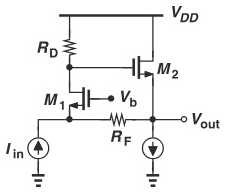

# 장말문제 12.30 — 소스 폴로어 출력 트랜스임피던스 증폭기(Fig 12.95)로 예제 12.18 반복

## 원문
Repeat Example 12-18 for the circuit illustrated in Fig. 12.95.

## 조건
- 회로: Fig 12.95 — 공통 게이트 단 $M_1$ ($R_D$ 부하, 입력 전류 $I_{in}$이 소스로 들어감) 뒤에 NMOS 소스 폴로어 $M_2$ (전류원 부하), 출력 $V_{out}$에서 $M_1$ 소스(입력 노드)로 $R_F$ 귀환
- 예제 12.18에서 이어받는 가정: $\lambda = 0$, $R_F$가 매우 큼 (원문에 없음)
- 식 (12.72): $\dfrac{V_{out}}{I_{in}} = \dfrac{R_0}{1 + KR_0}$ (본문 식, 전압-전류 귀환의 폐루프 이득. $R_0$은 순방향 트랜스임피던스 증폭기의 개루프 이득, $K$는 귀환율, 원문에 없음)
- 원문 표기 "Example 12-18"은 예제 12.18 (원문에 없음)
- 소자 값은 주어지지 않음 (답은 $g_m$, 저항의 식으로) (원문에 없음)

## 구할 것
- 이 회로에 대해 예제 12.18을 반복 (원문에 없음, 아래는 예제 12.18의 소문항)
  - (a) 귀환이 부귀환임을 증명
  - (b) 개루프 이득
  - (c) 폐루프 이득

## 상속·참조
- 예제 12.18 (E12.18, 교재 675쪽): 그림 12.38(a)의 회로에서 $\lambda = 0$, $R_F$가 매우 크다고 가정하고 (a) 귀환이 부귀환임을 증명, (b) 개루프 이득, (c) 폐루프 이득을 구함
- 본문 그림 12.38(a) (크롭 안 함): 2단 트랜스임피던스 증폭기
  - `RD1: VDD — X`, `M1: D = X, G = Vb, S = 입력 노드`, `iin: 접지 → 입력 노드`
  - `RD2: VDD — vout`, `M2: D = vout, G = X, S = 0` (공통 소스 둘째 단)
  - `RF: vout — 입력 노드`
- 식 (12.72) (12.6.2절): $\dfrac{V_{out}}{I_{in}} = \dfrac{R_0}{1 + KR_0}$, $K$는 출력 전압을 감지해 입력으로 반송하는 전류의 비 (컨덕턴스 차원)

## 회로 — Fig 12.95
```spice
RD  VDD   n1    {R_D}
M1  n1    Vb    n2    nmos   ; 좌우 반전 (게이트 오른쪽)
M2  VDD   n1    Vout  nmos
RF  n2    Vout  {R_F}
IIN 0     n2    {I_in}       ; 화살표 위
I1  Vout  0                  ; 라벨·값 없는 전류원, 화살표 아래
```
- 단자: VDD = 전원, 값 미지정 (가로 레일) / Vb = M1 게이트 바이어스, 값 미지정 (점 단자) / Vout = 출력 (개방 원)
- 표시: 노드 라벨 V_DD (레일 오른쪽 끝), V_b (점 단자 오른쪽), V_out (출력 원 오른쪽) / 소자 라벨 R_D (저항 왼쪽), M1 (M1 왼쪽, 소스 화살표 왼쪽 위), M2 (M2 오른쪽 아래), R_F (가로 저항 아래), I_in (왼쪽 전류원 왼쪽), I1 (라벨 없음, 오른쪽 전류원) / 부호 없음 / 화살표 없음 / 수치·면적 라벨 없음
- 배치: 맨 위 V_DD 가로 레일 / 왼쪽 세로줄 위→아래 레일, R_D, n1 접속점, M1, n2 접속점 / M1은 좌우 반전된 NMOS (게이트 오른쪽, 소스 화살표가 왼쪽 바깥을 향함), 게이트에서 짧은 가로선이 오른쪽 V_b 점 단자 / n1 접속점에서 가로선이 오른쪽으로 M2 게이트 / 오른쪽 세로줄 위→아래 레일, M2 (보통 방향 NMOS, 드레인이 위에서 레일 오른쪽 끝으로 올라감, 소스 아래·화살표 바깥), Vout 접속점, I1 전류원(원 안 화살표 아래), 접지 / n2 접속점에서 가로선이 오른쪽으로 R_F를 지나 Vout 접속점, Vout 접속점에서 가로선이 오른쪽 V_out 원 / I_in 전류원은 n2 왼쪽 아래: 위 단자에서 세로선이 올라가 오른쪽으로 꺾여 n2 접속점, 아래 단자 접지, 원 안 화살표 위 / 접속점 (세 갈래 이상, 3곳): n1 = 위 R_D + 아래 M1 드레인 + 오른쪽 M2 게이트 선 (점), n2 = 위 M1 소스 + 왼쪽 I_in 선 + 오른쪽 R_F (점), Vout = 위 M2 소스 + 왼쪽 R_F + 오른쪽 V_out 원 + 아래 I1 (점) / 교차: 없음


