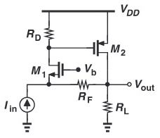

# 장말문제 12.31 — 둘째 단을 PMOS CS로 바꾼 예제 12.18 회로(Fig 12.96)의 정귀환 증명과 루프 이득

## 원문
A student adventurously modifies the circuit of Example 12-18 to that shown in Fig. 12.96. Assume $\lambda = 0$.

(a) Prove by inspection that the feedback is positive.

(b) Assuming $R_F$ is very large and breaking the loop at the gate of $M_2$, calculate the loop gain and prove that the feedback is positive.

## 조건
- 회로: Fig 12.96 — 예제 12.18의 회로를 학생이 고친 회로. 공통 게이트 단 $M_1$ ($R_D$ 부하, 입력 전류 $I_{in}$이 소스로 들어감) 뒤에 PMOS 공통 소스 단 $M_2$ (부하 $R_L$), 출력 $V_{out}$에서 $M_1$ 소스(입력 노드)로 $R_F$ 귀환
- 참고 회로 (예제 12.18의 그림 12.38(a)): $M_1$ 공통 게이트 단 ($R_{D1}$ 부하, 드레인 $X$) 뒤에 NMOS 공통 소스 단 $M_2$ ($R_{D2}$ 부하, 드레인이 출력), 출력에서 $M_1$ 소스로 $R_F$ (원문에 없음)
- $\lambda = 0$
- (b)에서는 $R_F$가 매우 크다고 가정
- 인쇄된 그림대로 극성을 따지면 문장(정귀환 증명)과 반대로 나온다. $M_2$의 종류가 바뀌어 인쇄됐을 가능성이 있다 (원문에 없음)
- 원문 표기 "Example 12-18"은 예제 12.18 (원문에 없음)
- 소자 값은 주어지지 않음 (답은 $g_m$, 저항의 식으로) (원문에 없음)

## 구할 것
- (a) 귀환이 정귀환임을 관찰로 증명
- (b) $R_F$가 매우 크다고 보고 $M_2$의 게이트에서 루프를 끊어 루프 이득을 계산하고 귀환이 정귀환임을 증명

## 상속·참조
- 예제 12.18 (E12.18, 교재 675쪽): 그림 12.38(a)의 회로에서 $\lambda = 0$, $R_F$가 매우 크다고 가정하고 귀환이 부귀환임을 증명하고 개루프·폐루프 이득을 구함
- 본문 그림 12.38(a) (크롭 안 함): 2단 트랜스임피던스 증폭기
  - `RD1: VDD — X`, `M1: D = X, G = Vb, S = 입력 노드`, `iin: 접지 → 입력 노드`
  - `RD2: VDD — vout`, `M2 (NMOS): D = vout, G = X, S = 0`
  - `RF: vout — 입력 노드`

## 회로 — Fig 12.96
```spice
RD  VDD   n1    {R_D}
M1  n1    Vb    n2    nmos   ; 좌우 반전 (게이트 오른쪽)
M2  Vout  n1    VDD   pmos
RF  n2    Vout  {R_F}
RL  Vout  0     {R_L}
IIN 0     n2    {I_in}       ; 화살표 위
```
- 단자: VDD = 전원, 값 미지정 (가로 레일) / Vb = M1 게이트 바이어스, 값 미지정 (점 단자) / Vout = 출력 (개방 원)
- 표시: 노드 라벨 V_DD (레일 오른쪽 끝), V_b (점 단자 오른쪽), V_out (출력 원 오른쪽) / 소자 라벨 R_D (저항 왼쪽), M1 (M1 왼쪽, 소스 화살표 왼쪽 위), M2 (M2 오른쪽 아래), R_F (가로 저항 아래), R_L (세로 저항 오른쪽), I_in (전류원 왼쪽) / 부호 없음 / 화살표 없음 / 수치·면적 라벨 없음
- 배치: 맨 위 V_DD 가로 레일 / 왼쪽 세로줄 위→아래 레일, R_D, n1 접속점, M1, n2 접속점 / M1은 좌우 반전된 NMOS (게이트 오른쪽, 소스 화살표가 왼쪽 바깥을 향함), 게이트에서 짧은 가로선이 오른쪽 V_b 점 단자 / n1 접속점에서 가로선이 오른쪽으로 M2 게이트 / 오른쪽 세로줄 위→아래 레일, M2 (보통 방향 PMOS, 게이트 왼쪽, 소스가 위에서 레일 오른쪽 끝으로 올라감·화살표가 채널 쪽을 향함, 드레인 아래), Vout 접속점, R_L, 접지 / n2 접속점에서 가로선이 오른쪽으로 R_F를 지나 Vout 접속점, Vout 접속점에서 가로선이 오른쪽 V_out 원 / I_in 전류원은 n2 왼쪽 아래: 위 단자에서 세로선이 올라가 오른쪽으로 꺾여 n2 접속점, 아래 단자 접지, 원 안 화살표 위 / 접속점 (세 갈래 이상, 3곳): n1 = 위 R_D + 아래 M1 드레인 + 오른쪽 M2 게이트 선 (점), n2 = 위 M1 소스 + 왼쪽 I_in 선 + 오른쪽 R_F (점), Vout = 위 M2 드레인 + 왼쪽 R_F + 오른쪽 V_out 원 + 아래 R_L (점) / 교차: 없음


