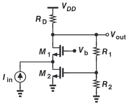

# 장말문제 12.33 — 저항 분배기와 M2로 귀환하는 CG 단(Fig 12.97)의 폐루프 이득과 I/O 임피던스

## 원문
The amplifier depicted in Fig. 12.97 consists of a common-gate stage ($M_1$ and $R_D$) and a feedback network ($R_1$, $R_2$, and $M_2$). Assuming $R_1 + R_2$ is very large and $\lambda = 0$, compute the closed-loop gain and I/O impedances.

## 조건
- 회로: Fig 12.97 — 공통 게이트 단 ($M_1$과 $R_D$, 입력 전류 $I_{in}$이 $M_1$ 소스로 들어감)과 귀환 회로망 ($R_1$, $R_2$, $M_2$). 출력 $V_{out}$을 $R_1$, $R_2$로 나눈 전압이 $M_2$ 게이트를 구동하고, $M_2$ 드레인이 $M_1$ 소스(입력 노드)에 연결됨
- $R_1 + R_2$가 매우 큼
- $\lambda = 0$
- 소자 값은 주어지지 않음 (답은 $g_m$, 저항의 식으로) (원문에 없음)

## 구할 것
- 폐루프 이득
- 입력 임피던스와 출력 임피던스 (I/O impedances)

## 회로 — Fig 12.97
```spice
RD  VDD   Vout  {R_D}
M1  Vout  Vb    n1    nmos   ; 좌우 반전 (게이트 오른쪽)
M2  n1    n2    0     nmos   ; 좌우 반전 (게이트 오른쪽)
R1  Vout  n2    {R_1}
R2  n2    0     {R_2}
IIN 0     n1    {I_in}       ; 화살표 위
```
- 단자: VDD = 전원, 값 미지정 (T 전원 기호) / Vb = M1 게이트 바이어스, 값 미지정 (점 단자) / Vout = 출력 (개방 원)
- 표시: 노드 라벨 V_DD (T 기호 오른쪽), V_b (점 단자 오른쪽), V_out (출력 원 오른쪽) / 소자 라벨 R_D (저항 왼쪽), M1 (M1 왼쪽, 소스 화살표 왼쪽 위), M2 (M2 왼쪽, 소스 화살표 왼쪽 위), R1, R2 (각 세로 저항 오른쪽), I_in (전류원 왼쪽) / 부호 없음 / 화살표 없음 / 수치·면적 라벨 없음
- 배치: 왼쪽 세로줄 위→아래 V_DD T 기호, R_D, R_D 아래 접속점, M1, n1 접속점, M2, 접지 / M1, M2 모두 좌우 반전된 NMOS (게이트 오른쪽, 소스 화살표가 왼쪽 바깥을 향함) / M1 게이트에서 짧은 가로선이 오른쪽 V_b 점 단자 / R_D 아래 접속점에서 가로선이 오른쪽으로 뻗어 오른쪽 접속점에 닿고 계속 오른쪽 V_out 원 / 오른쪽 세로줄 위→아래 오른쪽 접속점, R1, n2 접속점, R2, 접지 / n2 접속점에서 가로선이 왼쪽으로 M2 게이트 / M2 소스 아래 접지 / I_in 전류원은 n1 왼쪽 아래: 위 단자에서 세로선이 올라가 오른쪽으로 꺾여 n1 접속점, 아래 단자 접지, 원 안 화살표 위 / 접속점 (세 갈래 이상, 4곳): R_D 아래 = 위 R_D + 아래 M1 드레인 + 오른쪽 가로선 (점), 오른쪽 Vout = 왼쪽 가로선 + 아래 R1 + 오른쪽 V_out 원 (점), n1 = 위 M1 소스 + 아래 M2 드레인 + 왼쪽 I_in 선 (점), n2 = 위 R1 + 아래 R2 + 왼쪽 M2 게이트 선 (점) / 교차: 없음


> 참고: 문제 문장은 722쪽(PDF 42 왼쪽) 오른쪽 단 맨 아래, 그림 12.97은 723쪽(PDF 42 오른쪽) 맨 위
