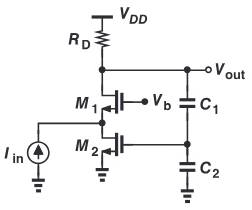

# 장말문제 12.34 — 용량 분배기로 귀환하는 CG 단(Fig 12.98)으로 문제 12.33 반복

## 원문
Repeat Problem 12.33 for the circuit illustrated in Fig. 12.98. Assume $C_1$ and $C_2$ are very small and neglect other capacitances.

## 조건
- 회로: Fig 12.98 — Fig 12.97의 $R_1$, $R_2$를 커패시터 $C_1$, $C_2$로 바꾼 회로. 공통 게이트 단 ($M_1$과 $R_D$, 입력 전류 $I_{in}$이 $M_1$ 소스로 들어감)과 귀환 회로망 ($C_1$, $C_2$, $M_2$)
- $C_1$과 $C_2$가 매우 작음
- 다른 커패시턴스는 무시
- 문제 12.33에서 이어받는 가정: $\lambda = 0$ (원문에 없음)
- 소자 값은 주어지지 않음 (답은 $g_m$, $R_D$, $C_1$, $C_2$의 식으로) (원문에 없음)

## 구할 것
- 이 회로에 대해 문제 12.33을 반복: 폐루프 이득과 입력·출력 임피던스 (원문에 없음, 문제 12.33의 요구)

## 상속·참조
- 문제 12.33 (P12.33): Fig 12.97 (공통 게이트 단 $M_1$, $R_D$와 귀환 회로망 $R_1$, $R_2$, $M_2$)에서 $R_1 + R_2$가 매우 크고 $\lambda = 0$이라 가정하고 폐루프 이득과 I/O 임피던스를 구함

## 회로 — Fig 12.98
```spice
RD  VDD   Vout  {R_D}
M1  Vout  Vb    n1    nmos   ; 좌우 반전 (게이트 오른쪽)
M2  n1    n2    0     nmos   ; 좌우 반전 (게이트 오른쪽)
C1  Vout  n2    {C_1}
C2  n2    0     {C_2}
IIN 0     n1    {I_in}       ; 화살표 위
```
- 단자: VDD = 전원, 값 미지정 (T 전원 기호) / Vb = M1 게이트 바이어스, 값 미지정 (점 단자) / Vout = 출력 (개방 원)
- 표시: 노드 라벨 V_DD (T 기호 오른쪽), V_b (점 단자 오른쪽), V_out (출력 원 오른쪽) / 소자 라벨 R_D (저항 왼쪽), M1 (M1 왼쪽, 소스 화살표 왼쪽 위), M2 (M2 왼쪽, 소스 화살표 왼쪽 위), C1, C2 (각 세로 커패시터 오른쪽), I_in (전류원 왼쪽) / 부호 없음 / 화살표 없음 / 수치·면적 라벨 없음
- 배치: 왼쪽 세로줄 위→아래 V_DD T 기호, R_D, R_D 아래 접속점, M1, n1 접속점, M2, 접지 / M1, M2 모두 좌우 반전된 NMOS (게이트 오른쪽, 소스 화살표가 왼쪽 바깥을 향함) / M1 게이트에서 짧은 가로선이 오른쪽 V_b 점 단자 / R_D 아래 접속점에서 가로선이 오른쪽으로 뻗어 오른쪽 접속점에 닿고 계속 오른쪽 V_out 원 / 오른쪽 세로줄 위→아래 오른쪽 접속점, C1, n2 접속점, C2, 접지 / n2 접속점에서 가로선이 왼쪽으로 M2 게이트 / M2 소스 아래 접지 / I_in 전류원은 n1 왼쪽 아래: 위 단자에서 세로선이 올라가 오른쪽으로 꺾여 n1 접속점, 아래 단자 접지, 원 안 화살표 위 / 접속점 (세 갈래 이상, 4곳): R_D 아래 = 위 R_D + 아래 M1 드레인 + 오른쪽 가로선 (점), 오른쪽 Vout = 왼쪽 가로선 + 아래 C1 + 오른쪽 V_out 원 (점), n1 = 위 M1 소스 + 아래 M2 드레인 + 왼쪽 I_in 선 (점), n2 = 위 C1 + 아래 C2 + 왼쪽 M2 게이트 선 (점) / 교차: 없음


