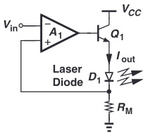

# 장말문제 12.35 — R_M으로 전류를 감지하는 레이저 다이오드 구동 회로(Fig 12.99)의 개루프·루프·폐루프 이득

## 원문
A “laser diode” converts current to light (as in laser pointers). We wish to design a circuit that delivers a well-defined current to a laser diode. Shown in Fig. 12.99 is an example in which resistor $R_M$ measures the current flowing through $D_1$ and amplifier $A_1$ subtracts the resulting voltage drop from $V_{in}$. Assume $R_M$ is very small and $V_A = \infty$.

(a) Following the procedure used in Example 12-21, determine the open-loop gain.

(b) Calculate the loop gain and the closed-loop gain.

## 조건
- "레이저 다이오드"는 전류를 빛으로 바꿈 (레이저 포인터처럼). 레이저 다이오드에 잘 정의된 전류를 공급하는 회로를 설계하려 함
- 회로: Fig 12.99 — 저항 $R_M$이 레이저 다이오드 $D_1$에 흐르는 전류 $I_{out}$을 측정하고, 증폭기 $A_1$이 그 전압 강하를 $V_{in}$에서 뺌. $A_1$ 출력이 $Q_1$의 베이스를 구동하고 $Q_1$이 $D_1$, $R_M$으로 전류를 공급
- 원문 문장은 이 회로의 $Q_1$을 공통 이미터 pnp 소자로 봄 (문제 12.37: "the common-emitter pnp device in Fig. 12.99") (원문에 없음)
- 그림에 인쇄된 $Q_1$은 npn (컬렉터 → $V_{CC}$, 이미터 → $D_1$, 이미터 폴로어 꼴). 문제 12.37의 "공통 이미터 pnp"와 맞지 않음(오식으로 보임). 인쇄된 $A_1$의 입력 극성($V_{in}$ → −, 귀환 → +)은 pnp 공통 이미터일 때 부귀환이 됨 (원문에 없음)
- $R_M$은 매우 작음
- $V_A = \infty$
- 예제 12.21의 방법: 귀환 회로망을 떼어 낸 순방향 증폭기에서 귀환 입력($A_1$의 귀환 쪽 입력)을 접지하고 출력(레이저 쪽 전류 출력)을 접지로 단락해 개루프 트랜스컨덕턴스 $G_m = I_{out}/V_{in}$을 구함. 귀환율 $K = V_F/I_{out} = R_M$, 폐루프 $I_{out}/V_{in} = G_m/(1 + G_m R_M)$ (본문 방법, 원문에 없음)
- 원문 표기 "Example 12-21"은 예제 12.21 (원문에 없음)
- $A_1$의 전압 이득은 주어지지 않음 (답은 $A_1$, $g_m$, $R_M$의 식으로) (원문에 없음)

## 구할 것
- (a) 예제 12.21의 방법으로 개루프 이득
- (b) 루프 이득과 폐루프 이득

## 상속·참조
- 예제 12.21 (E12.21, 교재 679쪽): 그림 12.42(b)처럼 레이저와 직렬인 작은 저항 $R_M$ 양단 전압 $V_F$를 연산 증폭기 입력으로 반송해 전류를 감시하는 회로. 연산 증폭기 이득이 매우 크면 $I_{out} \approx V_{in}/R_M$ (식 12.86). 트랜지스터 수준 회로 그림 12.42(c)의 개루프 이득은 그림 12.42(d)처럼 귀환 입력($M_4$ 게이트)을 접지하고 $M_1$ 드레인을 접지에 단락해 구함: $G_m = g_{m1}g_{m3}(r_{O3} \parallel r_{O5})$ (식 12.87), $K = V_F/I_{out} = R_M$, 폐루프 $\dfrac{I_{out}}{V_{in}} = \dfrac{G_m}{1 + G_m R_M}$ (식 12.88)
- 본문 그림 12.42(b) (크롭 안 함): $V_{in}$ → 연산 증폭기 − 입력, $V_F$ → + 입력, 출력 → PMOS $M_1$ 게이트, $M_1$ 소스 $V_{DD}$, 드레인 → "Laser" 상자 → $V_F$ 노드 → $R_M$ → 접지

## 회로 — Fig 12.99
```spice
XA1 n3    Vin   n1    opamp  ; 삼각형 증폭기 A1, + = n3(귀환), − = Vin
Q1  VCC   n1    n2    npn    ; 인쇄대로 npn (이미터 화살표 아래 바깥)
D1  n2    n3    laser        ; 레이저 다이오드 기호, 애노드 위
RM  n3    0     {R_M}
```
- 단자: VCC = 전원, 값 미지정 (T 전원 기호) / Vin = 입력 (개방 원)
- 표시: 노드 라벨 V_CC (T 기호 오른쪽), V_in (입력 원 왼쪽 위) / 소자 라벨 A1 (삼각형 안), Q1 (트랜지스터 오른쪽), D1 (다이오드 왼쪽), "Laser Diode" 두 줄 글자 (D1 왼쪽), R_M (저항 오른쪽) / 부호 A1 입력: − 위 (V_in 쪽), + 아래 (귀환 쪽), 둘 다 삼각형 안 / 화살표 "I_out": Q1 이미터와 D1 사이 세로 도선, 아래 방향 (D1 쪽으로), 도선 위, 글자는 화살표 오른쪽 / 수치·면적 라벨 없음
- 배치: 왼쪽에 오른쪽을 향한 삼각형 A1, V_in 원에서 가로선이 − 입력 / A1 출력에서 가로선이 오른쪽으로 Q1 베이스 / 오른쪽 세로줄 위→아래 V_CC T 기호, Q1 (베이스 왼쪽, 컬렉터 위 → V_CC, 이미터 아래·화살표 바깥), I_out 화살표, D1 (삼각형이 아래를 향함, 막대 아래, 오른쪽에 빛 화살표 두 개), n3 접속점, R_M, 접지 / n3 접속점에서 가로선이 왼쪽으로 A1 왼쪽 바깥까지 가서 위로 꺾여 + 입력 높이에서 오른쪽으로 꺾여 + 입력 / 접속점 (세 갈래 이상, 1곳): n3 = 위 D1 + 아래 R_M + 왼쪽 귀환선 (점) / 교차: 없음


