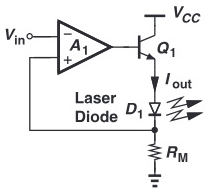

# 장말문제 12.36 — 레이저 다이오드 구동 회로(Fig 12.99)의 개루프·폐루프 출력 임피던스

## 원문
Following the procedure used in Example 12-22, compute the open-loop and closed-loop output impedances of the circuit depicted in Fig. 12.99.

## 조건
- 회로: Fig 12.99 — 증폭기 $A_1$이 $V_{in}$과 $R_M$ 양단 전압을 비교해 $Q_1$ 베이스를 구동하고, $Q_1$이 레이저 다이오드 $D_1$과 전류 감지 저항 $R_M$으로 전류 $I_{out}$을 공급
- 원문 문장(문제 12.37)은 이 회로의 $Q_1$을 공통 이미터 pnp 소자로 봄. 그림에 인쇄된 $Q_1$은 npn 이미터 폴로어 꼴이라 맞지 않음(오식으로 보임) (원문에 없음)
- 같은 그림을 쓰는 문제 12.35는 $R_M$이 매우 작고 $V_A = \infty$라고 가정함. 이 문제 문장에는 가정이 적혀 있지 않음 (원문에 없음)
- 예제 12.22의 방법: $R_M$이 매우 작아 귀환 전압을 0으로 보고(귀환 입력 접지) 개루프 회로를 만들고, 출력 임피던스는 부하(레이저)에서 본 임피던스로 테스트 전압원을 출력선과 직렬로 넣어 구함. 폐루프 출력 임피던스 $R_{out,closed} = R_{out,open}(1 + KG_m)$, $K = R_M$ (본문 방법, 원문에 없음)
- 원문 표기 "Example 12-22"는 예제 12.22 (원문에 없음)
- $A_1$의 전압 이득은 주어지지 않음 (답은 $A_1$, $g_m$, $R_M$의 식으로) (원문에 없음)

## 구할 것
- 개루프 출력 임피던스
- 폐루프 출력 임피던스

## 상속·참조
- 예제 12.22 (E12.22, 교재 681쪽): 그림 12.44(a)의 레이저 구동 회로 ($M_1$ 공통 게이트 입력, $R_D$, PMOS $M_2$가 "Laser" 상자와 $R_M$으로 전류 공급, $V_F$가 $M_1$ 게이트로 귀환)의 폐루프 이득과 I/O 임피던스를 구함. $R_M$이 매우 작아 개루프 회로는 그림 12.44(b) ($M_1$ 게이트 접지, $M_2$ 드레인 접지 단락). $G_m = g_{m1}R_D \cdot g_{m2}$ (식 12.94), 귀환율 $R_M$, 폐루프 $R_{out,closed} = \dfrac{1}{g_{m2}}(1 + g_{m1}g_{m2}R_DR_M)$ (식 12.97, 레이저에서 본 임피던스)
- 식 (12.92) (12.6.3절): 전류-전압 귀환의 출력 임피던스 $\dfrac{V_X}{I_X} = R_{out}(1 + KG_m)$, 테스트 전압원은 출력선과 직렬
- 문제 12.35 (같은 그림): $R_M$이 매우 작고 $V_A = \infty$라 가정하고 예제 12.21의 방법으로 개루프 이득, 루프 이득, 폐루프 이득을 구함

## 회로 — Fig 12.99
```spice
XA1 n3    Vin   n1    opamp  ; 삼각형 증폭기 A1, + = n3(귀환), − = Vin
Q1  VCC   n1    n2    npn    ; 인쇄대로 npn (이미터 화살표 아래 바깥)
D1  n2    n3    laser        ; 레이저 다이오드 기호, 애노드 위
RM  n3    0     {R_M}
```
- 단자: VCC = 전원, 값 미지정 (T 전원 기호) / Vin = 입력 (개방 원)
- 표시: 노드 라벨 V_CC (T 기호 오른쪽), V_in (입력 원 왼쪽 위) / 소자 라벨 A1 (삼각형 안), Q1 (트랜지스터 오른쪽), D1 (다이오드 왼쪽), "Laser Diode" 두 줄 글자 (D1 왼쪽), R_M (저항 오른쪽) / 부호 A1 입력: − 위 (V_in 쪽), + 아래 (귀환 쪽), 둘 다 삼각형 안 / 화살표 "I_out": Q1 이미터와 D1 사이 세로 도선, 아래 방향 (D1 쪽으로), 도선 위, 글자는 화살표 오른쪽 / 수치·면적 라벨 없음
- 배치: 왼쪽에 오른쪽을 향한 삼각형 A1, V_in 원에서 가로선이 − 입력 / A1 출력에서 가로선이 오른쪽으로 Q1 베이스 / 오른쪽 세로줄 위→아래 V_CC T 기호, Q1 (베이스 왼쪽, 컬렉터 위 → V_CC, 이미터 아래·화살표 바깥), I_out 화살표, D1 (삼각형이 아래를 향함, 막대 아래, 오른쪽에 빛 화살표 두 개), n3 접속점, R_M, 접지 / n3 접속점에서 가로선이 왼쪽으로 A1 왼쪽 바깥까지 가서 위로 꺾여 + 입력 높이에서 오른쪽으로 꺾여 + 입력 / 접속점 (세 갈래 이상, 1곳): n3 = 위 D1 + 아래 R_M + 왼쪽 귀환선 (점) / 교차: 없음


