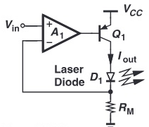

# 장말문제 12.37 — Q1을 이미터 폴로어로 바꾼 레이저 다이오드 구동 회로(Fig 12.100)로 문제 12.35, 12.36 반복

## 원문
A student mistakenly replaces the common-emitter pnp device in Fig. 12.99 with an npn emitter follower (Fig. 12.100). Repeat Problems 12.35 and 12.36 for this circuit and compare the results.

## 조건
- 회로: Fig 12.100 — 학생이 실수로 Fig 12.99의 공통 이미터 pnp 소자를 npn 이미터 폴로어로 바꾼 회로. 증폭기 $A_1$의 + 입력에 $V_{in}$, − 입력에 $R_M$ 양단 전압이 귀환되고, $A_1$ 출력이 $Q_1$ 베이스를 구동, $Q_1$이 레이저 다이오드 $D_1$과 $R_M$으로 전류 $I_{out}$을 공급
- 그림에 인쇄된 Fig 12.100의 $Q_1$은 pnp (이미터 → $V_{CC}$, 컬렉터 → $D_1$, 공통 이미터 꼴)이고, Fig 12.99의 $Q_1$은 npn 이미터 폴로어 꼴로 인쇄됨. 문장의 "Fig 12.99 = 공통 이미터 pnp, Fig 12.100 = npn 이미터 폴로어"와 맞지 않음(오식으로 보임). 인쇄된 $A_1$의 입력 극성(+ = $V_{in}$, − = 귀환)은 npn 이미터 폴로어일 때 부귀환이 됨 (원문에 없음)
- 문제 12.35에서 이어받는 가정: $R_M$이 매우 작음, $V_A = \infty$ (원문에 없음)
- 문제 12.35, 12.36의 방법: 예제 12.21의 방법으로 개루프 이득($A_1$의 귀환 입력 접지, 출력 전류 경로를 접지로 단락), 귀환율 $K = R_M$, 루프 이득과 폐루프 이득을 구하고, 예제 12.22의 방법으로 개루프 출력 임피던스와 폐루프 출력 임피던스 $R_{out}(1 + KG_m)$을 구함 (원문에 없음)
- $A_1$의 전압 이득은 주어지지 않음 (답은 $A_1$, $g_m$, $R_M$의 식으로) (원문에 없음)

## 구할 것
- 이 회로에 대해 문제 12.35와 12.36을 반복 (원문에 없음, 아래는 두 문제의 요구)
  - 개루프 이득 (예제 12.21의 방법)
  - 루프 이득과 폐루프 이득
  - 개루프 출력 임피던스와 폐루프 출력 임피던스 (예제 12.22의 방법)
- Fig 12.99 회로의 결과와 비교

## 상속·참조
- 문제 12.35 (P12.35): Fig 12.99 (증폭기 $A_1$: − 입력 $V_{in}$, + 입력 = $R_M$ 위 노드, 출력 → $Q_1$ 베이스, $Q_1$ → $D_1$ → $R_M$ → 접지)에서 $R_M$이 매우 작고 $V_A = \infty$라 가정하고 (a) 예제 12.21의 방법으로 개루프 이득, (b) 루프 이득과 폐루프 이득을 구함
- 문제 12.36 (P12.36): 같은 Fig 12.99 회로에서 예제 12.22의 방법으로 개루프·폐루프 출력 임피던스를 구함
- 예제 12.21 (교재 679쪽): 개루프 $G_m = I_{out}/V_{in}$ (귀환 입력 접지, 출력 단락), $K = V_F/I_{out} = R_M$, $\dfrac{I_{out}}{V_{in}}\Big|_{closed} = \dfrac{G_m}{1 + G_mR_M}$ (식 12.88)
- 예제 12.22 (교재 681쪽): 출력 임피던스는 레이저에서 본 임피던스, $R_{out,closed} = R_{out,open}(1 + G_mR_M)$
- 문제 12.35의 Fig 12.99 (이 파일의 그림 목록에는 넣지 않음, 크롭은 fig12-99.png): `XA1: + = n3, − = Vin, out = n1`, `Q1 (인쇄는 npn): C = VCC, B = n1, E = n2`, `D1: A = n2, K = n3`, `RM: n3 — 0`

## 회로 — Fig 12.100
```spice
XA1 Vin   n3    n1    opamp  ; 삼각형 증폭기 A1, + = Vin, − = n3(귀환)
Q1  n2    n1    VCC   pnp    ; 인쇄대로 pnp (이미터 위, 화살표가 막대 쪽으로 들어감)
D1  n2    n3    laser        ; 레이저 다이오드 기호, 애노드 위
RM  n3    0     {R_M}
```
- 단자: VCC = 전원, 값 미지정 (T 전원 기호) / Vin = 입력 (개방 원)
- 표시: 노드 라벨 V_CC (T 기호 오른쪽), V_in (입력 원 왼쪽 위) / 소자 라벨 A1 (삼각형 안), Q1 (트랜지스터 오른쪽), D1 (다이오드 왼쪽), "Laser Diode" 두 줄 글자 (D1 왼쪽), R_M (저항 오른쪽) / 부호 A1 입력: + 위 (V_in 쪽), − 아래 (귀환 쪽), 둘 다 삼각형 안 / 화살표 "I_out": Q1 컬렉터와 D1 사이 세로 도선, 아래 방향 (D1 쪽으로), 도선 위, 글자는 화살표 오른쪽 / 수치·면적 라벨 없음
- 배치: 왼쪽에 오른쪽을 향한 삼각형 A1, V_in 원에서 가로선이 + 입력 / A1 출력에서 가로선이 오른쪽으로 Q1 베이스 / 오른쪽 세로줄 위→아래 V_CC T 기호, Q1 (베이스 왼쪽, 이미터 위 → V_CC·화살표가 막대 쪽으로 들어감, 컬렉터 아래), I_out 화살표, D1 (삼각형이 아래를 향함, 막대 아래, 오른쪽에 빛 화살표 두 개), n3 접속점, R_M, 접지 / n3 접속점에서 가로선이 왼쪽으로 A1 왼쪽 바깥까지 가서 위로 꺾여 − 입력 높이에서 오른쪽으로 꺾여 − 입력 / 접속점 (세 갈래 이상, 1곳): n3 = 위 D1 + 아래 R_M + 왼쪽 귀환선 (점) / 교차: 없음


> 참고: 이미지 맨 아래 R_M 접지 기호의 아래 두 막대가 잘림 (바로 왼쪽의 그림 캡션과 높이가 겹쳐 직사각형으로 자를 수 없음). 원본에서는 R_M 아래가 보통 접지 기호
