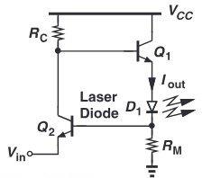

# 장말문제 12.38 — A1을 공통 베이스 단으로 구현한 레이저 다이오드 구동 회로(Fig 12.101)로 문제 12.37 반복

## 원문
The amplifier $A_1$ in Fig. 12.100 can be realized as a common-base stage (Fig. 12.101). Repeat Problem 12.37 for this circuit. For simplicity, assume $\beta \to \infty$.

## 조건
- 회로: Fig 12.101 — Fig 12.100의 증폭기 $A_1$을 공통 베이스 단으로 구현한 회로. $Q_2$ (npn) 이미터에 $V_{in}$, 베이스는 $R_M$ 위 노드, 컬렉터는 $R_C$를 거쳐 $V_{CC}$이고 $Q_1$ 베이스를 구동. $Q_1$ (npn, 컬렉터 $V_{CC}$)의 이미터가 레이저 다이오드 $D_1$, $R_M$으로 전류 $I_{out}$을 공급
- 간단히 $\beta \to \infty$로 가정
- 문제 12.37 (나아가 문제 12.35)에서 이어받는 가정: $R_M$이 매우 작음, $V_A = \infty$ (원문에 없음)
- Fig 12.101의 $Q_1$은 npn 이미터 폴로어로 인쇄돼 문제 12.37 문장의 "npn emitter follower"와 맞음. Fig 12.100에는 $Q_1$이 pnp로 인쇄돼 있음 (원문에 없음)
- 소자 값은 주어지지 않음 (답은 $g_m$, $R_C$, $R_M$의 식으로) (원문에 없음)

## 구할 것
- 이 회로에 대해 문제 12.37을 반복 (원문에 없음, 아래는 문제 12.37의 요구)
  - 개루프 이득 (예제 12.21의 방법)
  - 루프 이득과 폐루프 이득
  - 개루프 출력 임피던스와 폐루프 출력 임피던스 (예제 12.22의 방법)
  - 결과 비교

## 상속·참조
- 문제 12.37 (P12.37): Fig 12.99의 공통 이미터 pnp 소자를 npn 이미터 폴로어로 바꾼 Fig 12.100 회로에 대해 문제 12.35 (예제 12.21의 방법으로 개루프 이득, 루프 이득, 폐루프 이득, $R_M$ 매우 작음, $V_A = \infty$)와 문제 12.36 (예제 12.22의 방법으로 개루프·폐루프 출력 임피던스)을 반복하고 결과를 비교
- 예제 12.21 (교재 679쪽): 개루프 $G_m = I_{out}/V_{in}$ (귀환 입력 접지, 출력 단락), $K = R_M$, 폐루프 $G_m/(1 + G_mR_M)$
- 예제 12.22 (교재 681쪽): 출력 임피던스는 레이저에서 본 임피던스, $R_{out,closed} = R_{out,open}(1 + G_mR_M)$
- 문제 12.37의 Fig 12.100 (이 파일의 그림 목록에는 넣지 않음, 크롭은 fig12-100.png): `XA1: + = Vin, − = n3, out = n1`, `Q1 (인쇄는 pnp): E = VCC, B = n1, C = n2`, `D1: A = n2, K = n3`, `RM: n3 — 0`

## 회로 — Fig 12.101
```spice
RC  VCC   n1    {R_C}
Q1  VCC   n1    n2    npn
D1  n2    n3    laser        ; 레이저 다이오드 기호, 애노드 위
RM  n3    0     {R_M}
Q2  n1    n3    Vin   npn    ; 좌우 반전 (베이스 오른쪽)
```
- 단자: VCC = 전원, 값 미지정 (가로 레일) / Vin = 입력 (개방 원)
- 표시: 노드 라벨 V_CC (레일 오른쪽 끝), V_in (입력 원 왼쪽) / 소자 라벨 R_C (저항 왼쪽), Q1 (Q1 오른쪽), Q2 (Q2 왼쪽 위), D1 (다이오드 왼쪽), "Laser Diode" 두 줄 글자 (D1 왼쪽), R_M (저항 오른쪽) / 부호 없음 / 화살표 "I_out": Q1 이미터와 D1 사이 세로 도선, 아래 방향 (D1 쪽으로), 도선 위, 글자는 화살표 오른쪽 / 수치·면적 라벨 없음
- 배치: 맨 위 V_CC 가로 레일 / 왼쪽 세로줄 위→아래 레일, R_C, n1 접속점, 긴 세로선, Q2 컬렉터 / Q2는 좌우 반전된 npn (베이스 막대가 오른쪽, 컬렉터 왼쪽 위, 이미터 왼쪽 아래·화살표 바깥), 이미터에서 아래로 내려가 왼쪽으로 꺾여 V_in 원 / n1 접속점에서 가로선이 오른쪽으로 Q1 베이스 / 오른쪽 세로줄 위→아래 레일, Q1 (보통 방향 npn, 베이스 왼쪽, 컬렉터가 위에서 레일 오른쪽 끝으로 올라감, 이미터 아래·화살표 바깥), I_out 화살표, D1 (삼각형이 아래를 향함, 막대 아래, 오른쪽에 빛 화살표 두 개), n3 접속점, R_M, 접지 / n3 접속점에서 가로선이 왼쪽으로 Q2 베이스 / 접속점 (세 갈래 이상, 2곳): n1 = 위 R_C + 아래 Q2 컬렉터로 가는 세로선 + 오른쪽 Q1 베이스 선 (점), n3 = 위 D1 + 아래 R_M + 왼쪽 Q2 베이스 선 (점) / 교차: 없음


