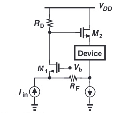

# 장말문제 12.39 — PMOS CS 단을 NMOS 소스 폴로어로 바꾼 전류-전류 귀환 회로(Fig 12.102)의 정귀환 증명과 루프 이득

## 원문
A student has adventurously replaced the PMOS common-source stage in Fig. 12.49(a) with an NMOS source follower (Fig. 12.102).

(a) Prove by inspection that the feedback is positive.

(b) Break the loop at the gate of $M_2$, determine the loop gain, and prove that the feedback is positive.

## 조건
- 회로: Fig 12.102 — 예제 12.24의 Fig 12.49(a)에서 PMOS 공통 소스 단 $M_2$를 NMOS 소스 폴로어 $M_2$로 바꾼 회로. 공통 게이트 단 $M_1$ ($R_D$ 부하, 입력 전류 $I_{in}$이 소스로 들어감)의 드레인이 $M_2$ 게이트를 구동하고, $M_2$ 소스 → "Device" 상자 → 아래 노드 → 전류원 → 접지, 아래 노드에서 $M_1$ 소스(입력 노드)로 $R_F$ 귀환
- 참고 회로 (본문 Fig 12.49(a)): $R_D$와 $M_1$ (공통 게이트, 게이트 $V_b$, 드레인 $X$, 소스에 $I_{in}$) 뒤에 PMOS $M_2$ (소스 $V_{DD}$, 게이트 $X$)의 드레인이 "Laser" 상자를 거쳐 노드 $P$로, $P$에서 $R_M$으로 접지, $R_F$가 $M_1$ 소스와 $P$ 사이 (원문에 없음)
- 예제 12.24는 $R_M$이 매우 작고 $R_F$가 매우 크다고 가정함. 이 문제 문장에는 가정이 적혀 있지 않음 (원문에 없음)
- 소자 값은 주어지지 않음 (답은 $g_m$, 저항의 식으로) (원문에 없음)

## 구할 것
- (a) 귀환이 정귀환임을 관찰로 증명
- (b) $M_2$의 게이트에서 루프를 끊고 루프 이득을 구해 귀환이 정귀환임을 증명

## 상속·참조
- 예제 12.24 (E12.24, 교재 685쪽): 그림 12.49(a)에서 레이저 다이오드에 공급되는 출력 전류가 부귀환으로 조절됨. $R_M$이 매우 작고 $R_F$가 매우 클 때 귀환이 부귀환임을 증명하고 폐루프 이득과 I/O 임피던스를 구함 (개루프 $A_I = -g_{m2}R_D$, $K = -R_M/R_F$)
- 본문 그림 12.49(a) (크롭 안 함, 예제 12.24의 문제 그림)
  - `RD: VDD — X`, `M1: D = X, G = Vb, S = n1`, `Iin: 접지 → n1`
  - `M2 (PMOS): D = n2, G = X, S = VDD`, `Laser 상자: n2 — P`
  - `RF: n1 — P`, `RM: P — 0`

## 회로 — Fig 12.102
```spice
RD  VDD   n1    {R_D}
M2  VDD   n1    n2    nmos
XD  n2    n3    box "Device"  ; 상자로 그려진 소자
M1  n1    Vb    n4    nmos    ; 좌우 반전 (게이트 오른쪽)
RF  n4    n3    {R_F}
IIN 0     n4    {I_in}        ; 화살표 위
I1  n3    0                   ; 라벨·값 없는 전류원, 화살표 아래
```
- 단자: VDD = 전원, 값 미지정 (가로 레일) / Vb = M1 게이트 바이어스, 값 미지정 (점 단자)
- 표시: 노드 라벨 V_DD (레일 오른쪽 끝), V_b (점 단자 오른쪽) / 소자 라벨 R_D (저항 왼쪽), M2 (M2 오른쪽 아래), "Device" (상자 안), M1 (M1 왼쪽, 소스 화살표 왼쪽 위), R_F (가로 저항 아래), I_in (왼쪽 전류원 왼쪽), I1 (라벨 없음, 오른쪽 전류원) / 부호 없음 / 화살표 없음 / 수치·면적 라벨 없음
- 배치: 맨 위 V_DD 가로 레일 / 왼쪽 세로줄 위→아래 레일, R_D, n1 접속점, 긴 세로선, M1, n4 접속점 / M1은 좌우 반전된 NMOS (게이트 오른쪽, 소스 화살표가 왼쪽 바깥을 향함), 게이트에서 짧은 가로선이 오른쪽 V_b 점 단자 / n1 접속점에서 가로선이 오른쪽으로 M2 게이트 / 오른쪽 세로줄 위→아래 레일, M2 (보통 방향 NMOS, 게이트 왼쪽, 드레인이 위에서 레일 오른쪽 끝으로 올라감, 소스 아래·화살표 바깥), "Device" 상자, n3 접속점, I1 전류원(원 안 화살표 아래), 접지 / n4 접속점에서 가로선이 오른쪽으로 R_F를 지나 n3 접속점 / I_in 전류원은 n4 왼쪽 아래: 위 단자에서 세로선이 올라가 오른쪽으로 꺾여 n4 접속점, 아래 단자 접지, 원 안 화살표 위 / 출력 단자 없음 / 접속점 (세 갈래 이상, 3곳): n1 = 위 R_D + 아래 M1 드레인으로 가는 세로선 + 오른쪽 M2 게이트 선 (점), n4 = 위 M1 소스 + 왼쪽 I_in 선 + 오른쪽 R_F (점), n3 = 위 Device 상자 + 왼쪽 R_F + 아래 I1 (점) / 교차: 없음


> 참고: 문제 문장은 723쪽(PDF 42 오른쪽) 오른쪽 단 아래, 소문항 (a)(b)는 724쪽(PDF 43 왼쪽) 왼쪽 단 맨 위
