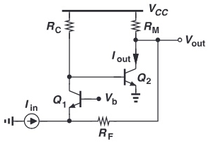

# 장말문제 12.40 — Fig 12.103 귀환 회로: 출력이 I_out일 때와 V_out일 때의 폐루프 이득과 I/O 임피던스

## 원문
Consider the feedback circuit depicted in Fig. 12.103. Assume $V_A = \infty$.

(a) Suppose the output quantity of interest is the collector current of $Q_2$, $I_{out}$. Assuming $R_M$ is very small and $R_F$ is very large, determine the closed-loop gain and I/O impedances of the circuit.

(b) Now, suppose the output quantity of interest is $V_{out}$. Assuming $R_F$ is very large, compute the closed-loop gain and I/O impedances of the circuit.

## 조건
- 회로: Fig 12.103 — 입력 전류 $I_{in}$이 $Q_1$(베이스 $V_b$, 공통 베이스) 이미터로 들어가고, $Q_1$ 컬렉터($R_C$ 부하)가 $Q_2$ 베이스를 구동하며, $Q_2$ 컬렉터($R_M$ 부하, $V_{out}$)에서 $R_F$를 거쳐 $Q_1$ 이미터로 귀환 (— 뒤 회로 설명은 원문에 없음)
- $V_A = \infty$
- (a) 관심 출력량은 $Q_2$의 컬렉터 전류 $I_{out}$. $R_M$은 매우 작고 $R_F$는 매우 크다고 가정
- (b) 관심 출력량은 $V_{out}$. $R_F$는 매우 크다고 가정
- 소자 값은 주어지지 않음 (답은 기호로) (원문에 없음)

## 구할 것
- (a) 출력이 $I_{out}$일 때 폐루프 이득과 입력·출력 임피던스
- (b) 출력이 $V_{out}$일 때 폐루프 이득과 입력·출력 임피던스

## 회로 — Fig 12.103
```spice
RC   VCC   n1    {R_C}
Q1   n1    Vb    n2    npn   ; 좌우 반전 (베이스 오른쪽)
Q2   Vout  n1    0     npn
RM   VCC   Vout  {R_M}
RF   n2    Vout  {R_F}
Iin  0     n2    {I_in}      ; 왼쪽 끝 옆으로 누운 접지 기호 → 전류원 → n2 (화살표 오른쪽)
```
- 단자: VCC = 전원, 값 미지정 (가로 레일) / Vb = 이상적 DC 바이어스, 값 미지정 (점 단자) / Vout = 출력 (개방 원) / 0 = 전류원 왼쪽 끝의 옆으로 누운 접지
- 표시: 노드 라벨 V_CC (레일 오른쪽 끝 위), V_b (점 단자 오른쪽), V_out (출력 원 오른쪽) / 소자 라벨 R_C (왼쪽 저항 왼쪽), R_M (오른쪽 저항 오른쪽), Q1 (Q1 왼쪽, 이미터 위), Q2 (Q2 오른쪽), R_F (가로 저항 아래), I_in (전류원 위) / 부호 없음 / 화살표 "I_out": R_M 아래 접속점과 Q2 컬렉터 사이 도선, 아래 방향(Q2 컬렉터로 들어감), 도선 위 / 수치·면적 라벨 없음
- 배치: 맨 위 가로 레일 V_CC, 레일에서 왼쪽 R_C, 오른쪽 R_M이 세로로 매달림 / R_C 아래 끝 → 세로선 → Q1 컬렉터 접속점 → Q1 컬렉터, 접속점에서 가로선이 오른쪽으로 Q2 베이스 / Q1 npn 좌우 반전(베이스 막대 오른쪽, 컬렉터 위, 이미터 왼쪽 아래·화살표 바깥), Q1 베이스 → 가로선 → 오른쪽 V_b 점 단자 / Q2 npn 보통 방향(베이스 왼쪽, 컬렉터 위, 이미터 아래), Q2 이미터 아래 접지 / R_M 아래 끝 접속점에서 가로선이 오른쪽으로 두 번째 접속점을 지나 V_out 원, 두 번째 접속점에서 세로선이 회로 맨 아래 높이까지 내려가 왼쪽으로 꺾여 가로 R_F를 지나 Q1 이미터 접속점 / 맨 아래 줄 왼쪽부터 옆으로 누운 접지 기호, 전류원 I_in(가로로 놓임, 화살표 오른쪽), Q1 이미터 접속점, R_F / 접속점 (세 갈래 이상, 4곳): ① n1 = 위 R_C + 아래 Q1 컬렉터 + 오른쪽 Q2 베이스 선 (점) ② R_M 아래 = 위 R_M + 아래 Q2 컬렉터 + 오른쪽 가로선 (점) ③ V_out 선 = 왼쪽 가로선 + 오른쪽 V_out 원 + 아래 R_F 귀환선 (점) ④ n2 = 위 Q1 이미터 + 왼쪽 I_in + 오른쪽 R_F (점) / 교차: 없음


