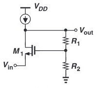

# 장말문제 12.41 — 이상적 전류원 부하 CG 단(Fig 12.104)에 예제 12.26 반복

## 원문
The common-gate stage shown in Fig. 12.104 employs an ideal current source as its load, requiring that the loading introduced by $R_1$ and $R_2$ be taken into account. Repeat Example 12-26 for this circuit.

## 조건
- 회로: Fig 12.104 — 공통 게이트 단, 부하는 이상적 전류원
- 부하가 이상적 전류원이므로 $R_1$, $R_2$가 일으키는 부하 효과를 고려해야 함
- 예제 12.26을 이 회로로 되풀이 (원문 표기 "Example 12-26")
- 예제 12.26: $R_1 + R_2$가 $R_D$보다 충분히 작지 않을 때 그림 12.55(a)의 증폭기(전압-전압 귀환 CG 단)를 해석하라 — 개루프 변수와 귀환율 $K$를 구하고 폐루프 이득 $A_{v,closed}$, $R_{in,closed}$, $R_{out,closed}$를 구함 (원문에 없음)
- 참고 회로 (본문 Fig 12.55(a)): $V_{DD}$에서 $R_D$를 거쳐 $M_1$ 드레인 $= V_{out}$, $V_{out}$과 접지 사이에 $R_1$, $R_2$ 직렬, 그 가운데 노드가 $M_1$ 게이트, $M_1$ 소스가 $V_{in}$ (원문에 없음)
- 식 (12.120)–(12.121): $K = \dfrac{V_2}{V_1} = \dfrac{R_2}{R_1 + R_2}$, 예제 12.26의 귀환율 (본문 식, 원문에 없음)
- 소자 값은 주어지지 않음 (답은 기호로) (원문에 없음)

## 구할 것
- 예제 12.26처럼 $R_1$, $R_2$의 부하 효과를 넣어 개루프 회로를 만들고, 귀환율, 폐루프 전압 이득, 폐루프 입력·출력 임피던스를 구함 (원문에 없음, 원문은 "Repeat Example 12-26"만 적음)

## 상속·참조
- 예제 12.26 (E12.26, 교재 690–691쪽): "$R_1 + R_2$가 $R_D$보다 충분히 작지 않을 때 그림 12.55(a)에 그려진 증폭기를 해석하라."
  - 그림 12.55(a) (크롭 안 함): $R_D$ $V_{DD}$–$V_{out}$, $M_1$ (D = $V_{out}$, G = $R_1$·$R_2$ 가운데 노드, S = $V_{in}$), $R_1$ $V_{out}$–가운데 노드, $R_2$ 가운데 노드–접지
  - 풀이: 순방향 시스템은 $M_1$과 $R_D$, 귀환 회로망은 $R_1$, $R_2$. 그림 12.53(a)에 따라 개루프 회로를 만듦 — 감지 복제의 출력 포트는 개방, 반송 복제의 입력 포트는 단락 (그림 12.55(b)). 개루프 변수는 예제 12.25에서 계산
  - 귀환율은 그림 12.54(a)의 법칙(그림 12.55(c) 회로)으로 $K = V_2/V_1 = \dfrac{R_2}{R_1 + R_2}$ (12.120–12.121)
  - $KA_0 = \dfrac{R_2}{R_1 + R_2} g_{m1}[R_D \| (R_1 + R_2)]$ (12.122)
  - 결과: $A_{v,closed} = \dfrac{g_{m1}[R_D \| (R_1 + R_2)]}{1 + \dfrac{R_2}{R_1 + R_2} g_{m1}[R_D \| (R_1 + R_2)]}$ (12.123), $R_{in,closed} = \dfrac{1}{g_{m1}}\left\{1 + \dfrac{R_2}{R_1 + R_2} g_{m1}[R_D \| (R_1 + R_2)]\right\}$ (12.124), $R_{out,closed} = \dfrac{R_D \| (R_1 + R_2)}{1 + \dfrac{R_2}{R_1 + R_2} g_{m1}[R_D \| (R_1 + R_2)]}$ (12.125)
- 예제 12.26 바로 뒤 연습문제("$R_D$가 이상적인 전류원으로 대체될 때 위의 해석을 반복하라")와 같은 회로 상황임 (원문에 없음)

## 회로 — Fig 12.104
```spice
I1   VDD   Vout              ; 라벨·값 없음 (이상적 전류원 부하)
M1   Vout  n1    Vin   nmos  ; 좌우 반전 (게이트 오른쪽)
R1   Vout  n1    {R_1}
R2   n1    0     {R_2}
```
- 단자: VDD = 전원, 값 미지정 (T 전원 기호) / Vin = 입력 (개방 원) / Vout = 출력 (개방 원)
- 표시: 노드 라벨 V_DD (T 기호 오른쪽), V_in (입력 원 왼쪽), V_out (출력 원 오른쪽) / 소자 라벨 M1 (M1 왼쪽), R_1, R_2 (각 저항 오른쪽), I1 (라벨 없음) / 부호 없음 / 화살표 없음 / 수치·면적 라벨 없음
- 배치: 왼쪽 세로줄 위→아래 V_DD T 기호, 전류원(화살표 아래), 위쪽 접속점, M1 / M1 NMOS 좌우 반전(게이트 오른쪽, 드레인 위, 소스 아래·화살표 바깥 왼쪽) / M1 소스 → 아래로 내려와 왼쪽으로 꺾여 V_in 원 / 위쪽 접속점에서 가로선이 오른쪽으로 R_1 위 접속점을 지나 V_out 원 / 오른쪽 세로줄 위→아래 R_1, 가운데 접속점, R_2, 접지 / 가운데 접속점에서 가로선이 왼쪽으로 M1 게이트 / 접속점 (세 갈래 이상, 3곳): ① 전류원 아래 = 위 전류원 + 아래 M1 드레인 + 오른쪽 가로선 (점) ② R_1 위 = 왼쪽 가로선 + 오른쪽 V_out 원 + 아래 R_1 (점) ③ R_1·R_2 사이 = 위 R_1 + 아래 R_2 + 왼쪽 게이트 선 (점) / 교차: 없음


