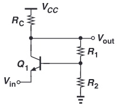

# 장말문제 12.42 — 예제 12.26의 바이폴라판 CB 단(Fig 12.105)의 폐루프 이득과 I/O 임피던스

## 원문
Figure 12.105 depicts the bipolar counterpart of the circuit studied in Example 12-26. Assuming $R_1 + R_2$ is not very large, $1 \ll \beta < \infty$ and $V_A = \infty$, determine the closed-loop gain and I/O impedances.

## 조건
- 회로: Fig 12.105 — 예제 12.26에서 다룬 회로의 바이폴라판 (원문 표기 "Example 12-26")
- 예제 12.26의 회로 (본문 Fig 12.55(a)): $R_D$를 부하로 한 NMOS 공통 게이트 단, $V_{out}$과 접지 사이 $R_1$, $R_2$ 분압기의 가운데 노드가 $M_1$ 게이트로 귀환. $R_1 + R_2$가 $R_D$보다 충분히 작지 않을 때 해석 (원문에 없음)
- $R_1 + R_2$는 매우 크지 않다고 가정 (부하 효과를 고려)
- $1 \ll \beta < \infty$
- $V_A = \infty$
- 소자 값은 주어지지 않음 (답은 기호로) (원문에 없음)

## 구할 것
- 폐루프 이득
- 폐루프 입력·출력 임피던스

## 상속·참조
- 예제 12.26 (E12.26, 교재 690–691쪽): "$R_1 + R_2$가 $R_D$보다 충분히 작지 않을 때 그림 12.55(a)에 그려진 증폭기를 해석하라."
  - 그림 12.55(a) (크롭 안 함): $R_D$ $V_{DD}$–$V_{out}$, $M_1$ (D = $V_{out}$, G = $R_1$·$R_2$ 가운데 노드, S = $V_{in}$), $R_1$ $V_{out}$–가운데 노드, $R_2$ 가운데 노드–접지
  - 풀이: 순방향 시스템은 $M_1$과 $R_D$, 귀환 회로망은 $R_1$, $R_2$. 개루프 회로는 감지 복제의 출력 포트 개방, 반송 복제의 입력 포트 단락 (그림 12.55(b)). $K = R_2/(R_1 + R_2)$ (12.121)
  - 결과: $A_{v,closed} = \dfrac{g_{m1}[R_D \| (R_1 + R_2)]}{1 + \dfrac{R_2}{R_1 + R_2} g_{m1}[R_D \| (R_1 + R_2)]}$ (12.123), $R_{in,closed} = \dfrac{1}{g_{m1}}\left\{1 + \dfrac{R_2}{R_1 + R_2} g_{m1}[R_D \| (R_1 + R_2)]\right\}$ (12.124), $R_{out,closed} = \dfrac{R_D \| (R_1 + R_2)}{1 + \dfrac{R_2}{R_1 + R_2} g_{m1}[R_D \| (R_1 + R_2)]}$ (12.125)

## 회로 — Fig 12.105
```spice
RC   VCC   Vout  {R_C}
Q1   Vout  n1    Vin   npn   ; 좌우 반전 (베이스 오른쪽)
R1   Vout  n1    {R_1}
R2   n1    0     {R_2}
```
- 단자: VCC = 전원, 값 미지정 (T 전원 기호) / Vin = 입력 (개방 원) / Vout = 출력 (개방 원)
- 표시: 노드 라벨 V_CC (T 기호 오른쪽), V_in (입력 원 왼쪽), V_out (출력 원 오른쪽) / 소자 라벨 R_C (저항 왼쪽), Q1 (Q1 왼쪽), R_1, R_2 (각 저항 오른쪽) / 부호 없음 / 화살표 없음 / 수치·면적 라벨 없음
- 배치: 왼쪽 세로줄 위→아래 V_CC T 기호, R_C, 위쪽 접속점, Q1 / Q1 npn 좌우 반전(베이스 막대 오른쪽, 컬렉터 위, 이미터 왼쪽 아래·화살표 바깥) / Q1 이미터 → 아래로 내려와 왼쪽으로 꺾여 V_in 원 / 위쪽 접속점에서 가로선이 오른쪽으로 R_1 위 접속점을 지나 V_out 원 / 오른쪽 세로줄 위→아래 R_1, 가운데 접속점, R_2, 접지 / 가운데 접속점에서 가로선이 왼쪽으로 Q1 베이스 / 접속점 (세 갈래 이상, 3곳): ① R_C 아래 = 위 R_C + 아래 Q1 컬렉터 + 오른쪽 가로선 (점) ② R_1 위 = 왼쪽 가로선 + 오른쪽 V_out 원 + 아래 R_1 (점) ③ R_1·R_2 사이 = 위 R_1 + 아래 R_2 + 왼쪽 베이스 선 (점) / 교차: 없음


