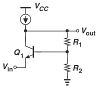

# 장말문제 12.43 — 전류원 부하 CB 단(Fig 12.106)에 문제 12.42 반복

## 원문
Repeat Problem 12.42 for the amplifier illustrated in Fig. 12.106.

## 조건
- 회로: Fig 12.106 — 문제 12.42의 회로에서 $R_C$를 이상적 전류원으로 바꾼 증폭기 (괄호 안 비교는 원문에 없음)
- 문제 12.42에서 이어받는 가정: $R_1 + R_2$는 매우 크지 않음 (부하 효과를 고려), $1 \ll \beta < \infty$, $V_A = \infty$ (원문에 없음)
- 소자 값은 주어지지 않음 (답은 기호로) (원문에 없음)

## 구할 것
- 폐루프 이득과 폐루프 입력·출력 임피던스 (원문에 없음, 원문은 "Repeat Problem 12.42"만 적음)

## 상속·참조
- 문제 12.42 (P12.42): Fig 12.105(예제 12.26 회로의 바이폴라판, $R_C$ 부하 CB 단, $R_1$·$R_2$ 분압 귀환)에서 $R_1 + R_2$가 매우 크지 않고 $1 \ll \beta < \infty$, $V_A = \infty$라고 가정하고 폐루프 이득과 I/O 임피던스를 구함
- 예제 12.26 결과(문제 12.42의 바탕): $A_{v,closed} = \dfrac{g_{m1}[R_D \| (R_1 + R_2)]}{1 + \dfrac{R_2}{R_1 + R_2} g_{m1}[R_D \| (R_1 + R_2)]}$, $R_{in,closed} = \dfrac{1}{g_{m1}}\left\{1 + \dfrac{R_2}{R_1 + R_2} g_{m1}[R_D \| (R_1 + R_2)]\right\}$, $R_{out,closed} = \dfrac{R_D \| (R_1 + R_2)}{1 + \dfrac{R_2}{R_1 + R_2} g_{m1}[R_D \| (R_1 + R_2)]}$ (식 12.123–12.125)

## 회로 — Fig 12.106
```spice
I1   VCC   Vout              ; 라벨·값 없음
Q1   Vout  n1    Vin   npn   ; 좌우 반전 (베이스 오른쪽)
R1   Vout  n1    {R_1}
R2   n1    0     {R_2}
```
- 단자: VCC = 전원, 값 미지정 (T 전원 기호) / Vin = 입력 (개방 원) / Vout = 출력 (개방 원)
- 표시: 노드 라벨 V_CC (T 기호 오른쪽), V_in (입력 원 왼쪽), V_out (출력 원 오른쪽) / 소자 라벨 Q1 (Q1 왼쪽), R_1, R_2 (각 저항 오른쪽), I1 (라벨 없음) / 부호 없음 / 화살표 없음 / 수치·면적 라벨 없음
- 배치: 왼쪽 세로줄 위→아래 V_CC T 기호, 전류원(화살표 아래), 위쪽 접속점, Q1 / Q1 npn 좌우 반전(베이스 막대 오른쪽, 컬렉터 위, 이미터 왼쪽 아래·화살표 바깥) / Q1 이미터 → 아래로 내려와 왼쪽으로 꺾여 V_in 원 / 위쪽 접속점에서 가로선이 오른쪽으로 R_1 위 접속점을 지나 V_out 원 / 오른쪽 세로줄 위→아래 R_1, 가운데 접속점, R_2, 접지 / 가운데 접속점에서 가로선이 왼쪽으로 Q1 베이스 / 접속점 (세 갈래 이상, 3곳): ① 전류원 아래 = 위 전류원 + 아래 Q1 컬렉터 + 오른쪽 가로선 (점) ② R_1 위 = 왼쪽 가로선 + 오른쪽 V_out 원 + 아래 R_1 (점) ③ R_1·R_2 사이 = 위 R_1 + 아래 R_2 + 왼쪽 베이스 선 (점) / 교차: 없음


