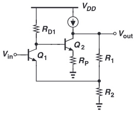

# 장말문제 12.45 — 바이폴라 두 단 귀환 증폭기(Fig 12.108)에 예제 12.28 반복

## 원문
Repeat Example 12-28 for the circuit shown in Fig. 12.108. Assume $V_A = \infty$.

## 조건
- 회로: Fig 12.108 — 예제 12.28 회로의 바이폴라판: $Q_1$ ($R_{D1}$ 부하) → $Q_2$ (이미터 저항 $R_P$, 이상적 전류원 부하) → $V_{out}$, $R_1$·$R_2$로 $Q_1$ 이미터에 귀환 (원문에 없음)
- 예제 12.28을 이 회로로 되풀이 (원문 표기 "Example 12-28")
- 예제 12.28: 그림 12.57(a)의 회로를 해석하라 — 순방향 시스템($M_1$, $R_{D1}$, $M_2$, $R_{D2}$)과 귀환 회로망($R_1$, $R_2$)으로 나눠 개루프 이득 $A_0$, $R_{in,open}$, $R_{out,open}$, 귀환율 $K$를 구하고 폐루프 이득, $R_{in,closed}$, $R_{out,closed}$를 구함. 귀환 전압은 $M_1$ 소스에 반송되고, 개루프 회로에서 $M_1$은 $R_1 \| R_2$로 축퇴됨 (원문에 없음)
- 참고 회로 (본문 Fig 12.57(a)): $V_{in}$이 $M_1$ 게이트, $M_1$ 드레인 $R_{D1}$ 부하가 $M_2$ 게이트를 구동, $M_2$ 소스 접지, $M_2$ 드레인 $R_{D2}$ 부하가 $V_{out}$, $V_{out}$–$R_1$–$M_1$ 소스 노드–$R_2$–접지 (원문에 없음)
- $V_A = \infty$
- 그림의 전원 라벨은 바이폴라 회로인데도 $V_{DD}$, 저항 라벨은 $R_{D1}$로 인쇄됨 (원문에 없음)
- 소자 값은 주어지지 않음 (답은 기호로) (원문에 없음)

## 구할 것
- 예제 12.28처럼 개루프 이득·개루프 입력·출력 임피던스, 귀환율, 폐루프 이득과 폐루프 입력·출력 임피던스 (원문에 없음, 원문은 "Repeat Example 12-28"만 적음)

## 상속·참조
- 예제 12.28 (E12.28, 교재 692–693쪽): "그림 12.57(a)의 회로를 해석하라."
  - 그림 12.57(a) (크롭 안 함, 노드 라벨 X는 그림 12.57(b)에만 인쇄됨): $R_{D1}$ $V_{DD}$–X, $M_1$ (D = X, G = $V_{in}$, S = $R_1$·$R_2$ 가운데 노드), $R_{D2}$ $V_{DD}$–$V_{out}$, $M_2$ (D = $V_{out}$, G = X, S = 접지), $R_1$ $V_{out}$–가운데 노드, $R_2$ 가운데 노드–접지
  - 풀이: 순방향 시스템은 $M_1$, $R_{D1}$, $M_2$, $R_{D2}$, 귀환 회로망은 $R_1$, $R_2$이며 전압을 뺄셈 트랜지스터 $M_1$의 소스에 반송. 개루프 회로는 그림 12.57(b) (출력 쪽 감지 복제는 개방, $M_1$ 소스 쪽 반송 복제는 단락, 그래서 $M_1$은 $R_1 \| R_2$로 축퇴). $A_0 = (V_X/V_{in})(V_{out}/V_X)$
  - $A_0 = \dfrac{-R_{D1}}{\dfrac{1}{g_m} + R_1 \| R_2} \cdot \{-g_{m2}[R_{D2} \| (R_1 + R_2)]\}$ (12.133), $R_{in,open} = \infty$ (12.134), $R_{out,open} = R_{D2} \| (R_1 + R_2)$ (12.135)
  - 귀환율 $K = R_2/(R_1 + R_2)$
  - $\left.\dfrac{V_{out}}{V_{in}}\right|_{closed} = \dfrac{A_0}{1 + \dfrac{R_2}{R_1 + R_2}A_0}$ (12.136), $R_{in,closed} = \infty$ (12.137), $R_{out,closed} = \dfrac{R_{D2} \| (R_1 + R_2)}{1 + \dfrac{R_2}{R_1 + R_2}A_0}$ (12.138)

## 회로 — Fig 12.108
```spice
RD1  VDD   n1    {R_D1}
Q1   n1    Vin   n2    npn
Q2   Vout  n1    n3    npn
RP   n3    0     {R_P}
I1   VDD   Vout              ; 라벨·값 없음
R1   Vout  n2    {R_1}
R2   n2    0     {R_2}
```
- 단자: VDD = 전원, 값 미지정 (가로 레일) / Vin = 입력 (개방 원) / Vout = 출력 (개방 원)
- 표시: 노드 라벨 V_DD (레일 오른쪽 끝), V_in (입력 원 왼쪽), V_out (출력 원 오른쪽) / 소자 라벨 R_D1 (저항 오른쪽), Q1 (Q1 오른쪽), Q2 (Q2 오른쪽), R_P (저항 오른쪽), R_1, R_2 (각 저항 오른쪽), I1 (라벨 없음) / 부호 없음 / 화살표 없음 / 수치·면적 라벨 없음
- 배치: 맨 위 가로 레일 V_DD, 레일 왼쪽 끝에서 R_D1, 오른쪽 끝 부근에서 전류원(화살표 아래)이 세로로 매달림 / R_D1 아래 접속점 → 아래로 Q1 컬렉터, 접속점에서 가로선이 오른쪽으로 Q2 베이스 / Q1 npn 보통 방향(베이스 왼쪽), V_in 원 → 가로선 → Q1 베이스 / Q1 이미터 → 아래로 길게 내려와 오른쪽으로 꺾여 맨 아래쪽 가로선이 R_1·R_2 사이 접속점으로 / Q2 npn 보통 방향, 컬렉터 위 → 전류원 아래 접속점, 이미터 아래 → 세로 R_P → 접지 / 전류원 아래 접속점에서 가로선이 오른쪽으로 R_1 위 접속점을 지나 V_out 원 / 오른쪽 세로줄 위→아래 R_1, 가운데 접속점, R_2, 접지 / 접속점 (세 갈래 이상, 4곳): ① R_D1 아래 = 위 R_D1 + 아래 Q1 컬렉터 + 오른쪽 Q2 베이스 선 (점) ② 전류원 아래 = 위 전류원 + 아래 Q2 컬렉터 + 오른쪽 가로선 (점) ③ R_1 위 = 왼쪽 가로선 + 오른쪽 V_out 원 + 아래 R_1 (점) ④ R_1·R_2 사이 = 위 R_1 + 아래 R_2 + 왼쪽 Q1 이미터 선 (점) / 교차: 없음


> 참고: 문제 문장은 교재 724쪽(PDF 43 왼쪽), 그림 12.108은 다음 쪽인 725쪽(PDF 43 오른쪽) 맨 위에 인쇄됨
