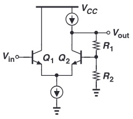

# 장말문제 12.46 — 차동쌍 귀환 증폭기(Fig 12.109)의 폐루프 이득과 I/O 임피던스

## 원문
Assuming $V_A = \infty$, determine the closed-loop gain and I/O impedances of the amplifier depicted in Fig. 12.109. (For open-loop calculations, it is helpful to view $Q_1$ and $Q_2$ as a follower and a common-base stage, respectively.)

## 조건
- 회로: Fig 12.109 — $Q_1$, $Q_2$ 이미터 결합 쌍(꼬리 전류원), $Q_2$ 컬렉터는 이상적 전류원 부하로 $V_{out}$, $V_{out}$과 접지 사이 $R_1$·$R_2$ 분압기의 가운데 노드가 $Q_2$ 베이스 (괄호 안 회로 설명은 원문에 없음)
- $V_A = \infty$
- 개루프 계산에서는 $Q_1$을 폴로어, $Q_2$를 공통 베이스 단으로 보면 도움이 됨 (원문의 메모)
- 소자 값은 주어지지 않음 (답은 기호로) (원문에 없음)

## 구할 것
- 폐루프 이득
- 폐루프 입력·출력 임피던스

## 회로 — Fig 12.109
```spice
Q1   VCC   Vin   n1    npn
Q2   Vout  n2    n1    npn   ; 좌우 반전 (베이스 오른쪽)
I1   VCC   Vout              ; 라벨·값 없음
I2   n1    0                 ; 라벨·값 없음 (꼬리 전류원)
R1   Vout  n2    {R_1}
R2   n2    0     {R_2}
```
- 단자: VCC = 전원, 값 미지정 (가로 레일) / Vin = 입력 (개방 원) / Vout = 출력 (개방 원)
- 표시: 노드 라벨 V_CC (레일 오른쪽 끝), V_in (입력 원 왼쪽), V_out (출력 원 오른쪽) / 소자 라벨 Q1 (Q1 오른쪽), Q2 (Q2 왼쪽), R_1, R_2 (각 저항 오른쪽), I1, I2 (라벨 없음) / 부호 없음 / 화살표 없음 / 수치·면적 라벨 없음
- 배치: 맨 위 가로 레일 V_CC, 레일 왼쪽 끝에서 세로선이 곧장 Q1 컬렉터로, 레일 오른쪽 부근에서 전류원 I1(화살표 아래)이 매달림 / Q1 npn 보통 방향(베이스 왼쪽), V_in 원 → 가로선 → Q1 베이스 / Q2 npn 좌우 반전(베이스 막대 오른쪽, 컬렉터 위, 이미터 왼쪽 아래·화살표 바깥) / 두 이미터 → 각각 아래로 내려와 가운데로 꺾여 만나는 꼬리 접속점 → 아래로 전류원 I2(화살표 아래) → 접지 / I1 아래 접속점 → 아래로 Q2 컬렉터, 접속점에서 가로선이 오른쪽으로 R_1 위 접속점을 지나 V_out 원 / 오른쪽 세로줄 위→아래 R_1, 가운데 접속점, R_2, 접지 / 가운데 접속점에서 가로선이 왼쪽으로 Q2 베이스 / 접속점 (세 갈래 이상, 4곳): ① I1 아래 = 위 I1 + 아래 Q2 컬렉터 + 오른쪽 가로선 (점) ② R_1 위 = 왼쪽 가로선 + 오른쪽 V_out 원 + 아래 R_1 (점) ③ R_1·R_2 사이 = 위 R_1 + 아래 R_2 + 왼쪽 Q2 베이스 선 (점) ④ 꼬리 n1 = 왼쪽 Q1 이미터 + 오른쪽 Q2 이미터 + 아래 I2 (점) / 교차: 없음


