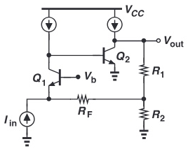

# 장말문제 12.48 — 바이폴라 트랜스임피던스 증폭기(Fig 12.111)에 예제 12.29 반복

## 원문
Repeat Example 12-29 for the bipolar transimpedance amplifier shown in Fig. 12.111. Assume $V_A = \infty$.

## 조건
- 회로: Fig 12.111 — 바이폴라 트랜스임피던스 증폭기: 입력 전류 $I_{in}$이 공통 베이스 $Q_1$(베이스 $V_b$, 이상적 전류원 부하) 이미터로 들어가고, $Q_1$ 컬렉터가 $Q_2$(이상적 전류원 부하, 출력 $V_{out}$)를 구동하며, $V_{out}$과 접지 사이 $R_1$·$R_2$ 분압기의 가운데 노드에서 $R_F$를 거쳐 $Q_1$ 이미터로 귀환 (원문에 없음)
- 예제 12.29를 이 회로로 되풀이 (원문 표기 "Example 12-29")
- 예제 12.29: $R_F$가 매우 크지 않다고 가정할 때 그림 12.58(a)의 회로를 해석하라 — 전압-전류 귀환으로 보고 개루프 트랜스임피던스 $R_0$, $R_{in,open}$, $R_{out,open}$, 귀환율 $K$를 구한 뒤 폐루프 이득 $V_{out}/I_{in}$, $R_{in,closed}$, $R_{out,closed}$를 구함 (원문에 없음)
- 참고 회로 (본문 Fig 12.58(a)): $I_{in}$이 $M_1$ 소스로 들어가고, $M_1$ (게이트 $V_b$, 드레인 X, $R_{D1}$ 부하) → $M_2$ (소스 접지, 드레인 $R_{D2}$ 부하 = $V_{out}$), $V_{out}$에서 $R_F$를 거쳐 $M_1$ 소스로 귀환 (원문에 없음)
- $V_A = \infty$
- 소자 값은 주어지지 않음 (답은 기호로) (원문에 없음)

## 구할 것
- 예제 12.29처럼 개루프 트랜스임피던스·개루프 입력·출력 임피던스, 귀환율, 폐루프 이득 $V_{out}/I_{in}$과 폐루프 입력·출력 임피던스 (원문에 없음, 원문은 "Repeat Example 12-29"만 적음)

## 상속·참조
- 예제 12.29 (E12.29, 교재 693–695쪽): "$R_F$가 매우 크지 않다고 가정할 때 그림 12.58(a)의 회로를 해석하라."
  - 그림 12.58(a) (크롭 안 함): $R_{D1}$ $V_{DD}$–X, $M_1$ (D = X, G = $V_b$, S = 입력 노드), $R_{D2}$ $V_{DD}$–$V_{out}$, $M_2$ (D = $V_{out}$, G = X, S = 접지), $R_F$ 입력 노드–$V_{out}$, $I_{in}$ 접지 → 입력 노드, $R_F$ 도선에 전류 화살표 $i_{RF}$
  - 풀이: 전압-전류 귀환 토폴로지라서 그림 12.53(b)와 12.54(b)의 법칙을 따름. 순방향 증폭기는 $M_1$, $R_{D1}$, $M_2$, $R_{D2}$, 귀환 회로망은 $R_F$. 감지 복제의 출력 포트는 단락 (그림 12.58(b)). $I_{in}$이 $R_F$와 $M_1$으로 나뉘므로
  - $V_X = I_{in}\dfrac{R_F R_{D1}}{R_F + \dfrac{1}{g_{m1}}}$ (12.139), $R_0 = V_{out}/I_{in} = (V_X/I_{in})(V_{out}/V_X)$
  - $R_0 = \dfrac{R_F R_{D1}}{R_F + \dfrac{1}{g_{m1}}} \cdot [-g_{m2}(R_{D2} \| R_F)]$ (12.140)
  - $R_{in,open} = \dfrac{1}{g_{m1}} \| R_F$ (12.141), $R_{out,open} = R_{D2} \| R_F$ (12.142)
  - 귀환율은 그림 12.54(b)의 법칙(그림 12.58(c) 테스트 회로)으로 $K = I_2/V_1 = -\dfrac{1}{R_F}$ (12.143–12.144). $R_0$와 $K$가 모두 음이라 루프 이득이 양이고 부귀환임
  - $\left.\dfrac{V_{out}}{I_{in}}\right|_{closed} = \dfrac{R_0}{1 - \dfrac{R_0}{R_F}}$ (12.145), $R_{in,closed} = \dfrac{\dfrac{1}{g_{m1}} \| R_F}{1 - \dfrac{R_0}{R_F}}$ (12.146), $R_{out,closed} = \dfrac{R_{D2} \| R_F}{1 - \dfrac{R_0}{R_F}}$ (12.147)

## 회로 — Fig 12.111
```spice
I1   VCC   n1                ; 라벨·값 없음
Q1   n1    Vb    n2    npn   ; 좌우 반전 (베이스 오른쪽)
I2   VCC   Vout              ; 라벨·값 없음
Q2   Vout  n1    0     npn
R1   Vout  n3    {R_1}
R2   n3    0     {R_2}
RF   n2    n3    {R_F}
Iin  0     n2    {I_in}      ; 화살표 위 (접지 → n2)
```
- 단자: VCC = 전원, 값 미지정 (가로 레일) / Vb = 이상적 DC 바이어스, 값 미지정 (점 단자) / Vout = 출력 (개방 원)
- 표시: 노드 라벨 V_CC (레일 오른쪽 끝), V_b (점 단자 오른쪽), V_out (출력 원 오른쪽) / 소자 라벨 Q1 (Q1 왼쪽), Q2 (Q2 오른쪽), R_1, R_2 (각 저항 오른쪽), R_F (가로 저항 아래), I_in (전류원 왼쪽), I1, I2 (라벨 없음) / 부호 없음 / 화살표 없음 / 수치·면적 라벨 없음
- 배치: 맨 위 가로 레일 V_CC, 레일 왼쪽 끝에서 전류원 I1, 오른쪽 끝 부근에서 전류원 I2가 세로로 매달림 (둘 다 화살표 아래) / I1 아래 접속점 → 아래로 Q1 컬렉터, 접속점에서 가로선이 오른쪽으로 Q2 베이스 / Q1 npn 좌우 반전(베이스 막대 오른쪽, 컬렉터 위, 이미터 왼쪽 아래·화살표 바깥), Q1 베이스 → 가로선 → 오른쪽 V_b 점 단자 / Q1 이미터 → 아래로 n2 접속점 / Q2 npn 보통 방향, 컬렉터 위 → I2 아래 접속점, 이미터 아래 접지 / I2 아래 접속점에서 가로선이 오른쪽으로 R_1 위 접속점을 지나 V_out 원 / 오른쪽 세로줄 위→아래 R_1, n3 접속점, R_2, 접지 / n2 접속점에서 가로 R_F가 오른쪽으로 n3 접속점 / 맨 왼쪽 아래 전류원 I_in(화살표 위), 그 아래 접지, 위 끝에서 위로 올라가 오른쪽으로 꺾여 n2 접속점 / 접속점 (세 갈래 이상, 5곳): ① I1 아래 = 위 I1 + 아래 Q1 컬렉터 + 오른쪽 Q2 베이스 선 (점) ② I2 아래 = 위 I2 + 아래 Q2 컬렉터 + 오른쪽 가로선 (점) ③ R_1 위 = 왼쪽 가로선 + 오른쪽 V_out 원 + 아래 R_1 (점) ④ n2 = 위 Q1 이미터 + 왼쪽 I_in 선 + 오른쪽 R_F (점) ⑤ n3 = 위 R_1 + 아래 R_2 + 왼쪽 R_F (점) / 교차: 없음


