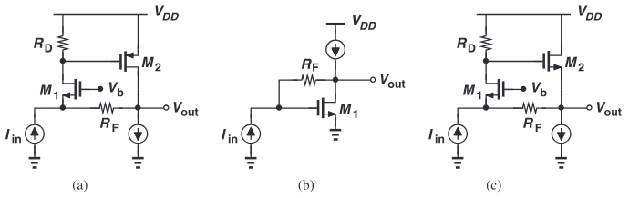

# 장말문제 12.51 — 세 트랜스임피던스 회로(Fig 12.114)의 폐루프 이득과 I/O 임피던스, 귀환 회로망 부하 효과 포함

## 원문
Determine the closed-loop gain and I/O impedances of the circuits shown in Fig. 12.114, including the loading effects of each feedback network. Assume $\lambda = 0$.

## 조건
- 회로: Fig 12.114 (a)–(c) — 세 회로 모두 입력 전류 $I_{in}$을 받고 $R_F$로 $V_{out}$에서 입력 노드로 귀환 (원문에 없음)
- 각 귀환 회로망의 부하 효과를 포함해서 구함
- $\lambda = 0$
- 소자 값은 주어지지 않음 (답은 기호로) (원문에 없음)

## 구할 것
- (a)–(c) 각 회로의 폐루프 이득
- (a)–(c) 각 회로의 폐루프 입력·출력 임피던스

## 회로 — Fig 12.114(a)
```spice
RD   VDD   n1    {R_D}
M2   Vout  n1    VDD   pmos
M1   n1    Vb    n2    nmos  ; 좌우 반전 (게이트 오른쪽)
RF   n2    Vout  {R_F}
Iin  0     n2    {I_in}      ; 화살표 위 (접지 → n2)
I1   Vout  0                 ; 라벨·값 없음
```
- 단자: VDD = 전원, 값 미지정 (가로 레일) / Vb = 이상적 DC 바이어스, 값 미지정 (점 단자) / Vout = 출력 (개방 원)
- 표시: 노드 라벨 V_DD (레일 오른쪽 끝), V_b (점 단자 오른쪽), V_out (출력 원 오른쪽) / 소자 라벨 R_D (저항 왼쪽), M2 (M2 오른쪽), M1 (M1 왼쪽), R_F (가로 저항 아래), I_in (전류원 왼쪽), I1 (라벨 없음) / 부호 없음 / 화살표 없음 / 수치·면적 라벨 없음
- 배치: 맨 위 가로 레일 V_DD, 레일 왼쪽 끝에서 R_D, 오른쪽 끝에서 세로선이 M2 소스로 / M2 PMOS(게이트 왼쪽, 소스 위 → 레일, 소스 화살표는 게이트 쪽을 향함, 드레인 아래) / R_D 아래 접속점 → 아래로 M1 드레인, 접속점에서 가로선이 오른쪽으로 M2 게이트 / M1 NMOS 좌우 반전(게이트 오른쪽, 드레인 위, 소스 아래·화살표 바깥 왼쪽), M1 게이트 → 가로선 → 오른쪽 V_b 점 단자 / M1 소스 → 아래로 n2 접속점 / n2 접속점에서 가로 R_F가 오른쪽으로 V_out 접속점 / M2 드레인 → 길게 아래로 V_out 접속점 → 아래로 전류원 I1(화살표 아래) → 접지, V_out 접속점에서 오른쪽 가로선 → V_out 원 / 맨 왼쪽 전류원 I_in(화살표 위), 그 아래 접지, 위 끝에서 위로 올라가 오른쪽으로 꺾여 n2 접속점 / 접속점 (세 갈래 이상, 3곳): ① n1 = 위 R_D + 아래 M1 드레인 + 오른쪽 M2 게이트 선 (점) ② n2 = 위 M1 소스 + 왼쪽 I_in 선 + 오른쪽 R_F (점) ③ V_out = 위 M2 드레인 + 왼쪽 R_F + 아래 I1 + 오른쪽 V_out 원 (점) / 교차: 없음

## 회로 — Fig 12.114(b)
```spice
I1   VDD   Vout              ; 라벨·값 없음
M1   Vout  n1    0     nmos
RF   n1    Vout  {R_F}
Iin  0     n1    {I_in}      ; 화살표 위 (접지 → n1)
```
- 단자: VDD = 전원, 값 미지정 (T 전원 기호) / Vout = 출력 (개방 원)
- 표시: 노드 라벨 V_DD (T 기호 오른쪽), V_out (출력 원 오른쪽) / 소자 라벨 R_F (가로 저항 위), M1 (M1 오른쪽, 소스 옆), I_in (전류원 왼쪽), I1 (라벨 없음) / 부호 없음 / 화살표 없음 / 수치·면적 라벨 없음
- 배치: 오른쪽 세로줄 위→아래 V_DD T 기호, 전류원 I1(화살표 아래), V_out 접속점, M1, 접지 / M1 NMOS 보통 방향(게이트 왼쪽, 드레인 위, 소스 아래 → 접지) / V_out 접속점에서 오른쪽 가로선 → V_out 원, 왼쪽 가로 R_F → 왼쪽 끝에서 아래로 꺾여 게이트 접속점 / 게이트 접속점에서 가로선이 오른쪽으로 M1 게이트, 왼쪽으로 가서 아래로 꺾여 전류원 I_in(화살표 위), 그 아래 접지 / 접속점 (세 갈래 이상, 2곳): ① V_out = 위 I1 + 아래 M1 드레인 + 왼쪽 R_F + 오른쪽 V_out 원 (점) ② n1 = 왼쪽 I_in 선 + 위 R_F 선 + 오른쪽 M1 게이트 (점) / 교차: 없음

## 회로 — Fig 12.114(c)
```spice
RD   VDD   n1    {R_D}
M2   VDD   n1    Vout  nmos
M1   n1    Vb    n2    nmos  ; 좌우 반전 (게이트 오른쪽)
RF   n2    Vout  {R_F}
Iin  0     n2    {I_in}      ; 화살표 위 (접지 → n2)
I1   Vout  0                 ; 라벨·값 없음
```
- 단자: VDD = 전원, 값 미지정 (가로 레일) / Vb = 이상적 DC 바이어스, 값 미지정 (점 단자) / Vout = 출력 (개방 원)
- 표시: 노드 라벨 V_DD (레일 오른쪽 끝), V_b (점 단자 오른쪽), V_out (출력 원 오른쪽) / 소자 라벨 R_D (저항 왼쪽), M2 (M2 오른쪽), M1 (M1 왼쪽), R_F (가로 저항 아래), I_in (전류원 왼쪽), I1 (라벨 없음) / 부호 없음 / 화살표 없음 / 수치·면적 라벨 없음
- 배치: (a)와 같은 모양에서 M2만 NMOS 소스 폴로어로 바뀜 / 맨 위 가로 레일 V_DD, 레일 왼쪽 끝에서 R_D, 오른쪽 끝에서 세로선이 M2 드레인으로 / M2 NMOS(게이트 왼쪽, 드레인 위 → 레일, 소스 아래·화살표 바깥) / R_D 아래 접속점 → 아래로 M1 드레인, 접속점에서 가로선이 오른쪽으로 M2 게이트 / M1 NMOS 좌우 반전(게이트 오른쪽, 드레인 위, 소스 아래·화살표 바깥 왼쪽), M1 게이트 → 가로선 → 오른쪽 V_b 점 단자 / M1 소스 → 아래로 n2 접속점 / n2 접속점에서 가로 R_F가 오른쪽으로 V_out 접속점 / M2 소스 → 길게 아래로 V_out 접속점 → 아래로 전류원 I1(화살표 아래) → 접지, V_out 접속점에서 오른쪽 가로선 → V_out 원 / 맨 왼쪽 전류원 I_in(화살표 위), 그 아래 접지, 위 끝에서 위로 올라가 오른쪽으로 꺾여 n2 접속점 / 접속점 (세 갈래 이상, 3곳): ① n1 = 위 R_D + 아래 M1 드레인 + 오른쪽 M2 게이트 선 (점) ② n2 = 위 M1 소스 + 왼쪽 I_in 선 + 오른쪽 R_F (점) ③ V_out = 위 M2 소스 + 왼쪽 R_F + 아래 I1 + 오른쪽 V_out 원 (점) / 교차: 없음


> 참고: 문제 문장은 교재 725쪽(PDF 43 오른쪽) 맨 아래, 그림 12.114는 다음 쪽인 726쪽(PDF 44 왼쪽) 맨 위에 인쇄됨
