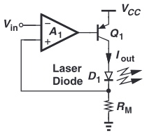

# 장말문제 12.52 — 레이저 다이오드 구동 회로(Fig 12.115)에 예제 12.30 해석 반복

## 원문
The circuit of Fig. 12.99, repeated in Fig. 12.115, employs a value for $R_M$ that is not very small. Assuming $V_A < \infty$ and the diode exhibits an impedance of $R_L$, repeat the analysis of Example 12-30 for this circuit.

## 조건
- 회로: Fig 12.115 (Fig 12.99를 다시 인쇄한 그림)
- 문제 12.35의 설명: 저항 $R_M$이 $D_1$에 흐르는 전류를 감지하고, 증폭기 $A_1$이 그 결과 생기는 전압 강하를 $V_{in}$에서 뺌 (원문에 없음)
- $R_M$은 그다지 작지 않은 값
- $V_A < \infty$
- 레이저 다이오드는 임피던스 $R_L$을 가짐
- 예제 12.30의 해석을 이 회로로 되풀이 (원문 표기 "Example 12-30")
- 예제 12.30: $R_M$이 작지 않고, $r_{O1} < \infty$이고 레이저 다이오드가 임피던스 $R_L$을 갖는다고 가정할 때 그림 12.59(a)의 회로를 해석하라 — 전류-전압 귀환으로 보고 루프를 열어 개루프 이득 $G_m = I_{out}/V_{in}$, 개루프 출력 임피던스, 귀환율 $K = R_M$을 구한 뒤 폐루프 이득 $I_{out}/V_{in}|_{closed} = G_m/(1 + R_M G_m)$, $R_{in,closed}$, $R_{out,closed}$를 구함. 개루프 회로에서 귀환 회로망 $R_M$은 출력 쪽(감지 복제)과 입력 쪽(반송 복제) 모두 개방 포트로 남김 (원문에 없음)
- 소자 값은 주어지지 않음 (답은 기호로) (원문에 없음)

## 구할 것
- 예제 12.30처럼 개루프 이득, 개루프 출력 임피던스, 귀환율, 폐루프 이득과 폐루프 입력·출력 임피던스 (원문에 없음, 원문은 "repeat the analysis of Example 12-30"만 적음)

## 상속·참조
- 문제 12.35 (P12.35, 교재 723쪽): Fig 12.99를 처음 보여 준 문제. "레이저 다이오드"는 전류를 빛으로 바꾸며, 이 회로는 레이저 다이오드에 정해진 전류를 공급함. 저항 $R_M$이 $D_1$에 흐르는 전류를 감지하고 증폭기 $A_1$이 그 전압 강하를 $V_{in}$에서 뺌. 문제 12.35는 $R_M$이 매우 작고 $V_A = \infty$라고 가정했음
- 예제 12.30 (E12.30, 교재 695–696쪽): "$R_M$이 작지 않고, $r_{O1} < \infty$이고 레이저 다이오드가 임피던스 $R_L$을 갖는다고 가정할 때 그림 12.59(a)의 회로를 해석하라."
  - 그림 12.59(a) (이 파일의 그림 목록에는 넣지 않음, 크롭은 fig12-59-a.png): $M_3$–$M_6$ 차동 증폭기(입력 $V_{in}$은 $M_3$ 게이트, $M_5$–$M_6$ 전류 거울 부하, 꼬리 전류 $I_{SS}$)의 출력 X가 PMOS $M_1$ 게이트를 구동, $M_1$ 드레인에서 $I_{out}$이 "Laser" 상자를 지나 $R_M$으로 흘러 접지, Laser와 $R_M$ 사이 노드가 $M_4$ 게이트로 귀환
  - 풀이: 전류-전압 귀환. 순방향 증폭기는 $M_1$과 $M_3$–$M_6$, 귀환 회로망은 $R_M$. 개루프 회로는 귀환 회로망의 두 복제(감지 복제의 출력 포트와 반송 복제의 입력 포트가 개방)를 포함
  - 개루프 이득 $G_m = I_{out}/V_{in} = (V_X/V_{in})(I_{out}/V_X)$, $V_X/V_{in} = -g_{m3}(r_{O3} \| r_{O5})$ (12.148)
  - $M_1$이 만든 전류는 $r_{O1}$과 $R_L + R_M$으로 나뉨: $I_{out} = -\dfrac{r_{O1}}{r_{O1} + R_L + R_M} g_{m1} V_X$ (12.149)
  - $G_m = \dfrac{g_{m3}(r_{O3} \| r_{O5}) g_{m1} r_{O1}}{r_{O1} + R_L + R_M}$ (12.150)
  - 출력 임피던스는 $R_L$ 대신 테스트 전압원을 넣어 구함(그림 12.59(c)): $V_X$ 위·아래에서 본 임피던스가 각각 $r_{O1}$, $R_M$이므로 $V_X/I_X = r_{O1} + R_M$ (12.151)–(12.152) (본문은 이 값을 $R_{in,open}$으로 적음)
  - 귀환율 $K = V_2/I_1 = R_M$ (12.153)–(12.154)
  - $\left.\dfrac{I_{out}}{V_{in}}\right|_{closed} = \dfrac{G_m}{1 + R_M G_m}$ (12.155), $R_{in,closed} = \infty$ (12.156), $R_{out,closed} = (r_{O1} + R_M)(1 + R_M G_m)$ (12.157)

## 회로 — Fig 12.115
```spice
XA1  n2    Vin   n1   opamp   ; in+ = n2 (아래 + 입력), in- = Vin (위 − 입력)
Q1   n3    n1    VCC  pnp
D1   n3    n2    laser        ; 인쇄 라벨 "Laser Diode D1"
RM   n2    0     {R_M}
```
- 단자: Vin = 입력 (개방 원) / VCC = 전원, 값 미지정 (T 전원 기호)
- 표시: 노드 라벨 V_in (입력 원 왼쪽), V_CC (T 기호 오른쪽) / 소자 라벨 A1 (삼각형 안), Q1 (Q1 오른쪽), D1 (다이오드 왼쪽), "Laser Diode" (D1 왼쪽, 두 줄), R_M (저항 오른쪽) / 부호 A1 입력 − (위), + (아래) / 화살표 "I_out": Q1 컬렉터와 D1 사이 세로 도선, 아래 방향, 도선 위 / 수치·면적 라벨 없음
- 배치: 왼쪽에 증폭기 A1 삼각형(오른쪽을 향함), V_in 원 → 가로선 → 위 − 입력 / A1 출력 → 가로선 → 오른쪽 Q1 베이스 / Q1 PNP 보통 방향(베이스 왼쪽), 이미터 위 → V_CC T 기호, 컬렉터 아래 / 오른쪽 세로줄 위→아래 Q1, I_out 화살표, D1(애노드 위, 캐소드 아래, 오른쪽에 빛 화살표 두 개), 접속점, R_M, 접지 / A1 + 입력에서 가로선이 왼쪽으로 나가 아래로 꺾여 내려간 뒤 오른쪽으로 꺾여 D1 아래 접속점으로 / 접속점 (세 갈래 이상, 1곳): ① D1 아래 = 위 D1 + 아래 R_M + 왼쪽 귀환선 (점) / 교차: 없음


