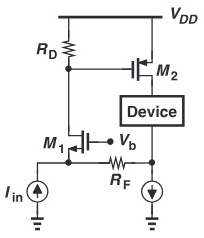

# 장말문제 12.53 — R_M을 전류원으로 바꾼 회로(Fig 12.116)에 예제 12.32 반복

## 원문
Repeat Example 12-32 for the circuit shown in Fig. 12.116. Note that $R_M$ is replaced with a current source but the analysis proceeds in a similar manner.

## 조건
- 회로: Fig 12.116
- 예제 12.32를 이 회로로 되풀이 (원문 표기 "Example 12-32")
- 예제 12.32: $R_F$가 크지 않고, $R_M$이 작지 않으며, 레이저 다이오드가 저항 $R_L$에 의해 모델링될 때 그림 12.61(a)의 회로를 해석하라. 역시 $r_{O2} < \infty$라고 가정하라 — 전류-전류 귀환으로 보고 루프를 열어 개루프 이득 $A_{I,open}$, $R_{in,open}$, $R_{out,open}$, 귀환율 $K = I_2/I_1$을 구한 뒤 폐루프 이득 $A_{I,closed}$, $R_{in,closed}$, $R_{out,closed}$를 구함. 귀환 회로망($R_F$, $R_M$)은 전류를 입력에 반송하므로 감지 복제의 출력 포트는 단락 (원문에 없음)
- 참고 회로 (본문 Fig 12.61(a)): $R_D$가 $V_{DD}$–X, $M_1$ (D = X, G = $V_b$, S = 입력 노드), $I_{in}$이 입력 노드로 들어감, PMOS $M_2$ (S = $V_{DD}$, G = X, D → "Laser" 상자), Laser 아래 노드 P–$R_M$–접지, 입력 노드–$R_F$–P (원문에 없음)
- Fig 12.116은 예제 12.32 회로의 $R_M$ 자리에 전류원이 있고 "Laser" 대신 "Device" 상자가 그려진 회로 (원문에 없음)
- 예제 12.32의 가정 $R_F$가 크지 않음, $r_{O2} < \infty$, 부하(레이저 다이오드)를 저항 $R_L$로 모델링을 이어받음 (원문에 없음)
- 소자 값은 주어지지 않음 (답은 기호로) (원문에 없음)
- $R_M$이 전류원으로 바뀌었지만 해석은 비슷한 방식으로 진행됨 (원문의 메모)

## 구할 것
- 예제 12.32처럼 개루프 이득·개루프 입력·출력 임피던스, 귀환율, 폐루프 이득과 폐루프 입력·출력 임피던스 (원문에 없음, 원문은 "Repeat Example 12-32"만 적음)

## 상속·참조
- 예제 12.32 (E12.32, 교재 698–699쪽): "$R_F$가 크지 않고, $R_M$이 작지 않으며, 레이저 다이오드가 저항 $R_L$에 의해 모델링될 때 그림 12.61(a)의 회로를 해석하라. 역시 $r_{O2} < \infty$라고 가정하라."
  - 그림 12.61(a) (이 파일의 그림 목록에는 넣지 않음, 크롭은 fig12-61-a.png): `RD: VDD — X`, `M1: D = X, G = Vb, S = 입력 노드`, `Iin: 접지 → 입력 노드`, `M2 (PMOS): S = VDD, G = X, D = Laser 위`, `Laser: M2 드레인 — P`, `RF: 입력 노드 — P` (화살표 "I_F"), `RM: P — 0`, $I_{out}$은 $M_2$에서 Laser로 아래 방향
  - 풀이: 전류-전류 귀환. 순방향 시스템은 $M_1$, $R_D$, $M_2$, 귀환 회로망은 $R_M$과 $R_F$. 루프는 그림 12.61(b)처럼 열고, 귀환 회로망이 전류를 입력에 반송하므로 감지 복제의 출력 포트는 단락. 개루프 이득은 $(V_X/I_{in})(I_{out}/V_X)$
  - $A_{I,open} = \dfrac{(R_F + R_M)R_D}{R_F + R_M + \dfrac{1}{g_{m1}}} \cdot \dfrac{-g_{m2} r_{O2}}{r_{O2} + R_L + R_M \| R_F}$ (12.166) — 두 분수는 $I_{in}$이 $R_F + R_M$과 $M_1$으로 나뉘는 것을 나타냄
  - $R_{in,open} = \dfrac{1}{g_{m1}} \| (R_F + R_M)$ (12.167), $R_{out,open} = r_{O2} + R_F \| R_M$ (12.168) (후자는 그림 12.59(c)와 비슷한 방법)
  - 귀환율 (그림 12.61(c), 그림 12.54(c)의 법칙): $K = I_2/I_1 = -\dfrac{R_M}{R_M + R_F}$ (12.169)–(12.170)
  - $A_{I,closed} = \dfrac{A_{I,open}}{1 - \dfrac{R_M}{R_M + R_F} A_{I,open}}$ (12.171), $R_{in,closed} = \dfrac{\dfrac{1}{g_{m1}} \| (R_F + R_M)}{1 - \dfrac{R_M}{R_M + R_F} A_{I,open}}$ (12.172), $R_{out,closed} = (r_{O2} + R_F \| R_M)\left(1 - \dfrac{R_M}{R_M + R_F} A_{I,open}\right)$ (12.173)

## 회로 — Fig 12.116
```spice
RD   VDD  n1   {R_D}
M2   n3   n1   VDD   pmos
M1   n1   Vb   n2    nmos
XD   n3   n4   box "Device"   ; 상자로 그려진 소자 (예제 12.32의 레이저 다이오드 자리)
RF   n2   n4   {R_F}
IIN  0    n2   {I_in}
I1   n4   0                   ; 라벨·값 없음
```
- 단자: VDD = 전원, 값 미지정 (가로 레일) / Vb = 바이어스 전압 (점 단자)
- 표시: 노드 라벨 V_DD (레일 오른쪽 끝), V_b (점 단자 오른쪽) / 소자 라벨 R_D (저항 왼쪽), M2 (M2 오른쪽), "Device" (상자 안), M1 (M1 왼쪽), R_F (저항 아래), I_in (전류원 왼쪽), I1 (라벨 없음) / 부호 없음 / 화살표 없음 / 수치·면적 라벨 없음
- 배치: 맨 위 가로 레일 V_DD / 왼쪽 세로줄 위→아래 R_D, 접속점, M1 드레인 / R_D 아래 접속점에서 가로선이 오른쪽으로 M2 게이트 / M2 PMOS 보통 방향(게이트 왼쪽, 소스 위 → 레일 오른쪽 끝), 드레인 아래 → Device 상자 위 / 오른쪽 세로줄 위→아래 M2, Device 상자, 접속점, 전류원(화살표 아래), 접지 / M1 NMOS 좌우 반전(게이트 오른쪽 → V_b 점 단자, 드레인 위, 소스 아래) / M1 소스 아래 접속점에서 가로선이 왼쪽으로 꺾여 I_in 전류원(화살표 위) 위로, 아래 접지 / M1 소스 아래 접속점 → 가로선 → R_F → Device 아래 접속점 / 접속점 (세 갈래 이상, 3곳): ① R_D 아래 = 위 R_D + 아래 M1 드레인 + 오른쪽 M2 게이트 선 (점) ② M1 소스 아래 = 위 M1 소스 + 왼쪽 I_in 선 + 오른쪽 R_F (점) ③ Device 아래 = 위 Device + 아래 전류원 + 왼쪽 R_F (점) / 교차: 없음


