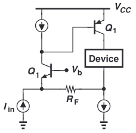

# 장말문제 12.54 — 바이폴라 공통 베이스 입력 회로(Fig 12.117)에 문제 12.53 반복

## 원문
Repeat Problem 12.53 for the circuit illustrated in Fig. 12.117. Assume $V_A = \infty$.

## 조건
- 회로: Fig 12.117
- 문제 12.53을 이 회로로 되풀이
- 문제 12.53에서 이어받는 요구: 예제 12.32의 해석(전류-전류 귀환으로 보고 루프를 열어 개루프 이득, 개루프 입력·출력 임피던스, 귀환율을 구한 뒤 폐루프 이득과 폐루프 입력·출력 임피던스를 구함)을 되풀이. $R_M$ 자리에 전류원이 있어도 해석은 비슷한 방식으로 진행 (원문에 없음)
- 문제 12.53에서 이어받는 가정: 예제 12.32처럼 $R_F$가 크지 않고, "Device" 상자(레이저 다이오드)를 저항 $R_L$로 모델링 (원문에 없음)
- 예제 12.32의 결과 (참고 회로 Fig 12.61(a), $R_M$ 귀환): $A_{I,open} = \dfrac{(R_F + R_M)R_D}{R_F + R_M + 1/g_{m1}} \cdot \dfrac{-g_{m2} r_{O2}}{r_{O2} + R_L + R_M \| R_F}$, $K = -\dfrac{R_M}{R_M + R_F}$, $A_{I,closed} = \dfrac{A_{I,open}}{1 - \frac{R_M}{R_M + R_F} A_{I,open}}$ (본문 식 12.166, 12.170, 12.171, 원문에 없음)
- $V_A = \infty$
- 그림의 두 트랜지스터에 같은 라벨 "Q1"이 인쇄됨
- 두 트랜지스터에 같은 라벨 Q1은 문맥과 맞지 않음(오식으로 보임), 넷리스트에서는 아래 npn을 Q1A, 위 pnp를 Q1B로 구분함 (원문에 없음)
- 소자 값은 주어지지 않음 (답은 기호로) (원문에 없음)

## 구할 것
- 문제 12.53(예제 12.32)처럼 개루프 이득·개루프 입력·출력 임피던스, 귀환율, 폐루프 이득과 폐루프 입력·출력 임피던스 (원문에 없음, 원문은 "Repeat Problem 12.53"만 적음)

## 상속·참조
- 문제 12.53 (P12.53): "Repeat Example 12-32 for the circuit shown in Fig. 12.116. Note that $R_M$ is replaced with a current source but the analysis proceeds in a similar manner." Fig 12.116은 MOS 회로: $R_D$ ($V_{DD}$–X), $M_1$ 공통 게이트 (D = X, G = $V_b$, S = 입력 노드), PMOS $M_2$ (S = $V_{DD}$, G = X, D → "Device" 상자), Device 아래 노드 → 전류원 → 접지, 입력 노드–$R_F$–Device 아래 노드, $I_{in}$이 입력 노드로 들어감
- 예제 12.32 (E12.32, 교재 698–699쪽): "$R_F$가 크지 않고, $R_M$이 작지 않으며, 레이저 다이오드가 저항 $R_L$에 의해 모델링될 때 그림 12.61(a)의 회로를 해석하라. 역시 $r_{O2} < \infty$라고 가정하라."
  - 그림 12.61(a) (크롭 안 함): Fig 12.116에서 아래 전류원 대신 $R_M$ (P–접지), Device 대신 "Laser" 상자
  - 풀이: 전류-전류 귀환, 순방향 시스템 $M_1$, $R_D$, $M_2$, 귀환 회로망 $R_M$, $R_F$. 감지 복제의 출력 포트는 단락
  - $A_{I,open} = \dfrac{(R_F + R_M)R_D}{R_F + R_M + \dfrac{1}{g_{m1}}} \cdot \dfrac{-g_{m2} r_{O2}}{r_{O2} + R_L + R_M \| R_F}$ (12.166), $R_{in,open} = \dfrac{1}{g_{m1}} \| (R_F + R_M)$ (12.167), $R_{out,open} = r_{O2} + R_F \| R_M$ (12.168)
  - $K = I_2/I_1 = -\dfrac{R_M}{R_M + R_F}$ (12.169)–(12.170)
  - $A_{I,closed} = \dfrac{A_{I,open}}{1 - \dfrac{R_M}{R_M + R_F} A_{I,open}}$ (12.171), $R_{in,closed} = \dfrac{\dfrac{1}{g_{m1}} \| (R_F + R_M)}{1 - \dfrac{R_M}{R_M + R_F} A_{I,open}}$ (12.172), $R_{out,closed} = (r_{O2} + R_F \| R_M)\left(1 - \dfrac{R_M}{R_M + R_F} A_{I,open}\right)$ (12.173)

## 회로 — Fig 12.117
```spice
I1   VCC  n1                  ; 라벨·값 없음
Q1A  n1   Vb   n2   npn       ; 인쇄 라벨 Q1 (아래쪽)
Q1B  n3   n1   VCC  pnp       ; 인쇄 라벨 Q1 (위쪽, 같은 라벨이 두 번 인쇄됨)
XD   n3   n4   box "Device"   ; 레이저 다이오드 (상자로 그려짐)
RF   n2   n4   {R_F}
IIN  0    n2   {I_in}
I2   n4   0                   ; 라벨·값 없음
```
- 단자: VCC = 전원, 값 미지정 (가로 레일) / Vb = 바이어스 전압 (점 단자)
- 표시: 노드 라벨 V_CC (레일 오른쪽 끝), V_b (점 단자 오른쪽) / 소자 라벨 Q1 (위 pnp 오른쪽), "Device" (상자 안), Q1 (아래 npn 왼쪽), R_F (저항 아래), I_in (전류원 왼쪽), I1, I2 (라벨 없음) / 부호 없음 / 화살표 없음 / 수치·면적 라벨 없음
- 배치: 맨 위 가로 레일 V_CC / 왼쪽 세로줄 위→아래 전류원 I1(화살표 아래), 접속점, Q1A 컬렉터 / I1 아래 접속점에서 가로선이 오른쪽으로 가다 위로 꺾여 올라간 뒤 다시 오른쪽으로 꺾여 Q1B 베이스 / Q1B PNP 보통 방향(베이스 왼쪽, 이미터 위 → 레일, 컬렉터 아래) / 오른쪽 세로줄 위→아래 Q1B, Device 상자, 접속점, 전류원 I2(화살표 아래), 접지 / Q1A NPN 좌우 반전(베이스 오른쪽 → V_b 점 단자, 컬렉터 위, 이미터 왼쪽 아래) / Q1A 이미터 아래 접속점에서 가로선이 왼쪽으로 꺾여 I_in 전류원(화살표 위) 위로, 아래 접지 / Q1A 이미터 아래 접속점 → 가로선 → R_F → Device 아래 접속점 / 접속점 (세 갈래 이상, 3곳): ① I1 아래 = 위 I1 + 아래 Q1A 컬렉터 + 오른쪽 Q1B 베이스 선 (점) ② Q1A 이미터 아래 = 위 Q1A 이미터 + 왼쪽 I_in 선 + 오른쪽 R_F (점) ③ Device 아래 = 위 Device + 아래 I2 + 왼쪽 R_F (점) / 교차: 없음


