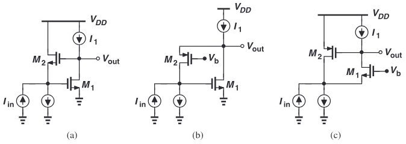

# 장말문제 12.56 — 세 귀환 단(Fig 12.119)의 폐루프 이득과 I/O 임피던스

## 원문
Compute the closed-loop gain and I/O impedances of the stages illustrated in Fig. 12.119.

## 조건
- 회로: Fig 12.119 (a), (b), (c) 세 단. 입력은 전류 $I_{in}$, 출력은 $V_{out}$
- 소자 값과 $\lambda$는 주어지지 않음 (답은 기호로) (원문에 없음)

## 구할 것
- (a), (b), (c) 각 단의 폐루프 이득 $V_{out}/I_{in}$ (이득의 형태는 원문에 없음)
- (a), (b), (c) 각 단의 폐루프 입력 임피던스와 출력 임피던스

## 회로 — Fig 12.119(a)
```spice
I1   VDD   Vout   {I_1}
M2   VDD   Vout   n1   nmos
M1   Vout  n1     0    nmos
IIN  0     n1     {I_in}
I2   n1    0                 ; 라벨·값 없음
```
- 단자: VDD = 전원, 값 미지정 (가로 레일) / Vout = 출력 (개방 원)
- 표시: 노드 라벨 V_DD (레일 오른쪽 끝), V_out (출력 원 오른쪽) / 소자 라벨 I1 (전류원 오른쪽), M2 (M2 왼쪽), M1 (M1 오른쪽), I_in (전류원 왼쪽), I2 (라벨 없음) / 부호 없음 / 화살표 없음 / 수치·면적 라벨 없음
- 배치: 맨 위 가로 레일 V_DD / 오른쪽 세로줄 위→아래 I1(화살표 아래), V_out 접속점, M1 드레인, M1 소스 아래 접지 / M2 NMOS 좌우 반전(게이트 오른쪽, 드레인 위 → 레일 왼쪽 끝, 소스 아래) / V_out 접속점에서 가로선이 왼쪽으로 M2 게이트, 오른쪽으로 V_out 원 / M2 소스 아래 접속점 → 오른쪽 가로선 → M1 게이트 (M1 NMOS 보통 방향, 게이트 왼쪽) / M2 소스 아래 접속점에서 가로선이 왼쪽으로 가 아래로 꺾여 I_in 전류원(화살표 위, 아래 접지), 접속점 바로 아래로 전류원 I2(화살표 아래, 아래 접지) / 접속점 (세 갈래 이상, 2곳): ① V_out = 위 I1 + 아래 M1 드레인 + 왼쪽 M2 게이트 선 + 오른쪽 V_out 원 (점) ② M2 소스 아래 = 위 M2 소스 + 왼쪽 I_in 선 + 아래 I2 + 오른쪽 M1 게이트 선 (점) / 교차: 없음

## 회로 — Fig 12.119(b)
```spice
I1   VDD   Vout   {I_1}
M2   n1    Vb     Vout  pmos
M1   Vout  n1     0     nmos
IIN  0     n1     {I_in}
I2   n1    0                  ; 라벨·값 없음
```
- 단자: VDD = 전원, 값 미지정 (T 전원 기호) / Vout = 출력 (개방 원) / Vb = 바이어스 전압 (점 단자)
- 표시: 노드 라벨 V_DD (T 기호 오른쪽), V_out (출력 원 오른쪽), V_b (점 단자 오른쪽) / 소자 라벨 I1 (전류원 오른쪽), M2 (M2 왼쪽), M1 (M1 오른쪽), I_in (전류원 왼쪽), I2 (라벨 없음) / 부호 없음 / 화살표 없음 / 수치·면적 라벨 없음
- 배치: 맨 위 V_DD T 기호 / 오른쪽 세로줄 위→아래 I1(화살표 아래), V_out 접속점, M1 드레인, M1 소스 아래 접지 / V_out 접속점에서 가로선이 왼쪽으로 가 아래로 꺾여 M2 소스(위)로, 오른쪽으로 V_out 원 / M2 PMOS 좌우 반전(게이트 오른쪽 → V_b 점 단자, 소스 위, 드레인 아래) / M2 드레인 아래 접속점 → 오른쪽 가로선 → M1 게이트 (M1 NMOS 보통 방향, 게이트 왼쪽) / M2 드레인 아래 접속점에서 가로선이 왼쪽으로 가 아래로 꺾여 I_in 전류원(화살표 위, 아래 접지), 접속점 바로 아래로 전류원 I2(화살표 아래, 아래 접지) / 접속점 (세 갈래 이상, 2곳): ① V_out = 위 I1 + 아래 M1 드레인 + 왼쪽 M2 소스 선 + 오른쪽 V_out 원 (점) ② M2 드레인 아래 = 위 M2 드레인 + 왼쪽 I_in 선 + 아래 I2 + 오른쪽 M1 게이트 선 (점) / 교차: 없음

## 회로 — Fig 12.119(c)
```spice
I1   VDD   Vout   {I_1}
M2   n1    Vout   VDD  pmos
M1   Vout  Vb     n1   nmos
IIN  0     n1     {I_in}
I2   n1    0                 ; 라벨·값 없음
```
- 단자: VDD = 전원, 값 미지정 (가로 레일) / Vout = 출력 (개방 원) / Vb = 바이어스 전압 (점 단자)
- 표시: 노드 라벨 V_DD (레일 오른쪽 끝), V_out (출력 원 오른쪽), V_b (점 단자 오른쪽) / 소자 라벨 I1 (전류원 오른쪽), M2 (M2 왼쪽), M1 (M1 왼쪽), I_in (전류원 왼쪽), I2 (라벨 없음) / 부호 없음 / 화살표 없음 / 수치·면적 라벨 없음
- 배치: 맨 위 가로 레일 V_DD / 오른쪽 세로줄 위→아래 I1(화살표 아래), V_out 접속점, M1 드레인 / V_out 접속점에서 가로선이 왼쪽으로 M2 게이트, 오른쪽으로 V_out 원 / M2 PMOS 좌우 반전(게이트 오른쪽, 소스 위 → 레일 왼쪽 끝, 드레인 아래) / M1 NMOS 좌우 반전(게이트 오른쪽 → V_b 점 단자, 드레인 위, 소스 아래) / M2 드레인 아래 접속점에서 가로선이 오른쪽으로 가 위로 꺾여 M1 소스로 / M2 드레인 아래 접속점에서 가로선이 왼쪽으로 가 아래로 꺾여 I_in 전류원(화살표 위, 아래 접지), 접속점 바로 아래로 전류원 I2(화살표 아래, 아래 접지) / 접속점 (세 갈래 이상, 2곳): ① V_out = 위 I1 + 아래 M1 드레인 + 왼쪽 M2 게이트 선 + 오른쪽 V_out 원 (점) ② M2 드레인 아래 = 위 M2 드레인 + 왼쪽 I_in 선 + 아래 I2 + 오른쪽 M1 소스 선 (점) / 교차: 없음


> 참고: 문제 문장은 교재 726쪽, 그림 12.119는 727쪽 위(같은 PDF 44 오른쪽 쪽)에 인쇄됨
