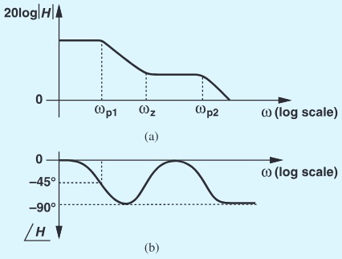

# 장말문제 12.58 — Fig 12.63 보데 선도에서 ω_z가 ω_p1이나 ω_p2에 가까워질 때

## 원문
In the Bode plots of Fig. 12.63, explain qualitatively what happens as $\omega_z$ comes closer to $\omega_{p1}$ or $\omega_{p2}$.

## 조건
- Fig 12.63의 보데 선도: 극점 $\omega_{p1}$, 영점 $\omega_z$, 극점 $\omega_{p2}$가 이 순서로 놓인 증폭기의 (a) 크기 특성 $20\log|H|$와 (b) 위상 응답 $\angle H$
- 예제 12.34의 가정: 극점과 영점 주파수는 $10\omega_{p1} < 0.1\omega_z$와 $10\omega_z < 0.1\omega_{p2}$가 되도록 충분히 떨어져 있음 (본문 가정, 원문에 없음)
- $\omega_z$가 $\omega_{p1}$ 또는 $\omega_{p2}$에 가까워지는 경우를 생각함

## 구할 것
- $\omega_z$가 $\omega_{p1}$ 또는 $\omega_{p2}$에 가까워질 때 보데 선도(크기와 위상)에 일어나는 일을 정성적으로 설명

## 상속·참조
- 그림 12.63 (예제 12.34, 교재 702쪽): 보데 선도 그래프 (회로 그림 아님). (a)는 예제 12.34의 문제 그림, (b)는 예제 12.34 풀이의 답 그림
  - (a) 세로축 "20log|H|", 가로축 "ω (log scale)", 가로축에 "0" 레벨. 곡선은 왼쪽에서 평평하다가 $\omega_{p1}$(점선)에서 꺾여 내려가고, $\omega_z$(점선)에서 다시 평평해지며, $\omega_{p2}$(점선)에서 다시 꺾여 내려가 $\omega_{p2}$ 조금 오른쪽에서 0 레벨에 닿음
  - (b) 세로축 "∠H" (아래 방향), 눈금 "0", "−45°", "−90°"(점선), 가로축 "ω (log scale)". 위상은 0에서 시작해 $\omega_{p1}$에서 $-45°$(점선 표시)를 지나 $-90°$ 근처까지 내려갔다가, 다시 올라가 0 근처까지 돌아온 뒤, 다시 내려가 $-90°$에 접근
- 예제 12.34 (E12.34, 교재 702쪽): "그림 12.63(a)는 증폭기의 크기 특성을 보여 준다. 보데의 규칙을 이용하여 위상 응답을 도시하라." 풀이: 위상은 $0.1\omega_{p1}$에서 내려가기 시작해 $\omega_{p1}$에서 $-45°$, $10\omega_{p1}$에서 $-90°$, $0.1\omega_z$에서 올라가기 시작해 $\omega_z$에서 $-45°$, $10\omega_z$에서 근사적으로 $0°$, 마지막으로 $0.1\omega_{p2}$에서 내려가 $\omega_{p2}$에서 $-45°$, $10\omega_{p2}$에서 $-90°$. 극점과 영점은 $10\omega_{p1} < 0.1\omega_z$, $10\omega_z < 0.1\omega_{p2}$가 되도록 충분히 떨어져 있다고 가정했으며, 이 조건이 성립하지 않으면 더 정확한 계산이 필요함

## 회로 — 없음 (특성 그래프 문제, 그림 12.63은 회로가 아닌 그래프로 상속·참조에 적음)
