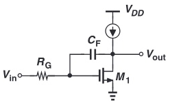

# 장말문제 12.59 — C_F 귀환 공통 소스단(Fig 12.120)의 전달 함수와 보데 선도

## 원문
Assuming $\lambda = 0$ and without using Miller's theorem, determine the transfer function of the circuit depicted in Fig. 12.120 and construct its Bode plots.

## 조건
- 회로: Fig 12.120
- $\lambda = 0$
- 밀러 정리를 쓰지 않음
- 소자 값은 주어지지 않음 (답은 기호로) (원문에 없음)

## 구할 것
- 전달 함수 $V_{out}/V_{in}$ (기호 $V_{out}/V_{in}$은 원문에 없음, 원문은 "the transfer function"만 적음)
- 보데 선도 (크기와 위상)

## 회로 — Fig 12.120
```spice
RG   Vin   n1    {R_G}
CF   n1    Vout  {C_F}
I1   VDD   Vout              ; 라벨·값 없음
M1   Vout  n1    0     nmos
```
- 단자: Vin = 입력 (개방 원) / Vout = 출력 (개방 원) / VDD = 전원, 값 미지정 (T 전원 기호)
- 표시: 노드 라벨 V_in (입력 원 왼쪽), V_out (출력 원 오른쪽), V_DD (T 기호 오른쪽) / 소자 라벨 R_G (저항 위), C_F (커패시터 위), M1 (M1 오른쪽), I1 (라벨 없음) / 부호 없음 / 화살표 없음 / 수치·면적 라벨 없음
- 배치: 맨 위 V_DD T 기호 → 아래로 전류원(화살표 아래) → V_out 접속점 → 아래 M1 드레인, M1 소스 아래 접지 / V_in 원 → 가로선 → R_G → 게이트 접속점 → 오른쪽 M1 게이트 (M1 NMOS 보통 방향, 게이트 왼쪽) / 게이트 접속점에서 선이 위로 올라가 오른쪽으로 꺾여 C_F를 지나 V_out 접속점으로 / V_out 접속점에서 가로선이 오른쪽으로 V_out 원 / 접속점 (세 갈래 이상, 2곳): ① 게이트 = 왼쪽 R_G + 오른쪽 M1 게이트 + 위 C_F 선 (점) ② V_out = 위 전류원 + 아래 M1 드레인 + 왼쪽 C_F 선 + 오른쪽 V_out 원 (점) / 교차: 없음


