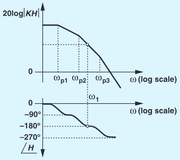

# 장말문제 12.60 — 예제 12.37 시스템에서 K를 줄이면 안정해지는 이유

## 원문
In the system of Example 12-37, we gradually decrease the value of $K$ without changing the position of the poles. Explain why decreasing $K$ can make the system stable?

## 조건
- 시스템: 예제 12.37의 3극점 귀환 시스템 (원문 표기 "Example 12-37")
- 예제 12.37: 3개의 극점을 갖는 귀환 시스템이 그림 12.67에 그려진 주파수 응답을 나타낸다. 이 시스템은 발진하는가? — 풀이 결과: 발진함. 위상이 $-180°$가 되는 $\omega_1$에서 루프 이득 $|KH|$가 1보다 큼 (원문에 없음)
- 극점의 위치는 바꾸지 않고 $K$의 값을 서서히 줄임

## 구할 것
- $K$를 줄이면 시스템이 안정해질 수 있는 이유를 설명

## 상속·참조
- 예제 12.37 (E12.37, 교재 706쪽): "3개의 극점을 갖는 귀환 시스템이 그림 12.67에 그려진 주파수 응답을 나타낸다. 이 시스템은 발진하는가?"
  - 풀이: 그렇다. $\omega_1$에서 루프 이득은 1보다 크다. 그림 12.66의 해석에 따라 한계가 없는 신호의 증가가 계속 일어나며, 루프를 돌 때마다 $\omega_1$에서의 정현파는 $|KH| > 1$인 이득을 경험하고 뺄셈기에 반대의 위상을 반송함
- 그림 12.67 (예제 12.37의 문제 그림, 교재 706쪽): 보데 선도 그래프 (회로 그림 아님)
  - 위: 세로축 "20log|KH|", 가로축 "ω (log scale)", "0" 레벨. 곡선은 왼쪽에서 0 레벨 훨씬 위로 평평하다가 $\omega_{p1}$(점선)에서 꺾여 내려가고, $\omega_{p2}$(점선), $\omega_{p3}$(점선)에서 차례로 더 가파르게 꺾여 $\omega_{p3}$ 오른쪽에서 0 레벨을 지나 아래로 내려감. $\omega_{p2}$와 $\omega_{p3}$ 사이 $\omega_1$에 빈 원 표시가 있고, 그 높이에서 가로 점선이 세로축까지 이어짐 (0 레벨보다 위)
  - 아래: 세로축 "∠H" (아래 방향), 눈금 "0", "−90°", "−180°", "−270°"(각 점선), 가로축 "ω (log scale)". 위상은 0에서 계단 모양으로 $-90°$, $-180°$를 지나 $-270°$에 접근. $\omega_1$의 세로 점선이 위상 곡선과 $-180°$에서 만나는 곳에 빈 원 표시

## 회로 — 없음 (특성 그래프 문제, 그림 12.67은 회로가 아닌 그래프로 상속·참조에 적음)
