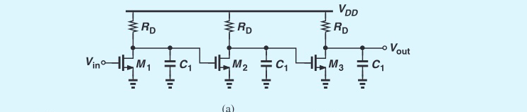

# 장말문제 12.63 — 예제 12.38 3단 증폭기를 K = 0.1로 반복

## 원문
Repeat Example 12-38 for $K = 0.1$.

## 조건
- 회로: 예제 12.38의 3단 증폭기 (Fig 12.69(a)) (그림 번호는 원문에 없음, 원문은 "Example 12-38"만 적음)
- 예제 12.38을 $K = 0.1$로 되풀이 (원문 표기 "Example 12-38")
- 예제 12.38: 그림 12.69(a)의 3단 증폭기에 $K = 1$인 부귀환을 걸려고 한다. 다른 커패시턴스를 무시하고 단이 모두 같다고 가정할 때 회로의 주파수 응답을 그리고 안정성 조건을 결정하라. $\lambda = 0$이라고 가정하라 (원문에 없음)
- 예제 12.38에서 이어받는 가정: 다른 커패시턴스 무시, 세 단이 모두 같음, $\lambda = 0$, 각 단 이득의 음의 부호는 생략 (원문에 없음)
- 식 (12.188): $H(s) = \dfrac{(g_m R_D)^3}{\left(1 + \dfrac{s}{\omega_p}\right)^3}$, $\omega_p = (R_D C_1)^{-1}$ (본문 식, 원문에 없음)
- $K = 0.1$

## 구할 것
- $K = 0.1$일 때 회로의 주파수 응답과 안정성 조건 (원문에 없음, 원문은 "Repeat Example 12-38"만 적음)

## 상속·참조
- 예제 12.38 (E12.38, 교재 707–709쪽): "그림 12.69(a)의 3단 증폭기에 $K = 1$인 부귀환을 걸려고 한다. 다른 커패시턴스를 무시하고 단이 모두 같다고 가정할 때 회로의 주파수 응답을 그리고 안정성 조건을 결정하라. $\lambda = 0$이라고 가정하라."
  - 풀이: 저주파 이득 $(g_m R_D)^3$, 겹친 세 극점 $(R_D C_1)^{-1}$. $|H|$는 $\omega_p = (R_D C_1)^{-1}$에서 60 dB/dec로 떨어지기 시작하고, 위상은 이 주파수의 1/10에서 변하기 시작해 $\omega_p$에서 $-135°$, $10\omega_p$에서 $-270°$에 접근 (그림 12.69(b))
  - 안정하려면 $|KH| (= |H|)$가 위상 교차 주파수에서 1 이하로 떨어져야 함. 그림 12.69(c)처럼 위상 응답에서 $\omega_{PX}$를 찾고 크기 응답의 대응점 P에서 $|H_P| < 1$을 요구
  - $H(s) = \dfrac{(g_m R_D)^3}{\left(1 + \dfrac{s}{\omega_p}\right)^3}$ (12.188), $\angle H(j\omega) = -3\tan^{-1}\dfrac{\omega}{\omega_p}$ (12.189), $\tan^{-1}(\omega/\omega_p) = 60°$에서 위상 교차, $\omega_{PX} = \sqrt{3}\,\omega_p$ (12.190)
  - $\dfrac{(g_m R_D)^3}{\left[\sqrt{1 + \left(\dfrac{\omega_{PX}}{\omega_p}\right)^2}\right]^3} < 1$ (12.191), 따라서 $g_m R_D < 2$ (12.192). 각 단의 저주파 이득이 2를 넘으면 $K = 1$인 귀환 루프는 불안정

## 회로 — Fig 12.69(a)
```spice
RD1  VDD   n1    {R_D}   ; 세 저항 모두 R_D로 인쇄
RD2  VDD   n2    {R_D}
RD3  VDD   Vout  {R_D}
M1   n1    Vin   0    nmos
M2   n2    n1    0    nmos
M3   Vout  n2    0    nmos
C11  n1    0     {C_1}   ; 세 커패시터 모두 C_1로 인쇄
C12  n2    0     {C_1}
C13  Vout  0     {C_1}
```
- 단자: VDD = 전원, 값 미지정 (가로 레일) / Vin = 입력 (개방 원) / Vout = 출력 (개방 원)
- 표시: 노드 라벨 V_DD (레일 오른쪽 끝), V_in (입력 원 왼쪽), V_out (출력 원 오른쪽) / 소자 라벨 R_D (세 저항 각각 오른쪽), M1, M2, M3 (각 트랜지스터 오른쪽), C_1 (세 커패시터 각각 오른쪽) / 부호 없음 / 화살표 없음 / 수치·면적 라벨 없음
- 배치: 맨 위 가로 레일 V_DD, 세 R_D가 레일에서 세로로 매달림 / 왼쪽→오른쪽 같은 모양의 단 세 개: R_D 아래 드레인 접속점 → 아래 트랜지스터 드레인, 트랜지스터 소스 아래 접지 / 드레인 접속점에서 가로선이 오른쪽으로 C_1 위 접속점(C_1 아래 접지)을 지나 다음 단 쪽으로 가서 아래로 꺾인 뒤 다시 오른쪽으로 꺾여 다음 트랜지스터 게이트로 (게이트 높이가 드레인 접속점보다 낮음) / 셋째 단은 C_1 위 접속점에서 가로선이 오른쪽 V_out 원으로 / V_in 원 → 가로선 → M1 게이트 / 세 NMOS 모두 보통 방향(게이트 왼쪽) / 접속점 (세 갈래 이상, 6곳): 각 단의 ① R_D 아래 = 위 R_D + 아래 드레인 + 오른쪽 가로선 (점) ② C_1 위 = 왼쪽 가로선 + 아래 C_1 + 오른쪽 선 (점) / 교차: 없음


