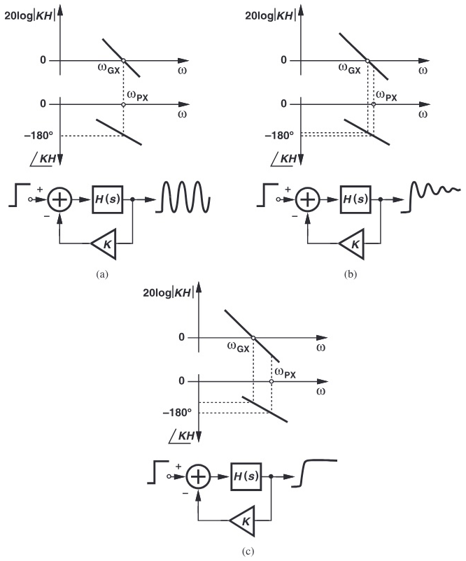

# 장말문제 12.67 — Fig 12.72의 세 경우에서 K를 절반으로 줄이면

## 원문
In each case illustrated in Fig. 12.72, what happens if $K$ is reduced by a factor of 2?

## 조건
- Fig 12.72의 세 경우: 같은 귀환 루프(덧셈기, 순방향 $H(s)$, 귀환 $K$)에 계단 입력을 넣었을 때 루프 이득 $KH$의 보데 그림과 계단 응답
  - (a) 이득 교차 $\omega_{GX}$와 위상 교차 $\omega_{PX}$가 같은 주파수 → 출력이 일정한 진폭으로 계속 진동
  - (b) $\omega_{GX}$가 $\omega_{PX}$보다 조금 낮음 → 출력이 진동하다가 줄어들며 정착
  - (c) $\omega_{GX}$가 $\omega_{PX}$보다 한참 낮음 → 출력이 진동 없이 올라가 정착
- 세 경우 모두 귀환율 $K$를 2배 줄임 ($K \to K/2$)
- 식 (12.187): 안정하려면 $\omega_{GX} < \omega_{PX}$ (본문 식, 원문에 없음)
- $K$에는 위상 편이가 없으므로 $\angle KH = \angle H$ (본문 가정, 원문에 없음)

## 구할 것
- (a), (b), (c) 각 경우에 $K$가 절반이 되면 어떻게 되는가? (보데 그림의 $\omega_{GX}$, 위상 마진, 계단 응답의 변화) (괄호 안은 원문에 없음)

## 상속·참조
- 본문 12.8.4절 (교재 710–711쪽): 그림 12.72는 위상 마진 개념을 보이는 세 시스템. (a) 이득과 위상 교차가 동시에 일어나는 시스템, (b) 이득 교차가 위상 교차보다 약간 낮은 시스템, (c) 이득 교차가 위상 교차보다 한참 낮은 시스템 (그림 캡션). (b)는 $\omega_{GX} < \omega_{PX}$이지만 "조금" 안정이라 계단 응답이 오래 진동하고, 잘 동작하는 시스템은 $\omega_{GX}$와 $\omega_{PX}$ 사이에 충분한 마진이 있어야 함
- 식 (12.195) (교재 711쪽): $\text{Phase Margin} = \angle H(\omega_{GX}) + 180^\circ$
- Fig 12.72의 보데 그림 (세 패널 모두 같은 틀, 각 패널 위쪽):
  - 위: 세로축 화살표 위쪽, 라벨 "20log|KH|". 가로축 화살표 "ω", 세로축 왼쪽 "0". 크기는 오른쪽 아래로 내려가는 직선 한 토막이 0 축과 만나는 곳에 작은 빈 원, 그 아래에 라벨 "ω_GX"
  - 아래: 가로축 화살표 "ω", 세로축 왼쪽 "0"과 "−180°", 세로축 화살표 아래쪽, 라벨 "∠KH". 위상은 오른쪽 아래로 내려가는 직선 한 토막. 0 축 위의 작은 빈 원이 "ω_PX"(라벨은 원 오른쪽 위)이고, 거기서 수직 점선이 위상 직선까지 내려가며 그 높이가 −180°(−180° 눈금에서 가로 점선)
  - (a): ω_GX에서 내려온 수직 점선이 그대로 위상 그림의 ω_PX 원을 지나 위상 직선과 −180° 높이에서 만남 (ω_GX = ω_PX). −180° 가로 점선 하나
  - (b): ω_GX가 ω_PX보다 조금 왼쪽. 수직 점선 두 개(ω_GX에서, ω_PX에서)가 위상 직선까지 내려가고, 가로 점선 두 개가 세로축으로 감: 위쪽은 ω_GX에서의 위상(−180°보다 조금 위, 라벨 없음), 아래쪽은 −180°
  - (c): ω_GX가 ω_PX보다 한참 왼쪽. (b)와 같은 점선 두 쌍이고 ω_GX에서의 위상 가로 점선이 −180°보다 뚜렷이 위 (라벨 없음)
- Fig 12.72의 계단 응답 (각 패널 블록도 왼쪽과 오른쪽): 입력 원 왼쪽에 올라가는 계단 파형. 출력 화살표 오른쪽에 (a) 진폭이 일정한 사인파 모양 진동, (b) 처음에 크게 튀었다가 점점 작아지는 감쇠 진동, (c) 진동 없이 매끄럽게 올라가 평평해지는 파형

## 회로 — Fig 12.72(a)
```spice
XS  n1  n4  n2  sum           ; n1(입력) +, n4(K 출력) −
XH  n2  n3  gain "H(s)"
XK  n3  n4  gain "K" tri      ; 입력은 오른쪽(출력 분기점 쪽), 출력은 왼쪽
```
- 단자: n1 = 입력 (개방 원, 라벨 없음, 원 왼쪽에 계단 파형) / n3 = 출력 (선 끝, 화살촉 오른쪽에 진폭이 일정한 진동 파형)
- 표시: 노드 라벨 없음 / 소자 라벨 H(s) (사각 상자 안), K (삼각형 안), 덧셈기 (⊕, 라벨 없음) / 부호 "+" 덧셈기 왼쪽 위(입력 원 쪽), "−" 덧셈기 왼쪽 아래(귀환 입력 쪽) / 화살표 신호선 화살촉 (모두 라벨 없음, 도선 위): 입력 원 → 덧셈기 왼쪽, 덧셈기 → H(s) 왼쪽, 출력 분기점 → 오른쪽 출력 파형, 귀환선 → 덧셈기 아래쪽(위 방향) / 수치·면적 라벨 없음
- 배치: 보데 그림 아래에 블록도. 가로줄 왼쪽→오른쪽 계단 파형, 입력 원, 덧셈기, H(s) 상자, 출력 분기점, 출력 파형 / H(s)와 분기점 사이 선에는 화살촉 없음 / 분기점에서 선이 아래로 내려가 맨 아래 높이에서 왼쪽으로 꺾여 왼쪽을 향한 K 삼각형의 오른쪽(입력)으로 들어감 / K 왼쪽(출력)에서 선이 왼쪽으로 가 덧셈기 x에서 위로 꺾여 덧셈기 아래쪽으로 들어감 / 접속점 (세 갈래 이상, 1곳): 출력 분기점 = 왼쪽 H(s) 선 + 오른쪽 출력 화살표 + 아래 귀환선 (점) / 교차: 없음

## 회로 — Fig 12.72(b)
```spice
XS  n1  n4  n2  sum           ; n1(입력) +, n4(K 출력) −
XH  n2  n3  gain "H(s)"
XK  n3  n4  gain "K" tri      ; 입력은 오른쪽(출력 분기점 쪽), 출력은 왼쪽
```
- 단자: n1 = 입력 (개방 원, 라벨 없음, 원 왼쪽에 계단 파형) / n3 = 출력 (선 끝, 화살촉 오른쪽에 감쇠 진동 파형)
- 표시: 노드 라벨 없음 / 소자 라벨 H(s) (사각 상자 안), K (삼각형 안), 덧셈기 (⊕, 라벨 없음) / 부호 "+" 덧셈기 왼쪽 위(입력 원 쪽), "−" 덧셈기 왼쪽 아래(귀환 입력 쪽) / 화살표 신호선 화살촉 (모두 라벨 없음, 도선 위): 입력 원 → 덧셈기 왼쪽, 덧셈기 → H(s) 왼쪽, 출력 분기점 → 오른쪽 출력 파형, 귀환선 → 덧셈기 아래쪽(위 방향) / 수치·면적 라벨 없음
- 배치: 보데 그림 아래에 블록도. 가로줄 왼쪽→오른쪽 계단 파형, 입력 원, 덧셈기, H(s) 상자, 출력 분기점, 출력 파형 / H(s)와 분기점 사이 선에는 화살촉 없음 / 분기점에서 선이 아래로 내려가 맨 아래 높이에서 왼쪽으로 꺾여 왼쪽을 향한 K 삼각형의 오른쪽(입력)으로 들어감 / K 왼쪽(출력)에서 선이 왼쪽으로 가 덧셈기 x에서 위로 꺾여 덧셈기 아래쪽으로 들어감 / 접속점 (세 갈래 이상, 1곳): 출력 분기점 = 왼쪽 H(s) 선 + 오른쪽 출력 화살표 + 아래 귀환선 (점) / 교차: 없음

## 회로 — Fig 12.72(c)
```spice
XS  n1  n4  n2  sum           ; n1(입력) +, n4(K 출력) −
XH  n2  n3  gain "H(s)"
XK  n3  n4  gain "K" tri      ; 입력은 오른쪽(출력 분기점 쪽), 출력은 왼쪽
```
- 단자: n1 = 입력 (개방 원, 라벨 없음, 원 왼쪽에 계단 파형) / n3 = 출력 (선 끝, 화살촉 오른쪽에 진동 없이 올라가 평평해지는 파형)
- 표시: 노드 라벨 없음 / 소자 라벨 H(s) (사각 상자 안), K (삼각형 안), 덧셈기 (⊕, 라벨 없음) / 부호 "+" 덧셈기 왼쪽 위(입력 원 쪽), "−" 덧셈기 왼쪽 아래(귀환 입력 쪽) / 화살표 신호선 화살촉 (모두 라벨 없음, 도선 위): 입력 원 → 덧셈기 왼쪽, 덧셈기 → H(s) 왼쪽, 출력 분기점 → 오른쪽 출력 파형, 귀환선 → 덧셈기 아래쪽(위 방향) / 수치·면적 라벨 없음
- 배치: 보데 그림 아래에 블록도. 가로줄 왼쪽→오른쪽 계단 파형, 입력 원, 덧셈기, H(s) 상자, 출력 분기점, 출력 파형 / H(s)와 분기점 사이 선에는 화살촉 없음 / 분기점에서 선이 아래로 내려가 맨 아래 높이에서 왼쪽으로 꺾여 왼쪽을 향한 K 삼각형의 오른쪽(입력)으로 들어감 / K 왼쪽(출력)에서 선이 왼쪽으로 가 덧셈기 x에서 위로 꺾여 덧셈기 아래쪽으로 들어감 / 접속점 (세 갈래 이상, 1곳): 출력 분기점 = 왼쪽 H(s) 선 + 오른쪽 출력 화살표 + 아래 귀환선 (점) / 교차: 없음


> 참고: Fig 12.72는 본문 그림(교재 711쪽, PDF 36 오른쪽, 12.8.4 위상 마진). 각 패널은 위에 보데 그림, 아래에 블록도와 계단 응답이 함께 있음. (a)(b)는 위 줄에 나란히, (c)는 아래 가운데
