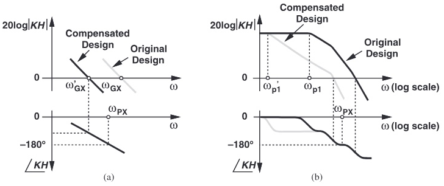

# 장말문제 12.69 — K가 절반이 될 때 Fig 12.74 주파수 보상 특성의 변화

## 원문
Explain what happens to the characteristics illustrated in Fig. 12.74 if $K$ drops by a factor of two. Assume $\omega_{p1}$ and $\omega_{p1}'$ remain constant.

## 조건
- Fig 12.74의 특성: 주파수 보상 전(Original Design)과 후(Compensated Design)의 루프 이득 $20\log|KH|$와 위상 $\angle KH$ 보데 그림. (a) 주파수 보상의 개념, (b) 우성 극점을 $\omega_{p1}$에서 $\omega_{p1}'$으로 옮긴 보상의 효과 (본문 설명, 캡션은 "위상 개요에 대한 효과")
- 귀환율 $K$가 2배 줄어듦 ($K \to K/2$)
- $\omega_{p1}$과 $\omega_{p1}'$은 그대로라고 가정
- 식 (12.195): $\text{Phase Margin} = \angle H(\omega_{GX}) + 180^\circ$, $K$에는 위상 편이가 없으므로 $\angle KH = \angle H$ (본문 식, 원문에 없음)

## 구할 것
- $K$가 절반이 될 때 Fig 12.74에 그려진 특성이 어떻게 되는지 설명 (원본 설계와 보상된 설계의 이득 교차 주파수, 위상 마진) (괄호 안은 원문에 없음)

## 상속·참조
- 본문 12.8.5 주파수 보상 (교재 712–713쪽): 위상 마진이 부족하면 $\omega_{PX}$를 바꾸지 않고 $\omega_{GX}$를 원점 쪽으로 옮겨, 즉 $|KH|$를 더 낮은 주파수에서 1로 떨어뜨려 위상 마진을 늘림 [그림 12.74(a)]. 우성 극점을 낮은 주파수로 옮기면 $\omega_{GX}$도 옮겨짐. 그림 12.74(b)는 첫 번째 극점이 $\omega_{p1}$에서 $\omega_{p1}'$으로 옮겨 가고 다른 극점은 그대로인 예로, $\omega_{GX}$가 줄어듦. $\angle KH$의 저주파 구간은 $\omega_{p1}$이 $\omega_{p1}'$으로 옮겨 가서 바뀌지만 $\omega_{GX}$ 근처의 중요한 구간은 바뀌지 않아 위상 마진이 늘어남
- 식 (12.195) (교재 711쪽): $\text{Phase Margin} = \angle H(\omega_{GX}) + 180^\circ$
- Fig 12.74 (교재 713쪽, PDF 37 오른쪽): 특성 그래프 (회로 그림 아님)
  - (a) 위: 세로축 화살표 위쪽, 라벨 "20log|KH|". 가로축 화살표 "ω", 세로축 왼쪽 "0". 기울기가 같은 두 직선 토막: 진한 선 "Compensated Design"(왼쪽, 0 축과 만나는 빈 원 아래 라벨 "ω'_GX")과 회색 선 "Original Design"(오른쪽, 0 축과 만나는 빈 원 아래 라벨 "ω_GX"). 두 라벨에서 각 선으로 화살표
  - (a) 아래: 가로축 화살표 "ω", 세로축 왼쪽 "0"과 "−180°", 세로축 화살표 아래쪽, 라벨 "∠KH". 위상은 오른쪽 아래로 내려가는 진한 직선 하나(두 설계 공통). 0 축 위 빈 원 "ω_PX"(라벨은 원 위). ω'_GX에서 수직 점선이 위상 직선까지 내려가고 거기서 가로 점선이 세로축으로 (라벨 없음, −180°보다 위). ω_PX에서 수직 점선이 위상 직선까지 내려가고 −180° 눈금에서 가로 점선이 그 점까지
  - (b) 위: 세로축 라벨 "20log|KH|", 가로축 "ω (log scale)", 세로축 왼쪽 "0". 진한 곡선 "Original Design": 높은 평탄 구간에서 ω_p1(0 축 위 빈 원, 수직 점선이 평탄 구간 끝까지)에서 꺾여 내려가고, 기울기가 두 번 더 가팔라지며 0 축을 지나 아래로. 회색 곡선 "Compensated Design": 같은 높이 평탄 구간에서 ω'_p1(0 축 위 빈 원, 라벨 "ω'_p1", 수직 점선)에서 꺾여 완만히 내려가다가 0 축 바로 위에서 가파르게 꺾여 0 축을 지나 아래로 (진한 곡선보다 왼쪽에서 0 축과 만남). 라벨 "Compensated Design" 화살표는 ω'_p1 바로 뒤 회색 곡선이 꺾여 내려가기 시작하는 곳을, "Original Design" 화살표는 진한 곡선을 가리킴
  - (b) 아래: 가로축 "ω (log scale)", 세로축 왼쪽 "0"과 "−180°", 세로축 라벨 "∠KH". 진한 곡선: 0에서 평탄하다가 계단처럼 세 번 내려감 (중간 평탄 구간 하나는 라벨 없음, 두 번째 평탄 구간이 −180° 높이, 마지막은 −180°보다 아래). 회색 곡선: 일찍 내려가 진한 곡선의 첫 중간 평탄 구간 높이에서 평탄하다가 진한 곡선과 합쳐짐. 0 축 위 빈 원 "ω_PX". 수직 점선 세 개가 위 그림에서 내려옴: 회색 곡선의 0 dB 교차점(라벨 없음), ω_PX, 진한 곡선의 0 dB 교차점(라벨 없음). −180° 눈금에서 가로 점선이 ω_PX 수직 점선까지

> 참고: Fig 12.74는 본문 그림(교재 713쪽, PDF 37 오른쪽, 12.8.5 주파수 보상). (a)에서는 보상된 설계가 진한 선, 원래 설계가 회색 선이고, (b)에서는 원래 설계가 진한 선, 보상된 설계가 회색 선으로 그려짐

## 회로 — 없음 (특성 그래프 문제, 그림 12.74는 회로가 아닌 보데 그림으로 상속·참조에 적음)
