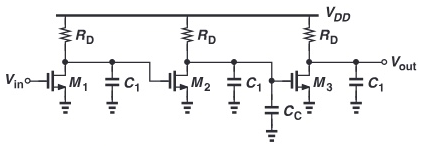

# 장말문제 12.70 — 예제 12.38의 3단 증폭기를 노드 X의 보상 커패시터로 위상 마진 45°에 맞추기

## 원문
Figure 12.121 depicts the amplifier of Example 12-38 with a compensation capacitor added to node $X$. Explain how the circuit can be compensated for a phase margin of $45^\circ$.

## 조건
- 회로: Fig 12.121 예제 12.38의 3단 증폭기 (원문 표기 "Example 12-38")에 보상 커패시터 $C_C$를 노드 $X$에 더한 것
- 노드 $X$는 그림에 라벨이 인쇄돼 있지 않음. $C_C$가 달린 노드, 곧 $M_2$ 드레인 = $M_3$ 게이트 노드로 보임 (원문에 없음)
- 예제 12.38에서 이어받는 조건: CS 단 $M_1$, $M_2$, $M_3$가 모두 같고 (같은 $g_m$, $R_D$, $C_1$), 각 드레인 노드에서 접지로 $C_1$, 그 밖의 커패시턴스는 무시, $\lambda = 0$, 귀환율 $K = 1$인 부귀환을 걸 증폭기 (원문에 없음)
- 예제 12.38의 결과: 보상 전 전달 함수 $H(s) = \dfrac{(g_m R_D)^3}{(1 + s/\omega_p)^3}$, $\omega_p = (R_D C_1)^{-1}$ (식 12.188, 단 이득의 음의 부호는 생략), 안정 조건 $g_m R_D < 2$ (식 12.192) (원문에 없음)
- 식 (12.195): $\text{Phase Margin} = \angle H(\omega_{GX}) + 180^\circ$ (본문 식, 원문에 없음)
- 목표 위상 마진 $45^\circ$

## 구할 것
- 회로를 위상 마진 $45^\circ$로 보상하는 방법 설명 (예: 필요한 $C_C$의 조건) (괄호 안은 원문에 없음)

## 상속·참조
- 예제 12.38 (교재 707쪽, PDF 34 오른쪽, 12.8.3 안정 조건): 그림 12.69(a)의 3단 증폭기에 $K = 1$인 부귀환을 걸려고 한다. 다른 커패시턴스를 무시하고 단이 모두 같다고 가정할 때 회로의 주파수 응답을 그리고 안정성 조건을 결정하라. $\lambda = 0$이라고 가정하라
  - 예제 풀이 (참고): 저주파 이득 $(g_m R_D)^3$, 세 개의 겹친 극점 $\omega_p = (R_D C_1)^{-1}$. $H(s) = \dfrac{(g_m R_D)^3}{(1 + s/\omega_p)^3}$ (12.188), $\angle H(j\omega) = -3\tan^{-1}(\omega/\omega_p)$ (12.189), 위상 교차 $\omega_{PX} = \sqrt{3}\,\omega_p$ (12.190), 거기서 크기가 1보다 작아야 하므로 $g_m R_D < 2$ (12.192)
- 그림 12.69(a) (교재 708쪽, 이 파일의 그림 목록에는 넣지 않음, 크롭은 fig12-69-a.png): 그림 12.121에서 $C_C$만 뺀 같은 회로
- 식 (12.195) (교재 711쪽, 12.8.4 위상 마진): $\text{Phase Margin} = \angle H(\omega_{GX}) + 180^\circ$
- 본문 12.8.5 주파수 보상 (교재 712–713쪽): 우성 극점을 낮은 주파수로 옮겨 $\omega_{PX}$는 그대로 두고 $\omega_{GX}$를 원점 쪽으로 옮기면 위상 마진이 늘어남

## 회로 — Fig 12.121
```spice
RD1  VDD   n1    {R_D}   ; 인쇄 라벨 R_D (첫째 단)
M1   n1    Vin   0       nmos
C1a  n1    0     {C_1}   ; 인쇄 라벨 C_1 (첫째 단)
RD2  VDD   n2    {R_D}   ; 인쇄 라벨 R_D (둘째 단)
M2   n2    n1    0       nmos
C1b  n2    0     {C_1}   ; 인쇄 라벨 C_1 (둘째 단)
CC   n2    0     {C_C}   ; n2가 원문이 말하는 노드 X로 보임 (그림에 X 라벨 없음)
RD3  VDD   Vout  {R_D}   ; 인쇄 라벨 R_D (셋째 단)
M3   Vout  n2    0       nmos
C1c  Vout  0     {C_1}   ; 인쇄 라벨 C_1 (셋째 단)
```
- 단자: VDD = 전원, 값 미지정 (가로 레일) / Vin = 입력 (개방 원) / Vout = 출력 (개방 원)
- 표시: 노드 라벨 V_DD (레일 오른쪽 끝), V_in (입력 원 왼쪽), V_out (출력 원 오른쪽), X는 인쇄되지 않음 / 소자 라벨 R_D 세 개 (각 저항 오른쪽), M1, M2, M3 (각 트랜지스터 오른쪽, 소스 옆), C_1 세 개 (각 커패시터 오른쪽), C_C (보상 커패시터 오른쪽) / 부호 없음 / 화살표 없음 / 수치·면적 라벨 없음
- 배치: 맨 위 가로 레일 VDD가 첫째 단 R_D에서 셋째 단 R_D 바로 오른쪽까지, 라벨은 오른쪽 끝 / 세 단이 왼쪽→오른쪽으로 같은 모양 반복: 레일에서 R_D가 아래로, 그 아래 드레인 노드, 바로 아래 NMOS(게이트 왼쪽, 소스 아래·화살표 바깥), 소스 아래 접지 / 각 드레인 노드에서 가로선이 오른쪽으로 C_1 위 접속점까지, C_1은 아래로 접지 / 첫째 단: C_1 접속점을 지나 더 오른쪽으로 가서 아래로 꺾여 게이트 높이에서 오른쪽으로 M2 게이트 / 둘째 단: C_1 접속점을 지나 더 오른쪽으로 가서 아래로 꺾여 M3 게이트 높이의 접속점, 거기서 오른쪽으로 M3 게이트, 아래로 C_C(그 아래 접지, 다른 접지보다 낮게) / 셋째 단: C_1 접속점을 지나 V_out 개방 원에서 끝남 / V_in 원에서 가로선이 M1 게이트로 / 접속점 (세 갈래 이상, 7곳): 각 단 드레인 = 위 R_D + 아래 드레인 + 오른쪽 가로선 (점), 각 단 C_1 위 = 왼쪽 가로선 + 아래 C_1 + 오른쪽 가로선 (점), M3 게이트 앞 = 위에서 내려온 선 + 오른쪽 M3 게이트 + 아래 C_C (점) / 교차: 없음


> 참고: 문제 문장은 727쪽(PDF 44 오른쪽 단 맨 아래)에 있고, 그림 12.121은 다음 쪽 728쪽(PDF 45 왼쪽 단 맨 위)에 있음
