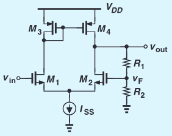

# 장말문제 12.71 — 예제 12.15 회로를 개루프 이득 50, 공칭 폐루프 이득 4로 설계

## 원문
Design the circuit of Example 12-15 for an open-loop gain of 50 and a nominal closed-loop gain of 4. Assume $I_{SS} = 0.5\ \text{mA}$. Choose $R_1 + R_2 \approx 10(r_{O2} \| r_{O4})$.

## 조건
- 회로: 예제 12.15의 회로 (Fig 12.32, 원문 표기 "Example 12-15"): 능동 부하($M_3$–$M_4$ 전류 거울) 차동쌍 $M_1$–$M_2$, 꼬리 전류원 $I_{SS}$, 출력 $v_{out}$의 $R_1$–$R_2$ 분배기 가운데 노드 $v_F$가 $M_2$ 게이트로 가는 전압-전압 귀환
- 개루프 이득 50, 공칭 폐루프 이득 4
- $I_{SS} = 0.5\ \text{mA}$
- $R_1 + R_2 \approx 10(r_{O2} \| r_{O4})$로 고름
- 공통 가정: $\mu_n C_{ox} = 2\mu_p C_{ox} = 100\ \mu\text{A/V}^2$, $\lambda_n = 0.5\lambda_p = 0.1\ \text{V}^{-1}$ (원문의 Design Problems 머리말)
- 예제 12.15의 결과: 개루프 이득 $A_0 = g_{mN}(r_{ON} \| r_{OP})$ (식 12.59, 첨자 $N$, $P$는 NMOS, PMOS), 귀환율 $K = R_2/(R_1 + R_2)$, 폐루프 이득 $\dfrac{V_{out}}{V_{in}} = \dfrac{A_0}{1 + KA_0}$ (식 12.58, 12.60), 루프 이득이 충분히 크면 $\approx 1/K = 1 + R_1/R_2$ (원문에 없음)
- 공칭 폐루프 이득은 $1/K$로 봄 (원문에 없음)

## 구할 것
- 회로 설계 (정할 값 예: $(W/L)_{1,2}$, $R_1$, $R_2$) (원문에 없음, 원문은 "설계하라"만 적음)

## 상속·참조
- 예제 12.15 (교재 670쪽, PDF 16 왼쪽, 12.6.1 전압-전압 귀환): $R_1 + R_2$가 매우 크다고 가정할 때 그림 12.32에서 보여 주는 회로의 폐루프 이득을 결정하라
  - 예제 풀이 (참고): 저항 회로망이 높은 임피던스로 $V_{out}$을 감지하고 $M_2$ 게이트에 전압을 반송하는 부 전압-전압 귀환. $M_1$, $M_2$는 순방향 시스템의 입력단이자 뺄셈기. $A_0 = g_{mN}(r_{ON} \| r_{OP})$ (12.59), $K = R_2/(R_1 + R_2)$, $\dfrac{V_{out}}{V_{in}} = \dfrac{g_{mN}(r_{ON} \| r_{OP})}{1 + \dfrac{R_2}{R_1 + R_2} g_{mN}(r_{ON} \| r_{OP})}$ (12.60), 루프 이득이 1보다 충분히 크면 $\approx 1/K = 1 + R_1/R_2$
  - 예제 풀이의 각주: 이 식이 성립하려면 $R_1 + R_2$가 $r_{ON} \| r_{OP}$보다 훨씬 커야 함
- Design Problems 공통 가정 (교재 728쪽 머리말, 문제에 따로 적힌 값이 우선):
  - $\mu_n C_{ox} = 2\mu_p C_{ox} = 100\ \mu\text{A/V}^2$
  - $\lambda_n = 0.5\lambda_p = 0.1\ \text{V}^{-1}$

## 회로 — Fig 12.32
```spice
M3   n1    n1  VDD  pmos
M4   vout  n1  VDD  pmos
M1   n1    vin n2   nmos
M2   vout  vF  n2   nmos
ISS  n2    0   {I_SS}
R1   vout  vF  {R_1}
R2   vF    0   {R_2}
```
- 단자: VDD = 전원, 값 미지정 (가로 레일) / vin = 입력 (개방 원) / vout = 출력 (개방 원)
- 표시: 노드 라벨 V_DD (레일 오른쪽 끝), v_in (입력 원 왼쪽), v_out (출력 원 오른쪽), v_F (분배기 가운데 접속점 오른쪽) / 소자 라벨 M3 (왼쪽), M4 (오른쪽), M1 (오른쪽), M2 (왼쪽), I_SS (전류원 오른쪽), R1, R2 (각 저항 오른쪽) / 부호 없음 / 화살표 없음 / 수치·면적 라벨 없음
- 배치: 맨 위 V_DD 가로 레일에 M3(좌우 반전 PMOS, 게이트 오른쪽), M4(보통 PMOS, 게이트 왼쪽)의 소스가 매달림 / 두 게이트를 잇는 가로선의 M3 게이트 바로 오른쪽 접속점에서 세로선이 내려와 왼쪽으로 꺾여 M3 드레인 접속점에 닿음 (다이오드 연결) / 왼쪽 세로줄 M3 – n1 접속점 – M1(보통 NMOS, 게이트 왼쪽 ← v_in 원), 오른쪽 세로줄 M4 – vout 접속점 – M2(좌우 반전 NMOS, 게이트 오른쪽) / M1, M2 소스는 아래 가로선으로 모여 꼬리 접속점, 그 아래 I_SS(화살표 아래쪽)와 접지 / vout 접속점에서 가로선이 오른쪽으로 가서 R1 위 접속점, 다시 오른쪽 v_out 원 / 맨 오른쪽 세로줄 위→아래 R1, v_F 접속점, R2, 접지 / v_F 접속점에서 가로선이 왼쪽으로 M2 게이트 / 접속점 (세 갈래 이상, 6곳): 게이트선 M3 게이트 쪽 (점), M3 드레인 n1 (점), M4 드레인 vout (점), R1 위 (점), v_F (점), 꼬리 n2 (점) / 교차: 없음


> 참고: Fig 12.32는 본문 그림(교재 670쪽, PDF 16 왼쪽, 예제 12.15)
