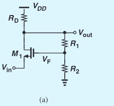

# 장말문제 12.72 — 예제 12.16의 귀환 CG 단을 개루프 이득 10, 폐루프 입력 임피던스 50 Ω, 공칭 폐루프 이득 2로 설계

## 원문
Design the circuit of Example 12-16 for an open-loop gain of 10, a closed-loop input impedance of $50\ \Omega$, and a nominal closed-loop gain of 2. Calculate the closed-loop I/O impedances. Assume $R_1 + R_2 \approx 10R_D$.

## 조건
- 회로: 예제 12.16의 회로 (Fig 12.34(a), 원문 표기 "Example 12-16"): 공통 게이트 단 $M_1$, 드레인은 $R_D$를 거쳐 $V_{DD}$이고 출력 $V_{out}$, 게이트는 $V_{out}$과 접지 사이 $R_1$–$R_2$ 분배기의 가운데 노드 $V_F$, 소스가 입력 $V_{in}$
- 개루프 이득 10, 폐루프 입력 임피던스 $50\ \Omega$, 공칭 폐루프 이득 2
- $R_1 + R_2 \approx 10R_D$로 둠
- 공통 가정: $\mu_n C_{ox} = 2\mu_p C_{ox} = 100\ \mu\text{A/V}^2$, $\lambda_n = 0.5\lambda_p = 0.1\ \text{V}^{-1}$ (원문의 Design Problems 머리말)
- 예제 12.16의 결과: 루프를 열면($M_1$ 게이트를 접지) 개루프 입력 저항 $R_{in} = 1/g_m$ (식 12.64), 폐루프 입력 임피던스 $\dfrac{V_{in}}{I_{in}} = \dfrac{1}{g_m}\left(1 + \dfrac{R_2}{R_1 + R_2} g_m R_D\right)$ (식 12.65) (원문에 없음)
- 식 (12.67): 전압-전압 귀환의 폐루프 출력 임피던스 $\dfrac{V_X}{I_X} = \dfrac{R_{out}}{1 + KA_0}$ ($R_{out}$은 순방향 증폭기의 개루프 출력 임피던스) (본문 식, 원문에 없음)
- 공칭 폐루프 이득은 $1/K = 1 + R_1/R_2$로 봄 (원문에 없음)

## 구할 것
- 회로 설계 (정할 값 예: $g_m$ 또는 $(W/L)_1$과 바이어스 전류, $R_D$, $R_1$, $R_2$) (원문에 없음, 원문은 "설계하라"만 적음)
- 폐루프 입력·출력 임피던스

## 상속·참조
- 예제 12.16 (교재 671쪽, PDF 16 오른쪽, 12.6.1 전압-전압 귀환): $R_1 + R_2$가 매우 클 때 그림 12.34(a)에 나와 있는 단의 입력 임피던스를 결정하라
  - 예제 풀이 (참고): 식 (12.63)에서 $R_{in}$을 구하려고 루프를 연다. 귀환 신호에서 $M_1$의 게이트를 끊고 접지에 연결하면 [그림 12.34(b)] $R_{in} = 1/g_m$ (12.64). 따라서 폐루프 입력 임피던스 $\dfrac{V_{in}}{I_{in}} = \dfrac{1}{g_m}\left(1 + \dfrac{R_2}{R_1 + R_2} g_m R_D\right)$ (12.65)
- 식 (12.63) (교재 671쪽): $\dfrac{V_{in}}{I_{in}} = R_{in}(1 + KA_0)$. 전압 증폭기의 부귀환은 입력 임피던스를 $1 + KA_0$배로 늘림
- 식 (12.67) (교재 672쪽): $\dfrac{V_X}{I_X} = \dfrac{R_{out}}{1 + KA_0}$. 출력 전압을 감지하는 귀환은 출력 임피던스를 $1 + KA_0$배로 줄임
- Design Problems 공통 가정 (교재 728쪽 머리말, 문제에 따로 적힌 값이 우선):
  - $\mu_n C_{ox} = 2\mu_p C_{ox} = 100\ \mu\text{A/V}^2$
  - $\lambda_n = 0.5\lambda_p = 0.1\ \text{V}^{-1}$

## 회로 — Fig 12.34(a)
```spice
RD  VDD   Vout  {R_D}
M1  Vout  VF    Vin  nmos
R1  Vout  VF    {R_1}
R2  VF    0     {R_2}
```
- 단자: VDD = 전원, 값 미지정 (T 전원 기호) / Vin = 입력, M1 소스 (개방 원) / Vout = 출력 (개방 원)
- 표시: 노드 라벨 V_DD (T 기호 오른쪽), V_out (출력 원 오른쪽), V_in (입력 원 왼쪽), V_F (게이트 가로선 아래, 게이트와 R1–R2 접속점 사이) / 소자 라벨 R_D (저항 왼쪽), M1 (트랜지스터 왼쪽, 소스 화살표 왼쪽 위), R1, R2 (각 저항 오른쪽) / 부호 없음 / 화살표 없음 / 수치·면적 라벨 없음
- 배치: 왼쪽 세로줄 위→아래 V_DD T 기호, R_D, 드레인 접속점, M1 / M1은 좌우 반전된 NMOS (게이트가 오른쪽, 드레인·소스 인출선이 왼쪽, 소스 화살표는 채널에서 왼쪽 바깥을 향함) / 소스에서 세로선이 아래로 내려가 왼쪽으로 꺾여 V_in 원에서 끝남 / 드레인 접속점에서 가로선이 오른쪽으로 가 R1 위 접속점을 지나 V_out 원까지 / 오른쪽 세로줄 위→아래 R1 위 접속점, R1, V_F 접속점, R2, 접지 / M1 게이트에서 가로선이 오른쪽으로 곧장 V_F 접속점 / 접속점 (세 갈래 이상, 3곳): 드레인 = 위 R_D + 아래 M1 드레인 + 오른쪽 가로선 (점), R1 위 = 왼쪽 가로선 + 아래 R1 + 오른쪽 V_out 선 (점), V_F = 위 R1 + 아래 R2 + 왼쪽 게이트 선 (점) / 교차: 없음


> 참고: Fig 12.34는 본문 그림(교재 671쪽, PDF 16 오른쪽, 예제 12.16)
