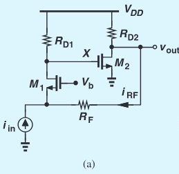

# 장말문제 12.73 — 예제 12.18의 트랜스임피던스 증폭기를 개루프 10 kΩ, 폐루프 1 kΩ, 입력 50 Ω, 출력 200 Ω으로 설계

## 원문
Design the transimpedance amplifier of Example 12-18 for an open-loop gain of $10\ \text{k}\Omega$, a closed-loop gain of $1\ \text{k}\Omega$, a closed-loop input impedance of $50\ \Omega$, and a closed-loop output impedance of $200\ \Omega$. Assume $R_{D1} = 1\ \text{k}\Omega$ and $R_F$ is very large.

## 조건
- 회로: 예제 12.18의 트랜스임피던스 증폭기 (Fig 12.38(a), 원문 표기 "Example 12-18"): 공통 게이트 $M_1$ (게이트 $V_b$, 드레인 $X$는 $R_{D1}$을 거쳐 $V_{DD}$, 소스는 입력 전류원 $i_{in}$), 공통 소스 $M_2$ (게이트 $X$, 드레인은 $R_{D2}$를 거쳐 $V_{DD}$이고 출력 $v_{out}$), $v_{out}$과 $M_1$ 소스 사이 귀환 저항 $R_F$
- 개루프 이득 $10\ \text{k}\Omega$, 폐루프 이득 $1\ \text{k}\Omega$, 폐루프 입력 임피던스 $50\ \Omega$, 폐루프 출력 임피던스 $200\ \Omega$
- $R_{D1} = 1\ \text{k}\Omega$, $R_F$가 매우 큼
- 공통 가정: $\mu_n C_{ox} = 2\mu_p C_{ox} = 100\ \mu\text{A/V}^2$, $\lambda_n = 0.5\lambda_p = 0.1\ \text{V}^{-1}$ (원문의 Design Problems 머리말)
- 예제 12.18은 $\lambda = 0$을 가정했으나 이 문제는 $\lambda$를 따로 적지 않음. 머리말의 $\lambda_n = 0.1\ \text{V}^{-1}$와 예제의 $\lambda = 0$ 중 어느 쪽을 쓸지는 원문에 없음 (원문에 없음)
- 예제 12.18–12.20의 결과 ($\lambda = 0$, $R_F$가 매우 큼): 개루프 이득 $R_0 = -g_{m2} R_{D1} R_{D2}$ (식 12.73), 귀환율 $K = -1/R_F$, 폐루프 이득 $\dfrac{-g_{m2} R_{D1} R_{D2}}{1 + g_{m2} R_{D1} R_{D2}/R_F}$ (식 12.75), 폐루프 입력 임피던스 $\dfrac{1}{g_{m1}} \cdot \dfrac{1}{1 + g_{m2} R_{D1} R_{D2}/R_F}$ (식 12.79), 폐루프 출력 임피던스 $\dfrac{R_{D2}}{1 + g_{m2} R_{D1} R_{D2}/R_F}$ (식 12.83) (원문에 없음)

## 구할 것
- 트랜스임피던스 증폭기 설계 (정할 값 예: $g_{m1}$, $g_{m2}$ 또는 $W/L$과 바이어스 전류, $R_{D2}$, $R_F$) (원문에 없음, 원문은 "설계하라"만 적음)

## 상속·참조
- 예제 12.18 (교재 675쪽, PDF 18 오른쪽, 12.6.2 전압-전류 귀환): 그림 12.38(a)의 회로에서 $\lambda = 0$과 $R_F$가 매우 크다고 가정하고, (a) 귀환이 부귀환임을 증명하라. (b) 개루프 이득을 계산하라. (c) 폐루프 이득을 계산하라
  - 예제 풀이 (참고): 귀환 회로망이 없는 순방향 증폭기에서 $R_0 = R_{D1}(-g_{m2} R_{D2})$ (12.73), $R_F \gg R_{D2}$. $R_F \gg 1/g_{m1}$이면 $I_{RF} \approx V_{out}/R_F$이므로 $K = -1/R_F$. $\left.\dfrac{V_{out}}{I_{in}}\right|_{closed} = \dfrac{-g_{m2} R_{D1} R_{D2}}{1 + \dfrac{g_{m2} R_{D1} R_{D2}}{R_F}}$ (12.75)
- 예제 12.19 (교재 677쪽): 개루프 입력 임피던스 $R_{in} = 1/g_{m1}$, $R_{in,closed} = \dfrac{1}{g_{m1}} \cdot \dfrac{1}{1 + \dfrac{g_{m2} R_{D1} R_{D2}}{R_F}}$ (12.79)
- 예제 12.20 (교재 677–678쪽): 개루프 $R_{out} \approx R_{D2}$, $R_{out,closed} = \dfrac{R_{D2}}{1 + \dfrac{g_{m2} R_{D1} R_{D2}}{R_F}}$ (12.83)
- 식 (12.72): $\dfrac{V_{out}}{I_{in}} = \dfrac{R_0}{1 + KR_0}$, 식 (12.78): $\dfrac{V_X}{I_X} = \dfrac{R_{in}}{1 + KR_0}$, 식 (12.82): $\dfrac{V_X}{I_X} = \dfrac{R_{out}}{1 + KR_0}$ (교재 675–677쪽, 전압-전류 귀환)
- Design Problems 공통 가정 (교재 728쪽 머리말, 문제에 따로 적힌 값이 우선):
  - $\mu_n C_{ox} = 2\mu_p C_{ox} = 100\ \mu\text{A/V}^2$
  - $\lambda_n = 0.5\lambda_p = 0.1\ \text{V}^{-1}$

## 회로 — Fig 12.38(a)
```spice
RD1  VDD   X     {R_D1}
RD2  VDD   vout  {R_D2}
M2   vout  X     0     nmos
M1   X     Vb    n1    nmos
Iin  0     n1    {i_in}
RF   vout  n1    {R_F}
```
- 단자: VDD = 전원, 값 미지정 (가로 레일) / Vb = 이상적 DC 바이어스, 값 미지정 (점 단자) / vout = 출력 (개방 원)
- 표시: 노드 라벨 V_DD (레일 오른쪽 끝), X (X–M2 게이트 가로선 위, M2 게이트 가까이), V_b (점 단자 오른쪽), v_out (출력 원 오른쪽) / 소자 라벨 R_D1 (저항 오른쪽), R_D2 (저항 오른쪽), M2 (트랜지스터 오른쪽), M1 (트랜지스터 왼쪽), i_in (전류원 왼쪽), R_F (저항 아래) / 부호 없음 / 화살표 "i_RF": 아래 가로 도선(R_F 오른쪽 끝과 오른쪽 모서리 사이), 왼쪽 방향(v_out 쪽에서 R_F 쪽으로), 도선 위, 글자는 화살표 위 / 수치·면적 라벨 없음
- 배치: 맨 위 V_DD 가로 레일 / 왼쪽 세로줄 위→아래 R_D1, X 접속점, M1, 입력 접속점(n1) / M1은 좌우 반전된 NMOS (게이트가 오른쪽 → 가로선 → V_b 점 단자, 드레인·소스 인출선이 왼쪽, 소스 화살표는 채널에서 왼쪽 바깥을 향함) / X 접속점에서 가로선이 오른쪽으로 곧장 M2 게이트 / 오른쪽 세로줄 위→아래 R_D2, 드레인 접속점, M2(보통 NMOS, 게이트 왼쪽), 소스 아래 접지 / 드레인 접속점에서 가로선이 오른쪽으로 귀환 접속점을 지나 v_out 원까지 / 귀환 접속점에서 세로선이 아래로 내려가 아래 가로선 높이에서 왼쪽으로 꺾여 R_F를 지나 n1 접속점 / n1 접속점에서 왼쪽으로 가로선이 가서 아래로 꺾여 i_in 전류원(화살표 위쪽) 위 단자, 전류원 아래 접지 / 접속점 (세 갈래 이상, 4곳): X = 위 R_D1 + 아래 M1 드레인 + 오른쪽 M2 게이트 선 (점), M2 드레인 = 위 R_D2 + 아래 M2 + 오른쪽 가로선 (점), 귀환 접속점 = 왼쪽 가로선 + 오른쪽 v_out 선 + 아래 귀환선 (점), n1 = 위 M1 소스 + 왼쪽 i_in 선 + 오른쪽 R_F (점) / 교차: 없음


> 참고: Fig 12.38은 본문 그림(교재 675쪽, PDF 18 오른쪽, 예제 12.18)
