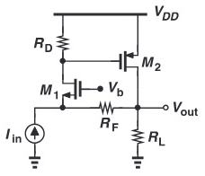

# 장말문제 12.74 — 문제 12.73을 Fig 12.96 회로(PMOS CS 둘째 단 + R_L)로 반복

## 원문
Repeat Problem 12.73 for the circuit shown in Fig. 12.96.

## 조건
- 회로: Fig 12.96 트랜스임피던스 증폭기: 공통 게이트 $M_1$ (게이트 $V_b$, 드레인은 $R_D$를 거쳐 $V_{DD}$, 소스는 입력 전류원 $I_{in}$), 공통 소스 PMOS $M_2$ (게이트는 $M_1$ 드레인, 소스 $V_{DD}$, 드레인은 출력 $V_{out}$), $V_{out}$에서 접지로 $R_L$, $V_{out}$과 $M_1$ 소스 사이 귀환 저항 $R_F$
- 문제 12.73에서 이어받는 사양: 개루프 이득 $10\ \text{k}\Omega$, 폐루프 이득 $1\ \text{k}\Omega$, 폐루프 입력 임피던스 $50\ \Omega$, 폐루프 출력 임피던스 $200\ \Omega$ (원문에 없음)
- 문제 12.73에서 이어받는 가정: $R_{D1} = 1\ \text{k}\Omega$, $R_F$가 매우 큼 (원문에 없음)
- Fig 12.96에는 $R_{D1}$이 없고 첫째 단 드레인 저항이 $R_D$로 인쇄돼 있어, $R_{D1} = 1\ \text{k}\Omega$는 $R_D = 1\ \text{k}\Omega$로 봄 (원문에 없음)
- 공통 가정: $\mu_n C_{ox} = 2\mu_p C_{ox} = 100\ \mu\text{A/V}^2$, $\lambda_n = 0.5\lambda_p = 0.1\ \text{V}^{-1}$ (원문의 Design Problems 머리말)
- 식 (12.72): $\dfrac{V_{out}}{I_{in}} = \dfrac{R_0}{1 + KR_0}$, 식 (12.78): 폐루프 입력 임피던스 $\dfrac{R_{in}}{1 + KR_0}$, 식 (12.82): 폐루프 출력 임피던스 $\dfrac{R_{out}}{1 + KR_0}$ ($R_0$, $R_{in}$, $R_{out}$은 순방향 증폭기의 개루프 값, $K = I_F/V_{out}$) (본문 식, 원문에 없음)

## 구할 것
- Fig 12.96 트랜스임피던스 증폭기 설계 (정할 값 예: $g_{m1}$, $g_{m2}$ 또는 $W/L$과 바이어스 전류, $R_L$, $R_F$) (원문에 없음, 원문은 "Repeat Problem 12.73"만 적음)

## 상속·참조
- 문제 12.73: 예제 12-18의 트랜스임피던스 증폭기를 개루프 이득 $10\ \text{k}\Omega$, 폐루프 이득 $1\ \text{k}\Omega$, 폐루프 입력 임피던스 $50\ \Omega$, 폐루프 출력 임피던스 $200\ \Omega$으로 설계. $R_{D1} = 1\ \text{k}\Omega$, $R_F$는 매우 크다고 가정
- 예제 12.18 (교재 675쪽, 참고): 같은 구조에서 둘째 단이 NMOS CS($R_{D2}$ 부하)인 회로. 개루프 $R_0 = -g_{m2} R_{D1} R_{D2}$, $K = -1/R_F$, 개루프 $R_{in} = 1/g_{m1}$, $R_{out} \approx R_{D2}$ ($\lambda = 0$, $R_F$가 매우 큼)
- 문제 12.31 (교재 722쪽)은 같은 그림 12.96에 대해 $\lambda = 0$에서 귀환이 정귀환임을 보이라고 함. 인쇄된 그림대로 따지면 극성이 이와 다르게 나올 수 있음 (참고, 원문에 없음)
- 식 (12.72), (12.78), (12.82) (교재 675–677쪽, 전압-전류 귀환): $\dfrac{V_{out}}{I_{in}} = \dfrac{R_0}{1 + KR_0}$, $\dfrac{V_X}{I_X} = \dfrac{R_{in}}{1 + KR_0}$, $\dfrac{V_X}{I_X} = \dfrac{R_{out}}{1 + KR_0}$
- Design Problems 공통 가정 (교재 728쪽 머리말, 문제에 따로 적힌 값이 우선):
  - $\mu_n C_{ox} = 2\mu_p C_{ox} = 100\ \mu\text{A/V}^2$
  - $\lambda_n = 0.5\lambda_p = 0.1\ \text{V}^{-1}$

## 회로 — Fig 12.96
```spice
RD   VDD   n1    {R_D}
M2   Vout  n1    VDD   pmos
M1   n1    Vb    n2    nmos   ; 좌우 반전 (게이트 오른쪽)
Iin  0     n2    {I_in}       ; 화살표 위쪽
RF   n2    Vout  {R_F}
RL   Vout  0     {R_L}
```
- 단자: VDD = 전원, 값 미지정 (가로 레일) / Vb = 이상적 DC 바이어스, 값 미지정 (점 단자) / Vout = 출력 (개방 원)
- 표시: 노드 라벨 V_DD (레일 오른쪽 끝), V_b (점 단자 오른쪽), V_out (출력 원 오른쪽) / 소자 라벨 R_D (저항 왼쪽), M2 (트랜지스터 오른쪽), M1 (트랜지스터 왼쪽), I_in (전류원 왼쪽), R_F (저항 아래), R_L (저항 오른쪽) / 부호 없음 / 화살표 없음 / 수치·면적 라벨 없음
- 배치: 맨 위 V_DD 가로 레일 / 왼쪽 세로줄 위→아래 R_D, n1 접속점, M1, n2 접속점 / M1은 좌우 반전된 NMOS (게이트가 오른쪽 → 가로선 → V_b 점 단자, 드레인 위·소스 아래 인출선이 왼쪽, 소스 화살표는 채널에서 왼쪽 바깥을 향함) / n1 접속점에서 가로선이 오른쪽으로 곧장 M2 게이트 / M2는 PMOS 보통 방향 (게이트 왼쪽, 소스 위 → 레일, 소스 화살표는 채널 쪽을 향함), 드레인은 아래로 길게 내려가 Vout 접속점 / Vout 접속점에서 오른쪽으로 V_out 원, 아래로 R_L → 접지 / 아래 가로줄: n2 접속점에서 오른쪽으로 R_F를 지나 Vout 접속점, 왼쪽으로 가서 아래로 꺾여 I_in 전류원(화살표 위쪽) → 접지 / 접속점 (세 갈래 이상, 3곳): n1 = 위 R_D + 아래 M1 드레인 + 오른쪽 M2 게이트 선 (점), n2 = 위 M1 소스 + 왼쪽 I_in 선 + 오른쪽 R_F (점), Vout = 위 M2 드레인 + 왼쪽 R_F + 오른쪽 V_out 원 + 아래 R_L (점) / 교차: 없음


> 참고: Fig 12.96은 문제 12.31·12.32의 그림(교재 722쪽, PDF 42 왼쪽 쪽 오른쪽 단)
