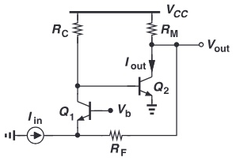

# 장말문제 12.75 — Fig 12.103 바이폴라 트랜스임피던스 증폭기를 폐루프 이득 1 kΩ으로 설계

## 원문
We wish to design the transimpedance amplifier depicted in Fig. 12.103 for a closed-loop gain of $1\ \text{k}\Omega$. Assume each transistor carries a collector bias current of $1\ \text{mA}$, $\beta = 100$, $V_A = \infty$, and $R_F$ is very large.

(a) Determine the values of $R_C$ and $R_M$ for an open-loop gain of $20\ \text{k}\Omega$ and an open-loop output impedance of $500\ \Omega$.

(b) Compute the required value of $R_F$.

(c) Calculate the closed-loop I/O impedances.

## 조건
- 회로: Fig 12.103 바이폴라 트랜스임피던스 증폭기: 공통 베이스 $Q_1$ (베이스 $V_b$, 컬렉터는 $R_C$를 거쳐 $V_{CC}$, 이미터는 입력 전류원 $I_{in}$), 공통 이미터 $Q_2$ (베이스는 $Q_1$ 컬렉터, 이미터 접지, 컬렉터는 $R_M$을 거쳐 $V_{CC}$이고 출력 $V_{out}$), $V_{out}$과 $Q_1$ 이미터 사이 귀환 저항 $R_F$
- 목표 폐루프 이득 $1\ \text{k}\Omega$
- 각 트랜지스터의 컬렉터 바이어스 전류 $1\ \text{mA}$, $\beta = 100$, $V_A = \infty$
- $R_F$가 매우 큼
- (a)의 목표: 개루프 이득 $20\ \text{k}\Omega$, 개루프 출력 임피던스 $500\ \Omega$
- Design Problems 머리말의 공통 가정은 MOS 값이라 이 BJT 회로에는 쓰이지 않음 (원문에 없음)

## 구할 것
- (a) 개루프 이득 $20\ \text{k}\Omega$, 개루프 출력 임피던스 $500\ \Omega$이 되는 $R_C$와 $R_M$
- (b) 필요한 $R_F$
- (c) 폐루프 입력·출력 임피던스

## 상속·참조
- Design Problems 공통 가정 (교재 728쪽 머리말, 문제에 따로 적힌 값이 우선):
  - $\mu_n C_{ox} = 2\mu_p C_{ox} = 100\ \mu\text{A/V}^2$
  - $\lambda_n = 0.5\lambda_p = 0.1\ \text{V}^{-1}$

## 회로 — Fig 12.103
```spice
RC   VCC   n1    {R_C}
Q1   n1    Vb    n2    npn   ; 좌우 반전 (베이스 오른쪽)
Q2   Vout  n1    0     npn
RM   VCC   Vout  {R_M}
RF   n2    Vout  {R_F}
Iin  0     n2    {I_in}      ; 왼쪽 끝 옆으로 누운 접지 기호 → 전류원 → n2 (화살표 오른쪽)
```
- 단자: VCC = 전원, 값 미지정 (가로 레일) / Vb = 이상적 DC 바이어스, 값 미지정 (점 단자) / Vout = 출력 (개방 원) / 0 = 전류원 왼쪽 끝의 옆으로 누운 접지
- 표시: 노드 라벨 V_CC (레일 오른쪽 끝), V_b (점 단자 오른쪽), V_out (출력 원 오른쪽) / 소자 라벨 R_C (저항 왼쪽), R_M (저항 오른쪽), Q1 (Q1 왼쪽, 이미터 위), Q2 (Q2 오른쪽), R_F (가로 저항 아래), I_in (전류원 위) / 부호 없음 / 화살표 "I_out": R_M 아래 접속점과 Q2 컬렉터 사이 도선, 아래 방향(Q2 컬렉터로 들어감), 도선 위, 글자는 화살표 왼쪽 / 수치·면적 라벨 없음
- 배치: 맨 위 가로 레일 V_CC, 레일에서 왼쪽 R_C, 오른쪽 R_M이 세로로 매달림 / R_C 아래 끝 → 세로선 → n1 접속점 → Q1 컬렉터, n1에서 가로선이 오른쪽으로 Q2 베이스 / Q1 npn 좌우 반전 (베이스 막대 오른쪽, 컬렉터 위, 이미터 왼쪽 아래·화살표 바깥), Q1 베이스 → 가로선 → V_b 점 단자 / Q2 npn 보통 방향 (베이스 왼쪽, 컬렉터 위, 이미터 아래), 이미터 아래 접지 / R_M 아래 접속점에서 가로선이 오른쪽으로 두 번째 접속점을 지나 V_out 원, 두 번째 접속점에서 세로선이 회로 맨 아래 높이까지 내려가 왼쪽으로 꺾여 가로 R_F를 지나 n2 접속점 / 맨 아래 줄 왼쪽부터 옆으로 누운 접지 기호, 가로로 놓인 전류원 I_in(화살표 오른쪽), n2 접속점(Q1 이미터 아래), R_F / 접속점 (세 갈래 이상, 4곳): n1 = 위 R_C + 아래 Q1 컬렉터 + 오른쪽 Q2 베이스 선 (점), R_M 아래 = 위 R_M + 아래 Q2 컬렉터 + 오른쪽 가로선 (점), V_out 쪽 = 왼쪽 가로선 + 오른쪽 V_out 원 + 아래 R_F 귀환선 (점), n2 = 위 Q1 이미터 + 왼쪽 I_in + 오른쪽 R_F (점) / 교차: 없음


> 참고: Fig 12.103은 문제 12.40의 그림(교재 724쪽, PDF 43 왼쪽 쪽). 문제 12.75 문장은 728쪽(PDF 45)에 있음
