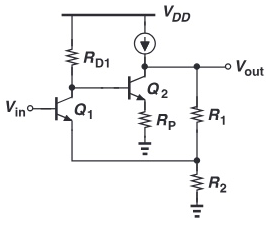

# 장말문제 12.76 — Fig 12.108 2단 바이폴라 전압 증폭기를 개루프 이득 20, 폐루프 이득 4로 설계

## 원문
Design the circuit illustrated in Fig. 12.108 for an open-loop voltage gain of 20, an open-loop output impedance of $2\ \text{k}\Omega$, and a closed-loop voltage gain of 4. Assume $\lambda = 0$. Is the solution unique? If not, how should the circuit parameters be chosen to minimize the power dissipation?

## 조건
- 회로: Fig 12.108: $Q_1$ (베이스 $V_{in}$, 컬렉터는 $R_{D1}$을 거쳐 $V_{DD}$, 이미터는 $R_1$–$R_2$ 분배기 가운데 노드), $Q_2$ (베이스는 $Q_1$ 컬렉터, 이미터는 $R_P$를 거쳐 접지, 컬렉터는 $V_{DD}$에서 내려오는 전류원에 연결되고 출력 $V_{out}$), $V_{out}$과 접지 사이 $R_1$–$R_2$ 분배기
- 목표: 개루프 전압 이득 20, 개루프 출력 임피던스 $2\ \text{k}\Omega$, 폐루프 전압 이득 4
- $\lambda = 0$
- BJT 회로에 쓰인 $\lambda = 0$은 Early 효과를 무시한다는 뜻($V_A = \infty$)으로 봄 (원문에 없음)
- Design Problems 머리말의 공통 가정은 MOS 값이라 이 BJT 회로에는 쓰이지 않음 (원문에 없음)

## 구할 것
- 회로 설계 (정할 값 예: 바이어스 전류, $R_{D1}$, $R_P$, $R_1$, $R_2$) (원문에 없음, 원문은 "설계하라"만 적음)
- 해가 유일한가?
- 유일하지 않다면 전력 소모를 최소로 하려면 회로 파라미터를 어떻게 골라야 하는가?

## 상속·참조
- Design Problems 공통 가정 (교재 728쪽 머리말, 문제에 따로 적힌 값이 우선):
  - $\mu_n C_{ox} = 2\mu_p C_{ox} = 100\ \mu\text{A/V}^2$
  - $\lambda_n = 0.5\lambda_p = 0.1\ \text{V}^{-1}$

## 회로 — Fig 12.108
```spice
RD1  VDD   n1    {R_D1}
Q1   n1    Vin   n2    npn
Q2   Vout  n1    n3    npn
RP   n3    0     {R_P}
I1   VDD   Vout              ; 라벨·값 없음
R1   Vout  n2    {R_1}
R2   n2    0     {R_2}
```
- 단자: VDD = 전원, 값 미지정 (가로 레일) / Vin = 입력 (개방 원) / Vout = 출력 (개방 원)
- 표시: 노드 라벨 V_DD (레일 오른쪽 끝), V_in (입력 원 왼쪽), V_out (출력 원 오른쪽) / 소자 라벨 R_D1 (저항 오른쪽), Q1 (Q1 오른쪽), Q2 (Q2 오른쪽), R_P (저항 오른쪽), R_1, R_2 (각 저항 오른쪽), I1 (라벨 없음) / 부호 없음 / 화살표 없음 / 수치·면적 라벨 없음
- 배치: 맨 위 가로 레일 V_DD, 레일 왼쪽 끝에서 R_D1, 오른쪽 끝에서 전류원 I1(화살표 아래)이 세로로 매달림 / R_D1 아래 n1 접속점 → 아래로 Q1 컬렉터, n1에서 가로선이 오른쪽으로 Q2 베이스 / Q1 npn 보통 방향 (베이스 왼쪽), V_in 원 → 가로선 → Q1 베이스 / Q1 이미터 → 아래로 길게 내려가 오른쪽으로 꺾여 맨 아래 가로선이 R_1·R_2 사이 접속점으로 / Q2 npn 보통 방향, 컬렉터 위 → I1 아래 접속점, 이미터 아래 → 세로 R_P → 접지 / I1 아래 접속점에서 가로선이 오른쪽으로 R_1 위 접속점을 지나 V_out 원 / 오른쪽 세로줄 위→아래 R_1, n2 접속점, R_2, 접지 / 접속점 (세 갈래 이상, 4곳): n1 = 위 R_D1 + 아래 Q1 컬렉터 + 오른쪽 Q2 베이스 선 (점), I1 아래 = 위 I1 + 아래 Q2 컬렉터 + 오른쪽 가로선 (점), R_1 위 = 왼쪽 가로선 + 오른쪽 V_out 원 + 아래 R_1 (점), n2 = 위 R_1 + 아래 R_2 + 왼쪽 Q1 이미터 선 (점) / 교차: 없음


> 참고: Fig 12.108은 문제 12.45의 그림(교재 725쪽, PDF 43 오른쪽 쪽). 문제 12.76 문장은 728쪽(PDF 45)에 있음
