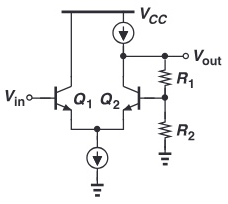

# 장말문제 12.77 — Fig 12.109 차동쌍 귀환 증폭기를 폐루프 이득 2, 꼬리 전류 1 mA, 최소 출력 임피던스로 설계

## 원문
Design the circuit of Fig. 12.109 for a closed-loop gain of 2, a tail current of $1\ \text{mA}$, and minimum output impedance. Assume $\beta = 100$ and $V_A = \infty$.

## 조건
- 회로: Fig 12.109 바이폴라 차동쌍 $Q_1$–$Q_2$ (공통 이미터 꼬리 전류원), $Q_1$ 베이스가 입력 $V_{in}$, $Q_1$ 컬렉터는 $V_{CC}$에 직접 연결, $Q_2$ 컬렉터는 $V_{CC}$에서 내려오는 전류원에 연결되고 출력 $V_{out}$, $V_{out}$과 접지 사이 $R_1$–$R_2$ 분배기의 가운데 노드가 $Q_2$ 베이스
- 목표: 폐루프 이득 2, 꼬리 전류 $1\ \text{mA}$, 출력 임피던스 최소
- $\beta = 100$, $V_A = \infty$
- Design Problems 머리말의 공통 가정은 MOS 값이라 이 BJT 회로에는 쓰이지 않음 (원문에 없음)

## 구할 것
- 회로 설계 (정할 값 예: $R_1$, $R_2$) (원문에 없음, 원문은 "설계하라"만 적음)

## 상속·참조
- Design Problems 공통 가정 (교재 728쪽 머리말, 문제에 따로 적힌 값이 우선):
  - $\mu_n C_{ox} = 2\mu_p C_{ox} = 100\ \mu\text{A/V}^2$
  - $\lambda_n = 0.5\lambda_p = 0.1\ \text{V}^{-1}$

## 회로 — Fig 12.109
```spice
Q1   VCC   Vin   n1    npn
Q2   Vout  n2    n1    npn   ; 좌우 반전 (베이스 오른쪽)
I1   VCC   Vout              ; 라벨·값 없음
I2   n1    0                 ; 라벨·값 없음 (꼬리 전류원)
R1   Vout  n2    {R_1}
R2   n2    0     {R_2}
```
- 단자: VCC = 전원, 값 미지정 (가로 레일) / Vin = 입력 (개방 원) / Vout = 출력 (개방 원)
- 표시: 노드 라벨 V_CC (레일 오른쪽 끝), V_in (입력 원 왼쪽), V_out (출력 원 오른쪽) / 소자 라벨 Q1 (Q1 오른쪽), Q2 (Q2 왼쪽), R_1, R_2 (각 저항 오른쪽), I1, I2 (라벨 없음) / 부호 없음 / 화살표 없음 / 수치·면적 라벨 없음
- 배치: 맨 위 가로 레일 V_CC, 레일 왼쪽 끝에서 세로선이 곧장 Q1 컬렉터로, 레일 오른쪽 부근에서 전류원 I1(화살표 아래)이 매달림 / Q1 npn 보통 방향 (베이스 왼쪽), V_in 원 → 가로선 → Q1 베이스 / Q2 npn 좌우 반전 (베이스 막대 오른쪽, 컬렉터 위, 이미터 왼쪽 아래·화살표 바깥) / 두 이미터 → 각각 아래로 내려와 가운데로 꺾여 만나는 꼬리 접속점 n1 → 아래로 전류원 I2(화살표 아래) → 접지 / I1 아래 접속점 → 아래로 Q2 컬렉터, 접속점에서 가로선이 오른쪽으로 R_1 위 접속점을 지나 V_out 원 / 오른쪽 세로줄 위→아래 R_1, n2 접속점, R_2, 접지 / n2 접속점에서 가로선이 왼쪽으로 Q2 베이스 / 접속점 (세 갈래 이상, 4곳): I1 아래 = 위 I1 + 아래 Q2 컬렉터 + 오른쪽 가로선 (점), R_1 위 = 왼쪽 가로선 + 오른쪽 V_out 원 + 아래 R_1 (점), n2 = 위 R_1 + 아래 R_2 + 왼쪽 Q2 베이스 선 (점), n1 = 왼쪽 Q1 이미터 + 오른쪽 Q2 이미터 + 아래 I2 (점) / 교차: 없음


> 참고: Fig 12.109는 문제 12.46의 그림(교재 725쪽, PDF 43 오른쪽 쪽). 문제 12.77 문장은 728쪽(PDF 45)에 있음
