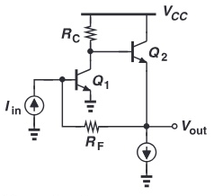

# 장말문제 12.78 — Fig 12.113 바이폴라 트랜스임피던스 증폭기를 폐루프 이득 1 kΩ, 출력 임피던스 50 Ω으로 설계

## 원문
Design the transimpedance amplifier of Fig. 12.113 for a closed-loop gain of $1\ \text{k}\Omega$ an output impedance of $50\ \Omega$. Assume each transistor is biased at a collector current of $1\ \text{mA}$ and $V_A = \infty$.

## 조건
- 회로: Fig 12.113 바이폴라 트랜스임피던스 증폭기: 공통 이미터 $Q_1$ (베이스는 입력 전류원 $I_{in}$, 이미터 접지, 컬렉터는 $R_C$를 거쳐 $V_{CC}$), 이미터 폴로어 $Q_2$ (베이스는 $Q_1$ 컬렉터, 컬렉터 $V_{CC}$, 이미터는 출력 $V_{out}$이고 아래 전류원으로 접지), $V_{out}$과 $Q_1$ 베이스 사이 귀환 저항 $R_F$
- 목표: 폐루프 이득 $1\ \text{k}\Omega$, 출력 임피던스 $50\ \Omega$
- 원문은 "closed-loop gain of 1 kΩ an output impedance of 50 Ω"으로 두 사양 사이에 "and"가 없이 인쇄됨. 두 사양을 모두 만족시키는 설계로 보고, 출력 임피던스는 폐루프 값으로 봄 (원문에 없음)
- 각 트랜지스터의 컬렉터 바이어스 전류 $1\ \text{mA}$, $V_A = \infty$
- $\beta$는 주어지지 않음 (원문에 없음)
- Design Problems 머리말의 공통 가정은 MOS 값이라 이 BJT 회로에는 쓰이지 않음 (원문에 없음)

## 구할 것
- 트랜스임피던스 증폭기 설계 (정할 값 예: $R_C$, $R_F$) (원문에 없음, 원문은 "설계하라"만 적음)

## 상속·참조
- Design Problems 공통 가정 (교재 728쪽 머리말, 문제에 따로 적힌 값이 우선):
  - $\mu_n C_{ox} = 2\mu_p C_{ox} = 100\ \mu\text{A/V}^2$
  - $\lambda_n = 0.5\lambda_p = 0.1\ \text{V}^{-1}$

## 회로 — Fig 12.113
```spice
RC   VCC   n1    {R_C}
Q1   n1    n2    0     npn
Q2   VCC   n1    Vout  npn
Iin  0     n2    {I_in}      ; 화살표 위쪽
RF   n2    Vout  {R_F}
I1   Vout  0                 ; 라벨·값 없음
```
- 단자: VCC = 전원, 값 미지정 (가로 레일) / Vout = 출력 (개방 원)
- 표시: 노드 라벨 V_CC (레일 오른쪽 끝), V_out (출력 원 오른쪽) / 소자 라벨 R_C (저항 왼쪽), Q1 (Q1 오른쪽), Q2 (Q2 오른쪽), I_in (전류원 왼쪽), R_F (저항 아래), I1 (라벨 없음) / 부호 없음 / 화살표 없음 / 수치·면적 라벨 없음
- 배치: 맨 위 가로 레일 V_CC, 왼쪽에서 R_C가 아래로 매달리고, 오른쪽 끝에서 세로선이 곧장 Q2 컬렉터로 / R_C 아래 n1 접속점 → 아래로 Q1 컬렉터, n1에서 가로선이 오른쪽으로 Q2 베이스 / Q1 npn 보통 방향 (베이스 왼쪽, 이미터 아래 → 접지) / Q2 npn 보통 방향 (베이스 왼쪽), 이미터 → 아래로 길게 내려가 Vout 접속점 / Vout 접속점에서 오른쪽으로 V_out 원, 아래로 전류원 I1(화살표 아래) → 접지 / n2 접속점(Q1 베이스 왼쪽)에서 오른쪽으로 Q1 베이스, 왼쪽으로 가서 아래로 꺾여 I_in 전류원(화살표 위쪽) → 접지, 아래로 내려가 맨 아래 가로선 높이에서 오른쪽으로 꺾여 R_F를 지나 Vout 접속점 / 접속점 (세 갈래 이상, 3곳): n1 = 위 R_C + 아래 Q1 컬렉터 + 오른쪽 Q2 베이스 선 (점), n2 = 왼쪽 I_in 선 + 오른쪽 Q1 베이스 + 아래 R_F 쪽 선 (점), Vout = 위 Q2 이미터 + 왼쪽 R_F + 오른쪽 V_out 원 + 아래 I1 (점) / 교차: 없음


> 참고: Fig 12.113은 문제 12.50의 그림(교재 725쪽, PDF 43 오른쪽 쪽). 문제 12.78 문장은 728쪽(PDF 45)에 있음
