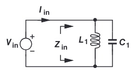

# 연습문제 13.4 — 두 주파수에서 이상적인 LC 탱크 임피던스의 크기 (예제 13.4 변형)

## 원문
$\omega = \omega_1/2$과 $\omega = 2\omega_1/2$에서의 $|Z_1|$을 결정하라.

## 조건
- 예제 13.4와 같은 회로: Fig 13.13 이상적인 병렬 LC 탱크 ($L_1$과 $C_1$ 병렬), 임피던스 $Z_1$ (그림 라벨은 $Z_{in}$) (괄호 안은 원문에 없음)
- $\omega_1 = 1/\sqrt{L_1 C_1}$: 탱크의 공진 주파수 (본문 정의, 원문에 없음)
- 식 (13.10): $|Z_1(j\omega)| = \dfrac{L_1\omega}{|1 - L_1 C_1 \omega^2|}$ (본문 식, 원문에 없음)
- 두 주파수: $\omega = \omega_1/2$, $\omega = 2\omega_1/2$
- 둘째 주파수는 인쇄대로 $2\omega_1/2$이며 값으로는 $\omega_1$(공진 주파수)과 같음 (원문에 없음)
- 소자 값은 주어지지 않음 (답은 $L_1$, $C_1$ 또는 $\omega_1$의 식으로) (원문에 없음)

## 구할 것
- $\omega = \omega_1/2$에서 $|Z_1|$
- $\omega = 2\omega_1/2$에서 $|Z_1|$

## 상속·참조
- 예제 13.4 (E13.04): 식 (13.9) $Z_1(j\omega) = \dfrac{jL_1\omega}{1 - L_1 C_1 \omega^2}$, 식 (13.10) $|Z_1(j\omega)| = \dfrac{L_1\omega}{|1 - L_1 C_1 \omega^2|}$. $|Z_1|$은 $\omega_1 = 1/\sqrt{L_1 C_1}$에서 무한대, 그 아래에서는 인덕터, 위에서는 커패시터처럼 동작

## 회로 — Fig 13.13
```spice
Vin  n1  n2
L1   n1  n2  {L_1}
C1   n1  n2  {C_1}
```
- 단자: Vin = 입력 전압원, 값 미지정 (원 기호, + 위 / − 아래) / 개방 단자 없음
- 표시: 노드 라벨 없음 / 소자 라벨 V_in (전압원 왼쪽), L_1 (인덕터 왼쪽), C_1 (커패시터 오른쪽) / 부호 + (전압원 오른쪽 위), − (전압원 오른쪽 아래) / 화살표 "I_in": 위 가로 도선, 오른쪽 방향(전압원 쪽 → 탱크 쪽), 도선 위, 글자는 화살표 위; "Z_in": 탱크 쪽(오른쪽)을 들여다봄, 오른쪽 방향, 도선 옆 별도 화살표 한 쌍 (위는 ┌ 꺾임, 아래는 L자, 두 화살촉 모두 오른쪽), 글자는 두 화살표 사이 / 수치·면적 라벨 없음
- 배치: 사각 고리 모양 / 왼쪽 세로선 가운데에 전압원 V_in / 위 가로선과 아래 가로선이 오른쪽으로 뻗고, 오른쪽에 L_1(세로)과 그보다 오른쪽 C_1(세로)이 위·아래 가로선 사이에 병렬 / 접지 기호 없음 / 접속점 (세 갈래 이상, 2곳): ① L_1 위 = 왼쪽 위 가로선 + 오른쪽 C_1 쪽 선 + 아래 L_1 (점) ② L_1 아래 (점) / C_1 쪽 모서리는 꺾임만 / 교차: 없음


