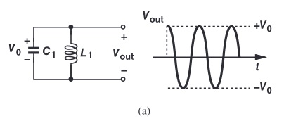

# 연습문제 13.6 — 이상적인 탱크의 인덕터에 저장되는 최대 에너지 (예제 13.6 변형)

## 원문
그림 13.17(a)의 $L_1$에 저장되는 최대 에너지를 계산하라.

## 조건
- 회로: Fig 13.17(a) 외부와 분리된 이상적인 병렬 탱크 ($C_1$과 $L_1$ 병렬)
- 초기 조건: 커패시터 $C_1$ 양단에 초기 전압 $V_0$ (예제 13.6의 가정) (원문에 없음)
- 출력 $V_{out}$은 $+V_0$와 $-V_0$ 사이를 감쇠 없이 흔들리는 사인파 (Fig 13.17(a) 파형 패널, 예제 13.6의 결과) (원문에 없음)
- 소자 값은 주어지지 않음 (답은 기호로) (원문에 없음)

## 구할 것
- $L_1$에 저장되는 최대 에너지

## 상속·참조
- 예제 13.6 (E13.06): 커패시터 양단에 초기 전압 $V_0$를 준 분리된 탱크. 이상적이면 $C_1$의 전기 에너지가 $L_1$의 자기 에너지로 바뀌고($V_{out} = 0$일 때 $L_1$의 전류로 에너지를 옮김) 다시 $C_1$을 $-V_0$ 쪽으로 충전하는 에너지 전송이 무기한 반복

## 회로 — Fig 13.17(a)
```spice
C1  out1  out2  {C_1}   ; 초기 전압 V0 (+ 위, − 아래)
L1  out1  out2  {L_1}
* out1/out2: 두 출력 원 사이에 V_out 하나만 인쇄 (차동 출력, + 위 / − 아래)
```
- 단자: out1, out2 = 출력 V_out (개방 원 두 개, 위·아래)
- 표시: 노드 라벨 V_out (두 출력 원 사이 왼쪽) / 소자 라벨 V_0 (커패시터 왼쪽, 초기 전압), C_1 (커패시터 오른쪽), L_1 (인덕터 오른쪽) / 부호 + (C_1 왼쪽 위), − (C_1 왼쪽 아래), + (위 출력 원 아래), − (아래 출력 원 위) / 화살표 없음 / 수치·면적 라벨 없음
- 배치: 사각 모양 / 왼쪽 세로 가지 C_1, 가운데 세로 가지 L_1, 위·아래 가로선이 오른쪽으로 뻗어 위 출력 원, 아래 출력 원에서 끝남 / 접지 기호 없음 / 접속점 (세 갈래 이상, 2곳): ① L_1 위 = 왼쪽 C_1 쪽 선 + 오른쪽 출력선 + 아래 L_1 (점) ② L_1 아래 (점) / 교차: 없음


> 참고: 크롭 오른쪽은 (a)의 파형 패널. 세로 라벨 "V_out", 가로축 화살표 "t". 굵은 곡선이 "+V_0"(위 점선 레벨)에서 시작해(시작점에서 가로축까지 세로 점선) "−V_0"(아래 점선 레벨)까지 내려갔다 올라오는 같은 진폭의 사인파를 약 2¼ 주기 그림 (마지막은 가로축에서 끝남)
