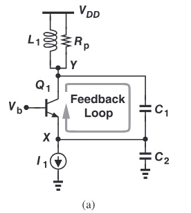

# 연습문제 13.8 — 콜피츠 발진기 노드 Y의 dc 전압과 발진 파형

## 원문
그림 13.22(a)의 노드 $Y$에서 dc 전압은 얼마인가? 이 노드에서 발진 파형을 그릴 수 있는가?

## 조건
- 회로: Fig 13.22(a) 콜피츠 발진기 ($Q_1$, 탱크 $L_1 \parallel R_p$, $C_1$, $C_2$, 바이어스 전류원 $I_1$)
- $I_1$은 $Q_1$의 바이어스 전류, $V_b$는 $Q_1$이 순방향 활성 영역에 있도록 정한 바이어스 전압 (본문 정의, 원문에 없음)
- 소자 값은 주어지지 않음 (답은 기호로) (원문에 없음)

## 구할 것
- 노드 $Y$의 dc 전압
- 노드 $Y$의 발진 파형 (그릴 수 있는지, 그려 보기)

## 상속·참조
- 예제 13.8 (E13.08): 같은 13.3.3절 콜피츠 발진기. 스타트업 조건 $g_m R_p \ge (C_1 + C_2)^2/(C_1 C_2)$ (식 13.26), 발진 주파수 $\omega_1^2 \approx 1/[L_1 C_1 C_2/(C_1 + C_2)]$ (식 13.25)
- 본문 13.3.3절: $I_1$은 $Q_1$의 바이어스 전류, $V_b$는 $Q_1$을 순방향 활성 영역에 두는 바이어스. 인덕터 손실은 $R_p$로 나타냄

## 회로 — Fig 13.22(a)
```spice
L1  VDD  Y   {L_1}
Rp  VDD  Y   {R_p}
Q1  Y    Vb  X  npn
C1  Y    X   {C_1}
I1  X    0
C2  X    0   {C_2}
```
- 단자: VDD = 전원, 값 미지정 (T 전원 기호) / Vb = Q1 베이스 바이어스, 값 미지정 (점 단자)
- 표시: 노드 라벨 V_DD (T 기호 오른쪽), V_b (점 단자 왼쪽), Y (Y 접속점 오른쪽), X (X 접속점 왼쪽) / 소자 라벨 L_1 (인덕터 왼쪽), R_p (저항 오른쪽), Q_1 (트랜지스터 왼쪽 위), C_1 (C1 오른쪽), C_2 (C2 오른쪽), I_1 (전류원 왼쪽) / 부호 없음 / 화살표 "Feedback Loop": Q1 오른쪽과 C_1 사이를 도는 귀환 루프, 왼쪽 변에서 위 방향(이미터 쪽 → 컬렉터 쪽), 도선 옆 별도 화살표 (둥근 모서리 사각 루프, 회색, 글자는 루프 안) / 수치·면적 라벨 없음
- 배치: 맨 위 V_DD T 기호에서 L_1(왼쪽)과 R_p(오른쪽)가 나란히 내려와 아래 끝이 짧은 가로선으로 모임 / 왼쪽 세로줄 위→아래 L_1∥R_p, Y, Q1(컬렉터 위·이미터 아래, 베이스 왼쪽, 보통 방향), X, I_1(화살표 아래), 접지 / V_b 점 단자에서 가로선이 오른쪽으로 베이스 / Y 아래 접속점에서 가로선이 오른쪽 끝까지 가서 아래로 C_1, C_1 아래 접속점, C_2, 접지 / X 접속점에서 가로선이 오른쪽으로 C_1–C_2 사이 접속점까지 / 접속점 (세 갈래 이상, 4곳): ① Y = L_1 아래 끝에서 오는 가로선 + R_p 아래 끝에서 오는 가로선 + 아래 세로선 (점, Y 라벨 왼쪽) ② Y 바로 아래 = 위 세로선 + 아래 Q1 컬렉터 + 오른쪽 C_1 가로선 (점) ③ X = 위 Q1 이미터 + 아래 I_1 + 오른쪽 가로선 (점) ④ C_1 아래 = 위 C_1 + 아래 C_2 + 왼쪽 X 가로선 (점) / 교차: 없음


