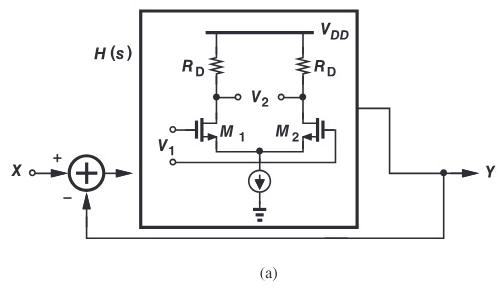
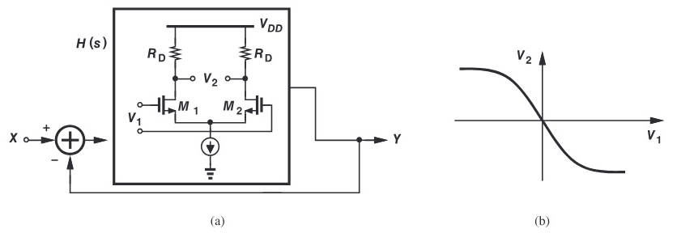

# 예제 13.1 — 차동쌍을 쓰는 발진기의 출력 진폭 제한

## 원문
발진기는 차동쌍을 활용한다[그림 13.5(a)]. 출력 진폭을 어떤 요인이 제한하는지 설명하라.

## 조건
- 회로: Fig 13.5(a) 귀환 루프. 입력 $X$와 귀환된 출력 $Y$가 덧셈기에서 $X - Y$로 합쳐져 $H(s)$ 상자로 들어가고, $H(s)$ 상자 안에 MOS 차동쌍($M_1$, $M_2$, 부하 $R_D$ 두 개, 테일 전류원)
- 차동쌍의 차동 입력은 $V_1$, 차동 출력은 $V_2$
- 소자 값은 주어지지 않음 (답은 기호와 설명으로) (원문에 없음)

## 구할 것
- 출력 진폭을 제한하는 요인 설명

## 상속·참조
- 본문 13.1절 (교재 733쪽, 그림 13.4): 공급 전압이 1.5 V이면 그보다 큰 진폭을 만들기 어렵다. 공통 소스 단이 $H(s)$ 안에서 증폭할 때 출력 스윙이 커지면 $M_1$이 트라이오드 영역에 들어가 트랜스컨덕턴스가 줄고, 루프 이득이 1에 가까워질 때까지 감소한다
- 10장 차동쌍의 대신호 동작: 차동 입력이 충분히 크면 테일 전류 $I_{SS}$가 한쪽 트랜지스터로 모두 흐르고, 차동 출력은 $\pm I_{SS} R_D$에서 포화한다

## 회로 — Fig 13.5(a)
```spice
Xsum  X     Y    n1  sum        ; X +, Y −
* H(s) 상자: 덧셈기 출력 n1의 화살표가 상자 왼쪽 변에 닿고, 상자 오른쪽 변에서 나온 선이 Y. 상자 안 차동쌍의 단자(V1, V2 원)와 상자 입출력선은 그림에서 선으로 이어지지 않음
XH    n1    Y    gain "H(s)"
* H(s) 상자 안 차동쌍
RD1   VDD   out1  {R_D}         ; 인쇄 라벨 R_D (왼쪽)
RD2   VDD   out2  {R_D}         ; 인쇄 라벨 R_D (오른쪽)
M1    out1  in1   n2  nmos
M2    out2  in2   n2  nmos
I1    n2    0                   ; 라벨·값 없음
* in1/in2: 두 입력 원 사이에 V_1 하나만 인쇄 (차동 입력), out1/out2: 두 출력 원 사이에 V_2 하나만 인쇄 (차동 출력)
```
- 단자: X = 루프 입력 (개방 원) / Y = 루프 출력, 화살촉 뒤 라벨만 있음 (선 끝) / VDD = 전원, 값 미지정 (가로 레일) / in1, in2 = 차동쌍 차동 입력 V_1 (개방 원 두 개) / out1, out2 = 차동쌍 차동 출력 V_2 (개방 원 두 개)
- 표시: 노드 라벨 X (입력 원 왼쪽), Y (오른쪽 화살촉 오른쪽), V_DD (레일 오른쪽 끝 위), V_1 (왼쪽 두 입력 원 사이, 위 원 아래), V_2 (두 출력 원 사이) / 소자 라벨 H(s) (상자 왼쪽 위 바깥), R_D (왼쪽 저항 왼쪽), R_D (오른쪽 저항 오른쪽), M1 (M1 오른쪽), M2 (M2 왼쪽), 테일 전류원 I1 (라벨 없음) / 부호 + (덧셈기 왼쪽 X 입력 화살표 위), − (덧셈기 아래 귀환 입력 왼쪽) / 화살표 X 입력 (라벨 없음): X 원 → 덧셈기, 오른쪽, 도선 위; 덧셈기 출력 (라벨 없음): 덧셈기 → H(s) 상자 왼쪽 변, 오른쪽, 도선 위; Y 출력 (라벨 없음): 접속점 → Y, 오른쪽, 도선 위; 귀환 (라벨 없음): 아래 귀환선 → 덧셈기 아래, 위쪽, 도선 위 / 수치·면적 라벨 없음
- 배치: 왼쪽에 X 원 → 덧셈기(⊕ 원) → 화살표, 가운데에 실선 사각형 H(s) 상자 / 상자 안: 맨 위 가로 레일 V_DD, 레일 양 끝 근처에서 R_D 두 개가 아래로, 각 R_D 아래 드레인 접속점에서 짧은 가로선이 안쪽으로 뻗어 V_2 원 두 개(왼쪽 원은 왼쪽 드레인, 오른쪽 원은 오른쪽 드레인) / M1 보통 방향(게이트 왼쪽), M2 좌우 반전(게이트 오른쪽) / 위 V_1 원 → 가로선 → M1 게이트 / 아래 V_1 원에서 가로선이 오른쪽으로 상자 거의 끝까지 가서 위로 꺾여 M2 게이트로 들어감 / 두 소스는 가로선으로 가운데 n2 접속점에서 만나고, 그 아래로 테일 전류원(화살표 아래), 그 아래 접지 / 상자 오른쪽 변 가운데쯤에서 나온 선이 오른쪽으로 갔다가 아래로 꺾여 Y 높이에서 다시 오른쪽으로 가서 Y 접속점, 화살촉, Y / Y 접속점에서 아래로 내려가 상자 아래를 왼쪽으로 지나 덧셈기 아래에서 위로 꺾여 덧셈기로 들어감 / 접속점 (세 갈래 이상, 4곳): ① 왼쪽 드레인 = 위 R_D + 아래 M1 드레인 + 오른쪽 V_2 원 선 (점) ② 오른쪽 드레인 = 위 R_D + 아래 M2 드레인 + 왼쪽 V_2 원 선 (점) ③ n2 = 왼쪽 M1 소스 선 + 오른쪽 M2 소스 선 + 아래 전류원 (점) ④ Y 접속점 = 왼쪽 상자 출력선 + 오른쪽 Y 화살표 + 아래 귀환선 (점) / 교차: 아래 V_1 원의 가로선이 n2에서 전류원으로 내려가는 세로선과 점 없이 교차



## 답 (검증용)
- 차동쌍의 입력 스윙이 커지면 회로가 포화 영역에 들어가 차동쌍의 이득(입력/출력 특성의 기울기)이 떨어지고 루프 이득도 감소 → 발진 진폭의 성장이 멈춤 (10장 차동쌍의 대신호 동작)
- $V_1$이 충분히 크면 테일 전류가 완전히 왼쪽 또는 오른쪽으로 흘러 $V_2$는 $-I_{SS}R_D$에서 $+I_{SS}R_D$로 스윙 → 최대 발진 진폭
- 테일 전류 $I_{SS}$는 Fig 13.5(a)에 라벨로 인쇄되지 않음 (원문에 없음)
- Fig 13.5(b): 세로축 화살표 "V_2", 가로축 화살표 "V_1". 곡선은 왼쪽에서 양의 일정한 값으로 평탄하다가 원점을 지나 내려가 오른쪽에서 음의 일정한 값으로 평탄해짐 (원점 대칭 S자, 기울기 음). 평탄 레벨에 수치 라벨 없음


