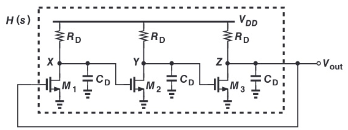

# 예제 13.2 — SPICE 과도 해석에서 3단 링 발진기가 발진하지 않는 이유

## 원문
한 학생이 그림 13.8의 링 발진기에서 과도(transient) SPICE 시뮬레이션을 수행하여, 3개의 모든 드레인 전압들이 동일하며, 회로가 발진하지 않는 것을 관찰하였다. 왜 그런지 설명하라. 각 단들은 동일하다고 가정한다.

## 조건
- 회로: Fig 13.8 간단한 3단 링 발진기 (공통 소스 단 3개: $M_1$–$M_3$, 각 단의 부하 $R_D$와 드레인 커패시턴스 $C_D$, 마지막 단 출력 $Z$가 첫 단 게이트로 귀환)
- 각 단은 동일하다고 가정
- 관찰: 과도 SPICE 시뮬레이션에서 세 드레인 전압이 모두 같고 회로가 발진하지 않음
- 소자 값은 주어지지 않음 (답은 설명으로) (원문에 없음)

## 구할 것
- 회로가 발진하지 않는 이유 설명

## 상속·참조
- 본문 13.2절 (교재 736–737쪽): 각 단은 $-60^\circ$의 위상 시프트를 제공해야 하므로 식 (13.2) $-\tan^{-1}(R_D C_D \omega_1) = -60^\circ$, 식 (13.3) $\omega_1 = \sqrt{3}/(R_D C_D)$. 스타트업 조건에서 각 단의 저주파 이득은 식 (13.6) $g_m R_D = 2$를 넘어야 함

## 회로 — Fig 13.8
```spice
RD1  VDD  X  {R_D}    ; 인쇄 라벨 R_D
RD2  VDD  Y  {R_D}    ; 인쇄 라벨 R_D
RD3  VDD  Z  {R_D}    ; 인쇄 라벨 R_D
M1   X    Z  0  nmos  ; 게이트는 귀환선으로 Z(Vout)에 연결
M2   Y    X  0  nmos
M3   Z    Y  0  nmos
CD1  X    0  {C_D}    ; 인쇄 라벨 C_D
CD2  Y    0  {C_D}    ; 인쇄 라벨 C_D
CD3  Z    0  {C_D}    ; 인쇄 라벨 C_D
* Vout 원은 Z 노드에서 오른쪽으로 뻗은 선 끝 (노드 이름 Z)
```
- 단자: VDD = 전원, 값 미지정 (가로 레일) / Z = 출력 Vout (개방 원)
- 표시: 노드 라벨 X, Y, Z (각 드레인 접속점 왼쪽 위), V_DD (레일 오른쪽 끝), V_out (출력 원 오른쪽) / 소자 라벨 H(s) (점선 상자 왼쪽 위 바깥), R_D 세 개 (각 저항 오른쪽), M1, M2, M3 (각 트랜지스터 오른쪽, 소스 옆), C_D 세 개 (각 커패시터 오른쪽) / 부호 없음 / 화살표 없음 / 수치·면적 라벨 없음
- 배치: 굵은 점선 사각형 상자가 레일·세 단을 모두 둘러쌈, 상자 왼쪽 위 바깥에 H(s) / 맨 위 가로 레일 V_DD에서 R_D 세 개가 아래로 / 각 단 세로줄 위→아래 R_D, 드레인 접속점(X, Y, Z), 트랜지스터, 접지 / 세 트랜지스터 모두 NMOS 보통 방향(게이트 왼쪽) / 각 드레인 접속점에서 가로선이 오른쪽으로 C_D 접속점을 지나고, X·Y 단은 그 선이 아래로 꺾여 다음 단 게이트 높이에서 오른쪽으로 들어감 / C_D는 각 C_D 접속점에서 아래로, 그 아래 접지 / Z 단의 가로선은 C_D 접속점을 지나 점선 상자 오른쪽 변을 넘어 귀환 접속점을 거쳐 V_out 원에서 끝남 / 귀환선: 귀환 접속점에서 아래로 상자 아래를 지나 왼쪽으로 가서 상자 왼쪽 바깥에서 위로 올라가 M1 게이트 높이에서 오른쪽으로 꺾여 상자 왼쪽 변을 넘어 M1 게이트로 들어감 / 접지 기호는 각 소스 아래, 각 C_D 아래에 따로 / 접속점 (세 갈래 이상, 7곳): ① X = 위 R_D + 아래 M1 드레인 + 오른쪽 가로선 (점) ② X 단 C_D 위 = 왼쪽 선 + 오른쪽 선 + 아래 C_D (점) ③ Y = 위 R_D + 아래 M2 드레인 + 오른쪽 가로선 (점) ④ Y 단 C_D 위 (점) ⑤ Z = 위 R_D + 아래 M3 드레인 + 오른쪽 가로선 (점) ⑥ Z 단 C_D 위 (점) ⑦ 귀환 접속점 = 왼쪽 Z 선 + 오른쪽 V_out 선 + 아래 귀환선 (점, 점선 상자 바깥) / 교차: 신호선은 서로 교차하지 않음. 점선 상자 변을 Z 출력선(오른쪽 변)과 귀환선(왼쪽 변, M1 게이트 높이)이 가로지름



## 답 (검증용)
- 과도 시뮬레이션을 시작할 때 SPICE는 모든 소자의 dc 동작점을 계산한다. 단이 동일하므로 같은 드레인 전압이 네트워크의 한 정답이고 SPICE는 그것을 유지 → 세 드레인 전압이 무제한으로 같은 값. 실제 회로에서는 소자의 전자 잡음이 이 전압을 교란해 발진이 일어나지만 SPICE 과도 해석은 잡음을 무시
- 회로에 '자극'을 주려면 예를 들어 노드 $X$에 0을 인가하는 등 초기 조건을 적용 → 그 결과 $V_Y = V_{DD}$, $V_Z \approx 0$이 되면서 $V_X$가 $V_{DD}$로 상승하므로 SPICE가 평형점을 찾지 못하고 발진이 일어남
