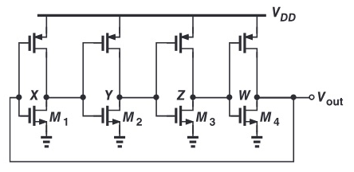

# 예제 13.3 — 인버터 4개로 4단 링 발진기를 만들 수 있는가

## 원문
4개의 인버터들을 연속으로 연결하여 4단 링 발진기를 구성할 수 있을까?

## 조건
- CMOS 인버터 4개를 연속(고리 모양)으로 연결한 4단 링 발진기
- 소자 값은 주어지지 않음 (답은 설명으로) (원문에 없음)

## 구할 것
- 4단 링 발진기를 구성할 수 있는지 판단하고 이유 설명

## 상속·참조
- 본문 Fig 13.9(b) (교재 738쪽, 이 파일의 그림 목록에는 넣지 않음, 크롭은 fig13-09-b.png): CMOS 인버터 3개($M_1$–$M_3$ NMOS, $M_4$–$M_6$ PMOS)로 된 3단 링. 각 인버터는 PMOS와 NMOS의 게이트끼리, 드레인끼리 연결되고, 드레인 $X$, $Y$, $Z$가 다음 인버터 입력, $Z$(V_out)가 첫 인버터 입력으로 귀환
- 본문 13.2절 (교재 738쪽, Fig 13.10): 3단 인버터 링에서 $V_X$가 0에서 시작하면 $V_Y = V_{DD}$, $V_Z = 0$이 되고, 첫 번째 단이 $V_X$를 $V_{DD}$로 올리려 해서 세 전압이 0과 $V_{DD}$ 사이를 차례로 토글하며 발진. 각 단의 지연이 $T_D$면 주기는 $6T_D$
- 바르크하우젠의 첫 번째 조건: 발진 주파수에서 루프 이득의 크기가 1 이상

## 회로 — 없음 (그림 없는 글 문제, 4단 인버터 링 그림은 풀이에만 있음)

## 답 (검증용)
- 불가능하다. Fig 13.11의 링이 $V_X = 0$에서 시작한다고 가정하면 $V_Y = V_{DD}$, $V_Z = 0$, $V_W = V_{DD}$. 첫 번째 단은 높은 입력을 감지하므로 무기한으로 낮은 출력을 유지
- 모든 트랜지스터가 꺼지거나(드레인 전류 0) 깊은 트라이오드 영역에 빠져 루프 이득이 0 → 바르크하우젠의 첫 번째 조건 위반. 이 회로를 '래치 업'이라 부름. 일반적으로 짝수 개의 인버터를 갖는 싱글엔디드 출력 링 발진기에서는 래치 업이 발생

### 정답 회로 — Fig 13.11
```spice
MP1  X  W  VDD  pmos
M1   X  W  0    nmos
MP2  Y  X  VDD  pmos
M2   Y  X  0    nmos
MP3  Z  Y  VDD  pmos
M3   Z  Y  0    nmos
MP4  W  Z  VDD  pmos
M4   W  Z  0    nmos
* Vout 원은 W 노드에서 오른쪽으로 뻗은 선 끝 (노드 이름 W), 귀환선이 W를 첫 인버터 입력으로 연결
```
- 단자: VDD = 전원, 값 미지정 (가로 레일) / W = 출력 Vout (개방 원)
- 표시: 노드 라벨 X, Y, Z, W (각 인버터 드레인 접속점 왼쪽 위), V_DD (레일 오른쪽 끝), V_out (출력 원 오른쪽) / 소자 라벨 M1, M2, M3, M4 (각 NMOS 오른쪽, 소스 옆), MP1–MP4 (라벨 없음, PMOS 네 개) / 부호 없음 / 화살표 없음 / 수치·면적 라벨 없음
- 배치: 맨 위 굵은 가로 레일 V_DD, 네 인버터가 왼쪽→오른쪽으로 나란함 / 각 인버터 세로줄 위→아래 PMOS(소스가 레일, 게이트 왼쪽), 드레인 접속점(X, Y, Z, W), NMOS(게이트 왼쪽), 접지 / 각 인버터 입력: 왼쪽 입력 접속점에서 세로선이 위로 PMOS 게이트, 아래로 NMOS 게이트 높이까지 가서 오른쪽으로 꺾여 각 게이트로 들어감 / 각 드레인 접속점에서 가로선이 오른쪽 다음 인버터의 입력 접속점으로 / W에서 오른쪽 가로선이 귀환 접속점을 지나 V_out 원에서 끝남 / 귀환선: 귀환 접속점에서 아래로 접지들 아래를 지나 왼쪽으로 가서 첫 인버터 왼쪽에서 위로 올라가 X 높이에서 오른쪽으로 꺾여 첫 입력 접속점으로 들어감 / 접속점 (세 갈래 이상, 9곳): ① 첫 입력 = 왼쪽 귀환선 + 위 PMOS 게이트 선 + 아래 M1 게이트 선 (점) ② X = 위 PMOS 드레인 + 아래 M1 드레인 + 오른쪽 선 (점) ③ 둘째 입력 = 왼쪽 X 선 + 위·아래 게이트 선 (점) ④ Y (점) ⑤ 셋째 입력 (점) ⑥ Z (점) ⑦ 넷째 입력 (점) ⑧ W = 위 PMOS 드레인 + 아래 M4 드레인 + 오른쪽 선 (점) ⑨ 귀환 접속점 = 왼쪽 W 선 + 오른쪽 V_out 선 + 아래 귀환선 (점) / 교차: 없음


