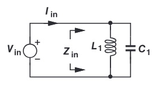
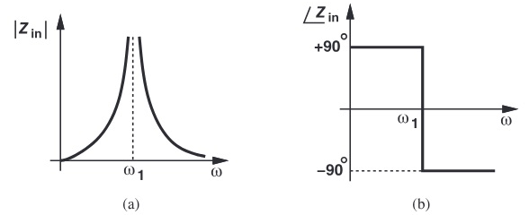

# 예제 13.4 — 이상적인 병렬 LC 탱크 임피던스의 크기와 위상

## 원문
$Z_1(j\omega)$의 크기와 위상을 주파수 함수로 스케치하라.

## 조건
- 회로: Fig 13.13 이상적인 병렬 LC 탱크 ($L_1$과 $C_1$ 병렬), 입력 전압원 $V_{in}$이 탱크를 구동하고 전류 $I_{in}$이 흘러 들어감
- $Z_1$: 이 탱크의 임피던스. 그림에는 같은 임피던스가 $Z_{in}$으로 표시됨 (원문에 없음)
- 식 (13.7)–(13.8): $Z_1(s) = (L_1 s) \parallel \dfrac{1}{C_1 s} = \dfrac{L_1 s}{L_1 C_1 s^2 + 1}$ (본문 식, 원문에 없음)
- 식 (13.9): $Z_1(j\omega) = \dfrac{jL_1\omega}{1 - L_1 C_1 \omega^2}$ (본문 식, 원문에 없음)
- $\omega_1 = 1/\sqrt{L_1 C_1}$: 탱크의 공진 주파수 (본문 정의, 원문에 없음)
- 소자 값은 주어지지 않음 (답은 그래프 모양으로) (원문에 없음)

## 구할 것
- $Z_1(j\omega)$의 크기 $|Z_1(j\omega)|$를 주파수의 함수로 스케치
- $Z_1(j\omega)$의 위상 $\angle Z_1(j\omega)$를 주파수의 함수로 스케치

## 상속·참조
- 본문 13.3.1절 (교재 741쪽): 식 (13.7) $Z_1(s) = (L_1 s) \parallel \dfrac{1}{C_1 s}$, 식 (13.8) $= \dfrac{L_1 s}{L_1 C_1 s^2 + 1}$, 식 (13.9) $Z_1(j\omega) = \dfrac{jL_1\omega}{1 - L_1 C_1 \omega^2}$. $\omega_1 = 1/\sqrt{L_1 C_1}$에서 임피던스가 무한대로 수렴(공진)
- Fig 13.13은 본문 그림(캡션 "병렬 LC 탱크의 임피던스")이고 예제 문장은 그림 번호를 말하지 않음. 예제가 바로 이 탱크의 임피던스를 묻으므로 문제 그림으로 넣음

## 회로 — Fig 13.13
```spice
Vin  n1  n2
L1   n1  n2  {L_1}
C1   n1  n2  {C_1}
```
- 단자: Vin = 입력 전압원, 값 미지정 (원 기호, + 위 / − 아래) / 개방 단자 없음
- 표시: 노드 라벨 없음 / 소자 라벨 V_in (전압원 왼쪽), L_1 (인덕터 왼쪽), C_1 (커패시터 오른쪽) / 부호 + (전압원 오른쪽 위), − (전압원 오른쪽 아래) / 화살표 "I_in": 위 가로 도선, 오른쪽 방향(전압원 쪽 → 탱크 쪽), 도선 위, 글자는 화살표 위; "Z_in": 탱크 쪽(오른쪽)을 들여다봄, 오른쪽 방향, 도선 옆 별도 화살표 한 쌍 (위는 ┌ 꺾임, 아래는 L자, 두 화살촉 모두 오른쪽), 글자는 두 화살표 사이 / 수치·면적 라벨 없음
- 배치: 사각 고리 모양 / 왼쪽 세로선 가운데에 전압원 V_in / 위 가로선과 아래 가로선이 오른쪽으로 뻗고, 오른쪽에 L_1(세로)과 그보다 오른쪽 C_1(세로)이 위·아래 가로선 사이에 병렬 / 접지 기호 없음 / 접속점 (세 갈래 이상, 2곳): ① L_1 위 = 왼쪽 위 가로선 + 오른쪽 C_1 쪽 선 + 아래 L_1 (점) ② L_1 아래 (점) / C_1 쪽 모서리는 꺾임만 / 교차: 없음



## 답 (검증용)
- 식 (13.10): $|Z_1(j\omega)| = \dfrac{L_1\omega}{|1 - L_1 C_1 \omega^2|}$ → Fig 13.14(a): $\omega = 0$에서 0, $\omega_1$에서 무한대, $\omega \to \infty$에서 0
- 위상: $\omega < \omega_1$이면 $1 - L_1 C_1 \omega^2 > 0$이라 $\angle Z_1(j\omega) = \angle(jL_1\omega) = +90^\circ$, $\omega > \omega_1$이면 $1 - L_1 C_1 \omega^2 < 0$이라 $\angle Z_1(j\omega) = \angle(jL_1\omega_1) - 180^\circ = -90^\circ$ (Fig 13.14(b)). 탱크는 $\omega < \omega_1$에서 인덕터, $\omega > \omega_1$에서 커패시터 역할
- Fig 13.14(a): 세로축 화살표 "|Z_in|", 가로축 화살표 "ω". 곡선은 원점에서 시작해 "ω_1"의 세로 점선 쪽으로 위로 치솟고(그림 위 끝까지), 점선 오른쪽에서 위에서부터 내려와 오른쪽으로 0에 다가감
- Fig 13.14(b): 세로축 화살표 "∠Z_in", 가로축 화살표 "ω" (가운데 높이). 굵은 선이 "+90°" 높이에서 수평으로 가다가 "ω_1"에서 수직으로 "−90°"까지 떨어져 그 뒤 수평. "−90°" 레벨은 세로축에서 수직 낙하선까지 점선
- 그림 라벨은 Z_in, 예제와 본문 답은 Z_1로 적음 (원문에 없음)


