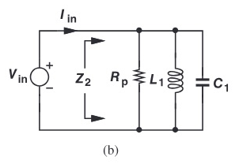
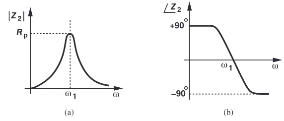

# 예제 13.5 — 손실 탱크(병렬 모델)의 임피던스 크기와 위상

## 원문
그림 13.15(b)에서 $Z_2(s)$의 크기와 위상을 주파수 함수로 그려라.

## 조건
- 회로: Fig 13.15(b) 손실 탱크의 병렬 등가 회로 ($R_p$, $L_1$, $C_1$ 병렬), 입력 전압원 $V_{in}$이 탱크를 구동하고 전류 $I_{in}$이 흘러 들어감
- $Z_2$: 탱크 쪽을 들여다본 임피던스
- $\omega_1 = 1/\sqrt{L_1 C_1}$: 탱크의 공진 주파수 (본문 정의, 원문에 없음)
- 소자 값은 주어지지 않음 (답은 그래프 모양으로) (원문에 없음)

## 구할 것
- $Z_2$의 크기 $|Z_2|$를 주파수의 함수로 그리기
- $Z_2$의 위상 $\angle Z_2$를 주파수의 함수로 그리기

## 상속·참조
- 본문 Fig 13.15(a) (교재 742쪽, 이 파일의 그림 목록에는 넣지 않음, 크롭은 fig13-15-a.png): 손실 탱크. 같은 $V_{in}$, $I_{in}$, $Z_2$ 표시에서 $L_1$과 직렬 저항 $R_1$이 한 가지, $C_1$이 다른 가지로 병렬. Fig 13.15(b)는 (a)의 등가 회로
- 식 (13.11): 공진 주파수 주변의 좁은 범위에서 두 탱크가 거의 등가가 되려면 $R_p = \dfrac{L_1^2\omega^2}{R_1}$. 이상적인 인덕터는 $R_1 = 0$, $R_p = \infty$

## 회로 — Fig 13.15(b)
```spice
Vin  n1  n2
RP   n1  n2  {R_p}
L1   n1  n2  {L_1}
C1   n1  n2  {C_1}
```
- 단자: Vin = 입력 전압원, 값 미지정 (원 기호, + 위 / − 아래) / 개방 단자 없음
- 표시: 노드 라벨 없음 / 소자 라벨 V_in (전압원 왼쪽), R_p (저항 왼쪽), L_1 (인덕터 왼쪽, R_p와 L_1 사이), C_1 (커패시터 오른쪽) / 부호 + (전압원 오른쪽 위), − (전압원 오른쪽 아래) / 화살표 "I_in": 위 가로 도선, 오른쪽 방향(전압원 쪽 → 탱크 쪽), 도선 위, 글자는 화살표 위; "Z_2": 탱크 쪽(오른쪽)을 들여다봄, 오른쪽 방향, 도선 옆 별도 화살표 한 쌍 (위는 ┌ 꺾임, 아래는 L자, 두 화살촉 모두 오른쪽), 글자는 두 화살표 사이 / 수치·면적 라벨 없음
- 배치: 사각 고리 모양 / 왼쪽 세로선 가운데에 전압원 V_in / 위·아래 가로선 사이에 왼쪽→오른쪽 R_p, L_1, C_1이 세로로 병렬 / 접지 기호 없음 / 접속점 (세 갈래 이상, 4곳): ① R_p 위 (점) ② L_1 위 (점) ③ R_p 아래 (점) ④ L_1 아래 (점) / C_1 쪽 모서리는 꺾임만 / 교차: 없음



## 답 (검증용)
- 식 (13.12)–(13.13): $Z_2(s) = R_p \parallel (L_1 s) \parallel \dfrac{1}{C_1 s} = \dfrac{R_p L_1 s}{R_p L_1 C_1 s^2 + L_1 s + R_p}$, 식 (13.14): $Z_2(j\omega) = \dfrac{jR_p L_1\omega}{R_p(1 - L_1 C_1\omega^2) + jL_1\omega}$
- $\omega_1 = 1/\sqrt{L_1 C_1}$에서 인덕터와 커패시터의 임피던스가 상쇄되어 $Z_2(j\omega_1) = R_p$, $\angle Z_2(j\omega_1) = 0$. 매우 낮은 주파수에서는 $Z_2 \approx jL_1\omega$, 매우 높은 주파수에서는 $Z_2 \approx 1/(jC_1\omega)$ → Fig 13.16
- Fig 13.16(a): 세로축 화살표 "|Z_2|", 가로축 화살표 "ω". 곡선은 원점에서 시작해 올라가 "ω_1"(세로 점선)에서 둥근 봉우리 "R_p"(세로축에서 봉우리까지 가로 점선)에 이른 뒤 내려가 오른쪽으로 0에 다가감
- Fig 13.16(b): 세로축 화살표 "∠Z_2", 가로축 화살표 "ω" (가운데 높이). 곡선은 "+90°" 높이에서 평탄하다가 부드럽게 내려가 "ω_1"에서 가로축(0)을 지나고 "−90°"(세로축에서 점선)에 다가가 평탄해짐


