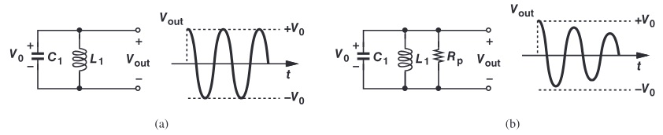

# 예제 13.6 — 초기 전압을 준 분리된 병렬 탱크의 시간 영역 동작

## 원문
분리된 병렬 탱크 내의 커패시터 양단의 $V_0$의 초기 전압을 인가했다고 가정하자. 만약 탱크가 이상적이거나 손실이 있을 경우, 시간 영역에서의 회로의 동작을 분석하라.

## 조건
- 외부와 분리된 병렬 탱크 (인덕터 $L_1$과 커패시터 $C_1$ 병렬, 손실이 있으면 병렬 저항 $R_p$도) (괄호 안은 원문에 없음)
- 초기 조건: 커패시터 양단에 초기 전압 $V_0$
- 두 경우: 탱크가 이상적인 경우, 손실이 있는 경우
- 소자 값은 주어지지 않음 (답은 파형 모양과 설명으로) (원문에 없음)

## 구할 것
- 이상적인 탱크와 손실 탱크 각각에서 시간 영역 회로 동작 분석

## 상속·참조
- 본문 13.3.1절 (교재 742–743쪽, Fig 13.15(b)): 손실 탱크는 $L_1$, $C_1$과 병렬 저항 $R_p$로 모델링. 이상적인 인덕터는 $R_p = \infty$

## 회로 — 없음 (그림 없는 글 문제, 탱크 회로와 파형은 풀이 그림에만 있음)

## 답 (검증용)
- 이상적인 탱크 (Fig 13.17(a)): 커패시터가 인덕터를 통해 방전을 시작, 전기 에너지가 자기 에너지로 변환. $V_{out} = 0$일 때 $L_1$이 전류의 형태로 에너지를 옮기고, 이 전류가 $C_1$을 $-V_0$ 쪽으로 계속 충전. $C_1$과 $L_1$ 사이의 에너지 전송이 반복되어 탱크가 무기한 발진 ($\pm V_0$ 사이의 감쇠 없는 사인파)
- 손실 탱크 (Fig 13.17(b)): 영이 아닌 출력 전압이 $R_p$를 통한 전류와 에너지 손실을 유발 → 매 사이클 에너지를 잃어 감쇠된 발진 출력. 발진기를 만들 때는 이 감쇠를 어떤 형태로든 상쇄해야 함

### 정답 회로 — Fig 13.17(a)
```spice
C1  out1  out2  {C_1}   ; 초기 전압 V0 (+ 위, − 아래)
L1  out1  out2  {L_1}
* out1/out2: 두 출력 원 사이에 V_out 하나만 인쇄 (차동 출력, + 위 / − 아래)
```
- 단자: out1, out2 = 출력 V_out (개방 원 두 개, 위·아래)
- 표시: 노드 라벨 V_out (두 출력 원 사이 왼쪽) / 소자 라벨 V_0 (커패시터 왼쪽, 초기 전압), C_1 (커패시터 오른쪽), L_1 (인덕터 오른쪽) / 부호 + (C_1 왼쪽 위), − (C_1 왼쪽 아래), + (위 출력 원 아래), − (아래 출력 원 위) / 화살표 없음 / 수치·면적 라벨 없음
- 배치: 사각 모양 / 왼쪽 세로 가지 C_1, 가운데 세로 가지 L_1, 위·아래 가로선이 오른쪽으로 뻗어 위 출력 원, 아래 출력 원에서 끝남 / 접지 기호 없음 / 접속점 (세 갈래 이상, 2곳): ① L_1 위 = 왼쪽 C_1 쪽 선 + 오른쪽 출력선 + 아래 L_1 (점) ② L_1 아래 (점) / 교차: 없음
- (a)의 파형 패널: 세로 라벨 "V_out", 가로축 화살표 "t". 굵은 곡선이 "+V_0"(위 점선 레벨)에서 시작해(시작점에서 가로축까지 세로 점선) "−V_0"(아래 점선 레벨)까지 내려갔다 올라오는 같은 진폭의 사인파를 약 2¼ 주기 그림 (마지막은 가로축에서 끝남)

### 정답 회로 — Fig 13.17(b)
```spice
C1  out1  out2  {C_1}   ; 초기 전압 V0 (+ 위, − 아래)
L1  out1  out2  {L_1}
RP  out1  out2  {R_p}
* out1/out2: 두 출력 원 사이에 V_out 하나만 인쇄 (차동 출력, + 위 / − 아래)
```
- 단자: out1, out2 = 출력 V_out (개방 원 두 개, 위·아래)
- 표시: 노드 라벨 V_out (두 출력 원 사이 왼쪽) / 소자 라벨 V_0 (커패시터 왼쪽, 초기 전압), C_1 (커패시터 오른쪽), L_1 (인덕터 오른쪽), R_p (저항 오른쪽) / 부호 + (C_1 왼쪽 위), − (C_1 왼쪽 아래), + (위 출력 원 아래), − (아래 출력 원 위) / 화살표 없음 / 수치·면적 라벨 없음
- 배치: (a)에 세로 가지 R_p가 L_1 오른쪽에 더해진 모양 / 왼쪽→오른쪽 C_1, L_1, R_p 세로 가지, 위·아래 가로선이 오른쪽 출력 원으로 / 접지 기호 없음 / 접속점 (세 갈래 이상, 4곳): ① L_1 위 (점) ② R_p 위 (점) ③ L_1 아래 (점) ④ R_p 아래 (점) / 교차: 없음
- (b)의 파형 패널: 세로 라벨 "V_out", 가로축 화살표 "t". 굵은 곡선이 "+V_0"(위 점선)에서 시작해 진폭이 점점 줄어드는 사인파(약 2¼ 주기, 마지막은 가로축에서 끝남), 아래 점선 "−V_0"에는 첫 골짜기도 닿지 않음


