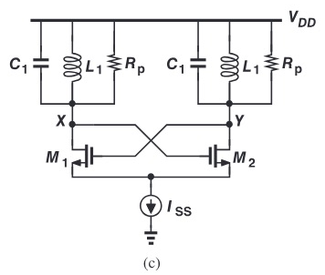
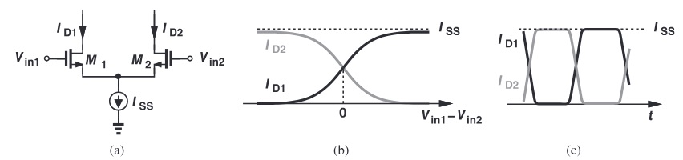

# 예제 13.7 — 큰 스윙에서 교차 결합 발진기의 드레인 전류

## 원문
$X$와 $Y$에서 전압 스윙이 크다면, 그림 13.20(c)에 있는 $M_1$과 $M_2$의 드레인 전류를 그려라.

## 조건
- 회로: Fig 13.20(c) 교차 결합 발진기 (각 드레인의 병렬 탱크 $C_1$, $L_1$, $R_p$, 교차 결합된 $M_1$, $M_2$, 테일 전류원 $I_{SS}$)
- $X$와 $Y$의 전압 스윙이 크다고 가정
- 소자 값은 주어지지 않음 (답은 파형 모양으로) (원문에 없음)

## 구할 것
- $M_1$과 $M_2$의 드레인 전류 파형 그리기

## 상속·참조
- 본문 13.3.2절 (교재 746쪽, Fig 13.20(a)(b)): 각 소자의 게이트를 다른 소자의 드레인에 연결하면 $M_1$과 $M_2$는 출력이 입력으로 귀환되는 차동쌍과 비슷해지고, 테일 전류원 $I_{SS}$를 더해 두 전류의 합이 $I_{SS}$가 되게 한 것이 Fig 13.20(b), 이를 다시 그린 것이 Fig 13.20(c)
- 10장 차동쌍의 대신호 동작: 차동 입력이 충분히 크면 테일 전류가 한쪽 트랜지스터로 모두 흐름

## 회로 — Fig 13.20(c)
```spice
C1_1  VDD  X  {C_1}   ; 인쇄 라벨 C_1 (왼쪽 탱크)
L1_1  VDD  X  {L_1}   ; 인쇄 라벨 L_1 (왼쪽 탱크)
RP1   VDD  X  {R_p}   ; 인쇄 라벨 R_p (왼쪽 탱크)
C1_2  VDD  Y  {C_1}   ; 인쇄 라벨 C_1 (오른쪽 탱크)
L1_2  VDD  Y  {L_1}   ; 인쇄 라벨 L_1 (오른쪽 탱크)
RP2   VDD  Y  {R_p}   ; 인쇄 라벨 R_p (오른쪽 탱크)
M1    X    Y  n1  nmos
M2    Y    X  n1  nmos
ISS   n1   0  {I_SS}
```
- 단자: VDD = 전원, 값 미지정 (가로 레일) / 개방 단자 없음
- 표시: 노드 라벨 V_DD (레일 오른쪽 끝), X (X 접속점 왼쪽), Y (Y 접속점 오른쪽) / 소자 라벨 C_1 두 개 (각 커패시터 왼쪽), L_1 두 개 (각 인덕터 오른쪽), R_p 두 개 (각 저항 오른쪽), M1 (M1 왼쪽 아래), M2 (M2 오른쪽 아래), I_SS (전류원 오른쪽) / 부호 없음 / 화살표 없음 / 수치·면적 라벨 없음
- 배치: 맨 위 굵은 가로 레일 V_DD / 왼쪽 탱크: 레일에서 C_1, L_1, R_p가 왼쪽→오른쪽 세로로 매달리고 아래 끝이 가로선으로 L_1 아래 접속점에 모임, 오른쪽 탱크도 같은 모양 / 각 탱크 접속점에서 세로선이 내려와 X(왼쪽), Y(오른쪽) 접속점, 그 아래 M1, M2 드레인 / M1 좌우 반전(게이트 오른쪽, 소스 왼쪽 아래), M2 보통 방향(게이트 왼쪽, 소스 오른쪽 아래) / X에서 가로선이 오른쪽으로 가다 비스듬히 내려가 M2 게이트 높이에서 오른쪽으로 M2 게이트, Y에서 가로선이 왼쪽으로 가다 비스듬히 내려가 M1 게이트 높이에서 왼쪽으로 M1 게이트 (두 비스듬한 선이 가운데에서 X자로 교차) / 두 소스는 아래로 내려가 가로선으로 가운데 n1 접속점에서 만나고, 그 아래 I_SS(화살표 아래), 그 아래 접지 / 접속점 (세 갈래 이상, 5곳): ① 왼쪽 탱크 아래 = 왼쪽 C_1 선 + 위 L_1 + 오른쪽 R_p 선 + 아래 X 쪽 선 (점) ② 오른쪽 탱크 아래 (점) ③ X = 위 탱크 선 + 아래 M1 드레인 + 오른쪽 교차 결합선 (점) ④ Y = 위 탱크 선 + 아래 M2 드레인 + 왼쪽 교차 결합선 (점) ⑤ n1 = 왼쪽 M1 소스 선 + 오른쪽 M2 소스 선 + 아래 I_SS (점) / 교차: X→M2 게이트 선과 Y→M1 게이트 선이 두 트랜지스터 사이 가운데에서 점 없이 교차



## 답 (검증용)
- 먼저 Fig 13.21(a)의 차동쌍을 보면, 큰 입력 전압 스윙에서 전체 전류가 왼쪽이나 오른쪽으로 흐름 (Fig 13.21(b)). 그림 13.20(b)의 회로(교차 결합 발진기)도 드레인 전류가 0과 $I_{SS}$ 사이에서 스윙하는 같은 동작 (Fig 13.21(c)): $I_{D1}$, $I_{D2}$는 서로 반대로 0과 $I_{SS}$ 사이를 오가는 사다리꼴(평탄부가 잘린) 파형
- 원문 풀이는 예제가 묻는 그림 13.20(c) 대신 그림 13.20(b)를 가리킴. 두 그림은 같은 회로를 다시 그린 것이라 인쇄대로 둠 (원문에 없음)

### 정답 회로 — Fig 13.21(a)
```spice
M1   out1  Vin1  n1  nmos
M2   out2  Vin2  n1  nmos
ISS  n1    0     {I_SS}
```
- 단자: Vin1, Vin2 = 입력 (개방 원) / out1, out2 = 드레인 전류 측정 단자 (선 끝, 위로 열린 드레인 선)
- 표시: 노드 라벨 V_in1 (왼쪽 입력 원 왼쪽), V_in2 (오른쪽 입력 원 오른쪽) / 소자 라벨 M1 (M1 오른쪽), M2 (M2 왼쪽), I_SS (전류원 오른쪽) / 부호 없음 / 화살표 "I_D1": M1 드레인 위 세로 도선, 아래 방향(드레인으로 들어감), 도선 위, 글자는 화살표 왼쪽; "I_D2": M2 드레인 위 세로 도선, 아래 방향, 도선 위, 글자는 화살표 오른쪽 / 수치·면적 라벨 없음
- 배치: M1 보통 방향(게이트 왼쪽), M2 좌우 반전(게이트 오른쪽) / V_in1 원 → 가로선 → M1 게이트, V_in2 원 → 가로선 → M2 게이트 / 두 드레인 선은 위로 뻗어 끝남 / 두 소스는 아래로 내려가 가로선으로 가운데 n1 접속점에서 만나고 그 아래 I_SS(화살표 아래), 그 아래 접지 / 접속점 (세 갈래 이상, 1곳): n1 = 왼쪽 M1 소스 선 + 오른쪽 M2 소스 선 + 아래 I_SS (점) / 교차: 없음
- Fig 13.21(b): 가로축 화살표 "V_in1 − V_in2", 가운데 "0"에 세로 점선. 검은 곡선 "I_D1"은 왼쪽 0에서 0 부근을 지나 올라가 오른쪽에서 점선 "I_SS" 레벨로 포화, 회색 곡선 "I_D2"는 왼쪽 I_SS에서 내려가 오른쪽에서 0. 두 곡선은 0에서 교차
- Fig 13.21(c): 가로축 화살표 "t", 위 점선 레벨 "I_SS". 검은 선 "I_D1"과 회색 선 "I_D2"가 0과 I_SS 사이를 서로 반대로 오가는 사다리꼴 파형 (한쪽이 I_SS에서 평탄할 때 다른 쪽은 0에서 평탄, 전환 구간에서 두 선이 교차)


